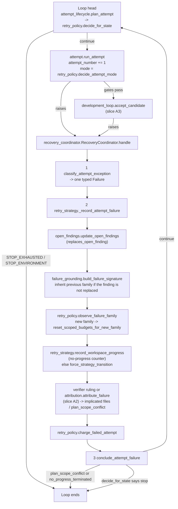
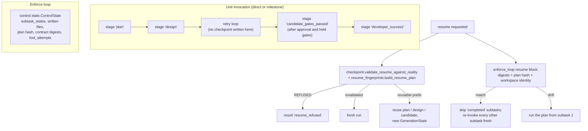

# 00 - End-to-end lifecycle and stage index

Canonical runtime baseline: commit `3eded93c0cfb50f8855d04510e3f9aa2cd5208f7`, tree
`97a3da6b2ef664e2b7e25c4c6fe3fc3f42f253a0`. AS-IS. Rows are filled by the slice that owns the stage.

## Stage index

| Stage ID | Stage | Owning slice | Status |
|---|---|---|---|
| STAGE-GOAL-INTAKE | Goal intake | A4 | pending |
| STAGE-SEMANTIC-CONTRACT | Goal / semantic contract authority | A2 | pending |
| STAGE-KNOWLEDGE | Knowledge / Skills | A4 | pending |
| STAGE-PLANNING | Planning | A4 | pending |
| STAGE-PLAN-VALIDATION | Plan validation | A4 | pending |
| STAGE-WORKSPACE | Workspace / root authority | A5 | pending |
| STAGE-SUBTASK-SELECTION | Subtask selection (direct, milestone, enforce) | A4 | A1 part below |
| STAGE-CONTEXT | Context construction | A4 | pending |
| STAGE-MODEL-RUNTIME | Runtime / model selection and qualification | A6 | pending |
| STAGE-GENERATION | Generation | A3 | pending |
| STAGE-CANDIDATE | Candidate formation | A3 | pending |
| STAGE-REVIEW | Review / source approval | A3 | pending |
| STAGE-GATES | Deterministic gates | A3 | pending |
| STAGE-VERIFIER-ID | Generated-verifier identification | A2 | pending |
| STAGE-VERIFIER-AUTH | Verifier semantic authority | A2 | pending |
| STAGE-ATTRIBUTION | Failure attribution | A2 | pending |
| STAGE-RETRY | Retry | A1 | **filled** |
| STAGE-RECOVERY | Recovery / owner reopen | A1 (accounting), A3 (apply) | A1 part filled |
| STAGE-APPLY | Candidate apply | A3 | pending |
| STAGE-REPLAY | Replay | A3 | pending |
| STAGE-FINAL-VERIFICATION | Integration / final verification | A3 | pending |
| STAGE-EVIDENCE | Evidence / audit | A6 | pending |
| STAGE-CHECKPOINT | Checkpoint / resume | A1 | **filled** |
| STAGE-TERMINAL | Terminal result | A3 | pending |

## STAGE-RETRY (A1) - AS-IS flow

One `run_generation_workflow` call is one **unit invocation**. Each invocation builds one `GenerationState`
(`kriya/workflow/state.py::GenerationState`, created through `run_lifecycle.open_run_state`). Every retry counter,
the open finding and the progress history live on that object, in memory. (`TRACED`)

Step order inside `_record_attempt_failure` is fixed and matters: the open set is updated first, then the family is
observed, then scoped budgets are reset, then progress is classified, then attribution runs, and the charge is last.

### A1 answers (AS-IS). Each cites the row that holds the fact

1. **What fact is an OpenFinding?** A copy of one authoritative validator failure about the candidate (type, reason
   code, files, source, bounded evidence text, line locators) plus the attempt number at which that copy was made.
   `AUTH-A1-01`, `SM-A1-02`.
2. **Does it have an authoritative stable identity?** No. It has no ID. Recording the identical failure again makes
   a new object with a new `first_attempt`, and the two do not compare equal. `AUTH-A1-02`, `GAP-A1-01`
   (`MEASURED`, probe P4-P6).
3. **Who decides "B remains open", "B resolved", "B2 opened"?** Nobody decides it as a typed fact. The open set is
   replaced wholesale by the next authoritative candidate finding and is otherwise left alone. "Resolved" is never
   recorded; the set is emptied only when the loop ends or Best-of-N discards the candidate. `AUTH-A1-02`.
4. **What does failure-family identity mean?** A normalised text signature of the validator output: the failure
   type, the basenames of every reported file, and either the javac messages, the last exception type and message,
   or a hash of the normalised text. Line numbers are removed. `AUTH-A1-03`.
5. **What does workspace PROGRESS mean?** The effective workspace bytes differ from those of the previous failed
   attempt and the progress vector was not seen before. It says the candidate moved, not that a blocker was
   resolved. `AUTH-A1-04`.
6. **Which truth resets the no-progress counter?** A progress classification that does not count: `PROGRESS` (new
   workspace bytes, unseen vector), or a changed action on the same bytes. Best-of-N also zeroes it. `AUTH-A1-04`,
   `MUT-A1-06`, `MUT-A1-08`.
7. **Which truth grants a fresh targeted / fallback-targeted allowance?** Only a new failure family: a signature
   different from the previous attempt's and never seen in this invocation, from a failure that replaces the open
   finding. And, separately, every new unit invocation starts with all budgets at zero. `AUTH-A1-03`, `BYP-A1-01`.
8. **Who charges attempts?** `retry_policy.charge_failed_attempt`, called once per failed attempt. Four other
   modules write single budget fields directly. `AUTH-A1-06`.
9. **What retry state survives checkpoint/resume?** None. `AUTH-A1-09`, `AUTH-A1-10`, `GAP-A1-02`.
10. **What is reconstructed or fresh after resume?** Reused when fingerprints match: knowledge clearance, plan,
    design, validation baselines, and a candidate that already passed its gates. Fresh: `GenerationState` and with
    it every budget, the open finding, the progress history, the attempt number; the run's generation clock; the
    enforce loop's recovery counters and the verifier semantic ledger. `AUTH-A1-09`, `AUTH-A1-10`.
11. **Can recovery / owner-reopen paths bypass retry accounting?** They do not bypass it inside a unit, but every
    re-invocation of a unit by the enforce loop gets a complete fresh set of budgets. The bound is the enforce
    loop's own cycle caps and the run clock, not the unit's ceiling. `BYP-A1-01`, `AUTH-A1-11`.
12. **Direct vs enforce differences relevant to retry?** Same unit loop and same policy. Direct: one invocation,
    resumable from stage checkpoints. Milestone: one invocation per milestone, each resumable. Enforce: one
    invocation per subtask plus re-invocations in nine further roles (`BYP-A1-01`). A1 said here that the enforce
    loop never passes `resume` to a unit; that was wrong (the flag is forwarded, `BYP-A1-12`). In production an
    enforce run that failed keeps no completion, so a resume runs the whole plan again (`AUTH-A1-10`, `GAP-A1-09`).
    `BYP-A1-02`, `BYP-A1-03`.
13. **(A1b) Does the allowance have one real authority?** Inside a unit, one grant path with no authoritative input;
    across invocations, none. `AUTH-A1-13`.
14. **(A1b) How many attempts can one blocker get?** One unit: 10 or 11. One enforce stage: 7 unit invocations, up to
    77 attempts, before the stage stops; no time bound by default. `BYP-A1-01`, `GAP-A1-04`.
15. **(A1b) What can be reconstructed from a run's own evidence?** The mode, failure type and decision of every
    attempt; not the family decision, the counter values or a reset. `GAP-A1-03`.

## STAGE-CHECKPOINT (A1) - AS-IS flow

Stage and integration detail for these stages will be written as derivative views once the maps are stable.
