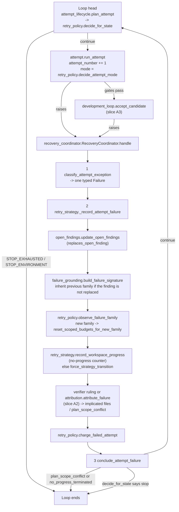
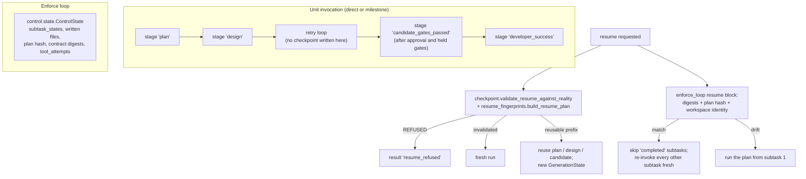
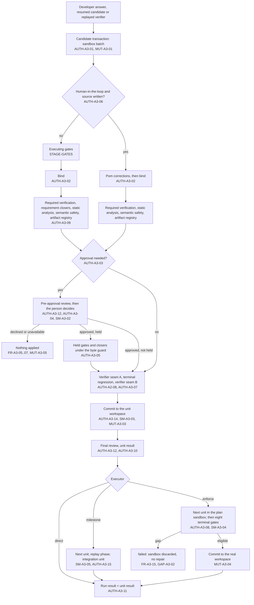
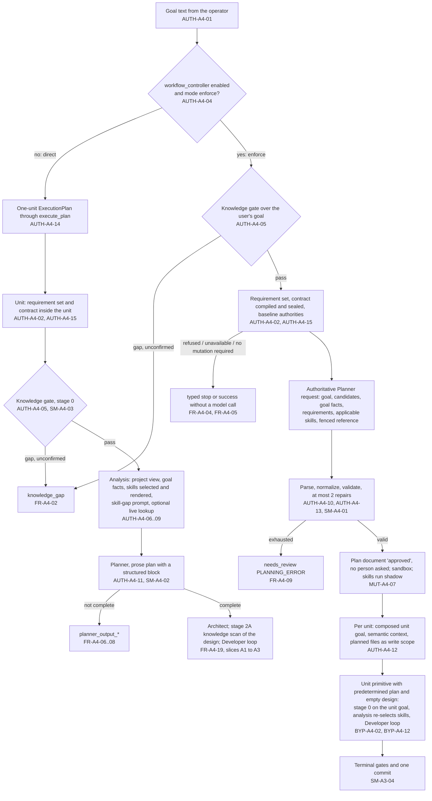
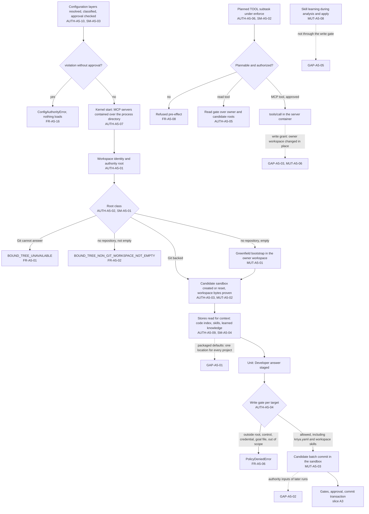

# 00 - End-to-end lifecycle and stage index

Canonical runtime baseline: commit `3eded93c0cfb50f8855d04510e3f9aa2cd5208f7`, tree
`97a3da6b2ef664e2b7e25c4c6fe3fc3f42f253a0`. AS-IS. Rows are filled by the slice that owns the stage.

## Stage index

| Stage ID | Stage | Owning slice | Status |
|---|---|---|---|
| STAGE-GOAL-INTAKE | Goal intake | A4 | **filled** (`AUTH-A4-01..03`, `GAP-A4-07`) |
| STAGE-SEMANTIC-CONTRACT | Goal / semantic contract authority | A2 | **filled** (`AUTH-A2-01..05`, `GAP-A2-01`) |
| STAGE-KNOWLEDGE | Knowledge / Skills | A4 | **filled** (`AUTH-A4-05..09`, `SM-A4-03`, `SM-A4-04`, `GAP-A4-02..04`) |
| STAGE-PLANNING | Planning | A4 | **filled** (`AUTH-A4-10..12`) |
| STAGE-PLAN-VALIDATION | Plan validation | A4 | **filled** (`AUTH-A4-10`, `AUTH-A4-11`, `AUTH-A4-13`, `AUTH-A4-16`, `SM-A4-01`, `SM-A4-02`, `GAP-A4-05`) |
| STAGE-WORKSPACE | Workspace / root authority | A5 | **filled** (`AUTH-A5-01..05`, `AUTH-A5-08`, `AUTH-A5-09`, `SM-A5-01`, `SM-A5-04`, `GAP-A5-01`, `GAP-A5-02`; tools and MCP `AUTH-A5-06`, `AUTH-A5-07`, `SM-A5-02`, `GAP-A5-03`; configuration `AUTH-A5-10..12`, `SM-A5-03`, `GAP-A5-04`) |
| STAGE-SUBTASK-SELECTION | Subtask selection (direct, milestone, enforce) | A4 | **filled** (`AUTH-A4-04`, `AUTH-A4-14`, `AUTH-A4-15`, `GAP-A4-01`; A1 part below) |
| STAGE-CONTEXT | Context construction | A4 (skill, plan and goal context), A6 (the Developer request and its budget) | A4 part **filled** (`AUTH-A4-09`, `AUTH-A4-12`); the request itself is owed by A6 |
| STAGE-MODEL-RUNTIME | Runtime / model selection and qualification | A6 | pending |
| STAGE-GENERATION | Generation | A3 (candidate formation), A6 (the Developer request) | A3 part filled (`AUTH-A3-01`); the request itself is owed by A6 (A4 traced what feeds it, not its assembly) |
| STAGE-CANDIDATE | Candidate formation | A3 | **filled** (`AUTH-A3-01`, `AUTH-A3-02`, `SM-A3-01`, `GAP-A3-04`) |
| STAGE-REVIEW | Review / source approval | A3 | **filled** (`AUTH-A3-03..05`, `AUTH-A3-12`, `AUTH-A3-13`, `SM-A3-02`, `GAP-A3-05`, `GAP-A3-06`) |
| STAGE-GATES | Deterministic gates | A3 | **filled** (`AUTH-A3-06..08`, `GAP-A3-02`) |
| STAGE-VERIFIER-ID | Generated-verifier identification | A2 | **filled** (`AUTH-A2-06`, `GAP-A2-02`) |
| STAGE-VERIFIER-AUTH | Verifier semantic authority | A2 | **filled** (`AUTH-A2-07..09`, `SM-A2-01`, `GAP-A2-03`) |
| STAGE-ATTRIBUTION | Failure attribution | A2 | **filled** (`AUTH-A2-10`, `AUTH-A2-11`) |
| STAGE-RETRY | Retry | A1 | **filled** |
| STAGE-RECOVERY | Recovery / owner reopen | A1 (accounting), A3 (apply) | A1 part filled |
| STAGE-APPLY | Candidate apply | A3 | **filled** (`AUTH-A3-14`, `SM-A3-03`, `MUT-A3-03`, `MUT-A3-04`) |
| STAGE-REPLAY | Replay | A3 | **filled** (`AUTH-A3-15`, `AUTH-A2-13`, `MUT-A3-13`) |
| STAGE-FINAL-VERIFICATION | Integration / final verification | A3 | **filled** (`AUTH-A3-08`, `AUTH-A3-09`, `GAP-A3-01`) |
| STAGE-EVIDENCE | Evidence / audit | A6 | pending |
| STAGE-CHECKPOINT | Checkpoint / resume | A1 | **filled** |
| STAGE-TERMINAL | Terminal result | A3 | **filled** (`AUTH-A3-10`, `AUTH-A3-11`, `SM-A3-04`, `SM-A3-05`, `GAP-A3-01`, `GAP-A3-03`) |

## STAGE-RETRY (A1) - AS-IS flow

One `run_generation_workflow` call is one **unit invocation**. Each invocation builds one `GenerationState`
(`kriya/workflow/state.py::GenerationState`, created through `run_lifecycle.open_run_state`). Every retry counter,
the open finding and the progress history live on that object, in memory. (`TRACED`)



Step order inside `_record_attempt_failure` is fixed and matters: the open set is updated first, then the family is
observed, then scoped budgets are reset, then progress is classified, then attribution runs, and the charge is last.

### A1 answers (AS-IS). Each cites the row that holds the fact

1. **What fact is an OpenFinding?** A copy of one authoritative validator failure about the candidate (type, reason
   code, files, source, bounded evidence text, line locators) plus the attempt number at which that copy was made.
   `AUTH-A1-01`, `SM-A1-02`.
2. **Does it have an authoritative stable identity?** No. It has no ID. Recording the identical failure again makes
   a new object with a new `first_attempt`, and the two do not compare equal. `AUTH-A1-02`, `GAP-A1-01`
   (`MEASURED`, probe P4-P6).
3. **Who decides "B remains open", "B resolved", "B2 opened"?** Nobody decides it as a typed fact. The open set is
   replaced wholesale by the next authoritative candidate finding and is otherwise left alone. "Resolved" is never
   recorded; the set is emptied only when the loop ends or Best-of-N discards the candidate. `AUTH-A1-02`.
4. **What does failure-family identity mean?** A normalised text signature of the validator output: the failure
   type, the basenames of every reported file, and either the javac messages, the last exception type and message,
   or a hash of the normalised text. Line numbers are removed. `AUTH-A1-03`.
5. **What does workspace PROGRESS mean?** The effective workspace bytes differ from those of the previous failed
   attempt and the progress vector was not seen before. It says the candidate moved, not that a blocker was
   resolved. `AUTH-A1-04`.
6. **Which truth resets the no-progress counter?** A progress classification that does not count: `PROGRESS` (new
   workspace bytes, unseen vector), or a changed action on the same bytes. Best-of-N also zeroes it. `AUTH-A1-04`,
   `MUT-A1-06`, `MUT-A1-08`.
7. **Which truth grants a fresh targeted / fallback-targeted allowance?** Only a new failure family: a signature
   different from the previous attempt's and never seen in this invocation, from a failure that replaces the open
   finding. And, separately, every new unit invocation starts with all budgets at zero. `AUTH-A1-03`, `BYP-A1-01`.
8. **Who charges attempts?** `retry_policy.charge_failed_attempt`, called once per failed attempt. Four other
   modules write single budget fields directly. `AUTH-A1-06`.
9. **What retry state survives checkpoint/resume?** None. `AUTH-A1-09`, `AUTH-A1-10`, `GAP-A1-02`.
10. **What is reconstructed or fresh after resume?** Reused when fingerprints match: knowledge clearance, plan,
    design, validation baselines, and a candidate that already passed its gates. Fresh: `GenerationState` and with
    it every budget, the open finding, the progress history, the attempt number; the run's generation clock; the
    enforce loop's recovery counters and the verifier semantic ledger. `AUTH-A1-09`, `AUTH-A1-10`.
11. **Can recovery / owner-reopen paths bypass retry accounting?** They do not bypass it inside a unit, but every
    re-invocation of a unit by the enforce loop gets a complete fresh set of budgets. The bound is the enforce
    loop's own cycle caps and the run clock, not the unit's ceiling. `BYP-A1-01`, `AUTH-A1-11`.
12. **Direct vs enforce differences relevant to retry?** Same unit loop and same policy. Direct: one invocation,
    resumable from stage checkpoints. Milestone: one invocation per milestone, each resumable. Enforce: one
    invocation per subtask plus re-invocations in nine further roles (`BYP-A1-01`). A1 said here that the enforce
    loop never passes `resume` to a unit; that was wrong (the flag is forwarded, `BYP-A1-12`). In production an
    enforce run that failed keeps no completion, so a resume runs the whole plan again (`AUTH-A1-10`, `GAP-A1-09`).
    `BYP-A1-02`, `BYP-A1-03`.
13. **(A1b) Does the allowance have one real authority?** Inside a unit, one grant path with no authoritative input;
    across invocations, none. `AUTH-A1-13`.
14. **(A1b) How many attempts can one blocker get?** One unit: 10 or 11. One enforce stage: 7 unit invocations, up to
    77 attempts, before the stage stops; no time bound by default. `BYP-A1-01`, `GAP-A1-04`.
15. **(A1b) What can be reconstructed from a run's own evidence?** The mode, failure type and decision of every
    attempt; not the family decision, the counter values or a reset. `GAP-A1-03`.

## STAGE-CHECKPOINT (A1) - AS-IS flow



Stage and integration detail for these stages will be written as derivative views once the maps are stable.

## STAGE-SEMANTIC-CONTRACT, STAGE-VERIFIER-ID, STAGE-VERIFIER-AUTH, STAGE-ATTRIBUTION (A2) - AS-IS flow

Every step cites the row that holds the fact; nothing is defined here.

```
goal text (+ optional operator artifacts: --requirements, --acceptance, approval, authority bundle, dispositions)
  -> requirement set, verbatim statements                                   AUTH-A2-01
  -> verification contract: claim kinds, strength, closers, authorities     AUTH-A2-02   (no product semantics: AUTH-A2-05)
  -> admission: refused before any model call only under policy "block"     AUTH-A2-03, FR-A2-10 / FR-A2-11
  -> sealed, digest bound to resume identities                              MUT-A2-01
  -> Planner / Developer write criteria, code and tests                     (models; GAP-A2-01)
  -> a test gate executes
       mapped run-authored test?                                            AUTH-A2-06   (unmapped: GAP-A2-02, FR-A2-08)
         yes -> a person decides, or the unit stops                         AUTH-A2-07, AUTH-A2-08, SM-A2-01
                 valid + failing -> strict production owner or stop         AUTH-A2-09
         no  -> attribution ladder picks targets                            AUTH-A2-10, AUTH-A2-11
  -> retry accounting                                                       STAGE-RETRY
```

## STAGE-CANDIDATE, STAGE-GATES, STAGE-REVIEW, STAGE-APPLY, STAGE-REPLAY, STAGE-FINAL-VERIFICATION, STAGE-TERMINAL (A3) - AS-IS flow

Every step cites the row that holds the fact; nothing is defined here. The full 21-field stage documents and the
integration contracts (Candidate -> Review, Candidate -> Gates, Approval -> Mutation, Apply -> Replay, Replay ->
Final Result, Evidence -> Terminal Result) are derivative views written after slice A6, from these rows.



| Stage | Owner today | Decides | Does not decide | Rows |
|---|---|---|---|---|
| STAGE-CANDIDATE | `candidate_transaction.py`, `verification_binding.py` | Which bytes are the candidate; whether a later batch is the same | Whether the candidate is correct | `AUTH-A3-01`, `AUTH-A3-02`, `GAP-A3-04` |
| STAGE-GATES | `gate_orchestrator.py`, `development_loop.py::accept_candidate`, `run_terminal_regression`; enforce `terminal_gate_service.py` | Deterministic acceptance of the candidate | Requirement truth beyond its own gate (`AUTH-A3-09`); retry (`STAGE-RETRY`) | `AUTH-A3-06`, `AUTH-A3-07`, `AUTH-A3-08` |
| STAGE-REVIEW | `stage_apply.py::approval_gate`, `policy/approval.py`, `control/launch_approval.py`, `stage_review.py` | Whether a person must approve; what the person decided | Anything about correctness: the Reviewer is advisory | `AUTH-A3-03`, `AUTH-A3-04`, `AUTH-A3-05`, `AUTH-A3-12`, `AUTH-A3-13`, `GAP-A3-05`, `GAP-A3-06` |
| STAGE-APPLY | `terminal_commit.py`, `repository/commit.py`, callers `stage_apply.py`, `commit_service.py` | Whether the workspace holds the candidate | Whether requirements are verified | `AUTH-A3-14`, `SM-A3-03`, `MUT-A3-03`, `MUT-A3-04` |
| STAGE-REPLAY | `milestones.py::replay_prior_milestone_report`; verifier replay `verifier_replay.py`; commit recovery `control/recovery.py` | Whether earlier milestones still verify; whether a carried verifier is valid; what an interrupted commit left | - | `AUTH-A3-15`, `AUTH-A2-13`, `MUT-A3-13` |
| STAGE-FINAL-VERIFICATION | `requirements.py`; enforce `TerminalGateService`; milestone integration unit | Requirement outcomes and truth; what blocks | The run status (`GAP-A3-01`) | `AUTH-A3-08`, `AUTH-A3-09` |
| STAGE-TERMINAL | `state.py::final_workflow_quality_passed`, `outcome.py`, the enforce tail, `plan_executor.py::_terminal` | The unit's and the run's status and failure category | Requirement truth (attached, not folded in) | `AUTH-A3-10`, `AUTH-A3-11`, `GAP-A3-01`, `GAP-A3-03` |

Not traced in A3 and still owed: STAGE-GENERATION (the Developer request itself: prompt composition, response
protocol, model dispatch). A3 starts at the parsed answer. Slices A4 (context) and A6 (dispatch) own it.

## STAGE-GOAL-INTAKE, STAGE-KNOWLEDGE, STAGE-PLANNING, STAGE-PLAN-VALIDATION, STAGE-SUBTASK-SELECTION, STAGE-CONTEXT (A4) - AS-IS flow

Every step cites the row that holds the fact; nothing is defined here. The 21-field stage documents and the
integration contracts (Goal -> Semantic Contract, Semantic Contract -> Planner / Developer / Verifier) are derivative
views written after slice A6, from these rows.



| Stage | Owner today | Decides | Does not decide | Rows |
|---|---|---|---|---|
| STAGE-GOAL-INTAKE | The operator's text; `requirements.py`, `requirement_contract.py` | The goal of record, its digest, the closed requirement set | Whether the goal is ambiguous; which statements are context | `AUTH-A4-01..03`, `GAP-A4-07` |
| STAGE-KNOWLEDGE | `tools/knowledge.py::KnowledgeGuard`; `skills/skill.py::SkillEngine`; `skill_conventions.py`; `live_lookup.py`, `outbound_lookup.py`, `policy/egress.py` | Whether a knowledge gap stops the run; which skills exist and are verified; which apply; what leaves as a search query | Whether a skill covers a library (a folder name does); rule-level applicability | `AUTH-A4-05..09`, `SM-A4-03`, `SM-A4-04`, `GAP-A4-02..04` |
| STAGE-PLANNING | Direct: `stage_planning.py`. Enforce: the planning loop of `enforce_loop.py` with `planning_request.py` | The Planner request; bounded repair | Plan validity | `AUTH-A4-10`, `AUTH-A4-11`, `AUTH-A4-12` |
| STAGE-PLAN-VALIDATION | Direct: `file_resolution.py::classify_plan_completeness`. Enforce: normalizers, `plan_validation.py::validate_plan` and five further checks | Whether the plan may proceed | A person's agreement (none is asked); on direct, the plan's structure | `AUTH-A4-10`, `AUTH-A4-11`, `AUTH-A4-13`, `AUTH-A4-16`, `SM-A4-01`, `SM-A4-02`, `GAP-A4-05` |
| STAGE-SUBTASK-SELECTION | Direct and milestone: `plan_executor.py::execute_plan`. Enforce: `enforce_loop.py` | Unit order, unit status, plan completion | Result truth across shapes | `AUTH-A4-14`, `AUTH-A4-15`, `GAP-A4-01`; A1 part `AUTH-A1-10` |
| STAGE-CONTEXT | `stage_analysis.py` (convention prompt); `planning_request.py` (unit goal, semantic and constraint context) | What Planner text and skill text a unit's models see, and with what label | The Developer request itself | `AUTH-A4-09`, `AUTH-A4-12`, `BYP-A4-04`, `BYP-A4-06`, `BYP-A4-12` |

Not traced in A4 and still owed: STAGE-GENERATION (the Developer request: `attempt.py`, `retry_prompts.py`,
`prompt_composition.py`, the context budget) goes to slice A6 with the dispatch and budget rows; the Architect stage
beyond its stage 2A and 2B blocks; `milestones.py`; `shadow_mode.py`; `plan_revision.py`; `triage.py`.

## STAGE-WORKSPACE, with tools, MCP, private state and configuration (A5) - AS-IS flow

Every step cites the row that holds the fact; nothing is defined here. STAGE-WORKSPACE is not a step in time: it is
the set of authorities every other stage stands on. The diagram shows where each one is consulted during a run and
which writes do not pass the candidate.



| Stage | Owner (one home per fact) | Rows |
|---|---|---|
| Configuration | `config/resolution.py`, `config/authority.py`, `config/authority_approval.py` | `AUTH-A5-10..12`, `SM-A5-03`, `FR-A5-16`, `FR-A5-17`, `GAP-A5-04` |
| Root and identity | `context/workspace_identity.py` | `AUTH-A5-01` |
| Membership | `repository/bound_tree.py` | `AUTH-A5-02`, `SM-A5-01`, `FR-A5-01`, `FR-A5-02` |
| Candidate sandbox | `workflow/worktree.py` | `AUTH-A5-03`, `MUT-A5-01`, `MUT-A5-02`, `FR-A5-03..05` |
| Write and read gates | `policy/filesystem.py` | `AUTH-A5-04`, `AUTH-A5-05`, `MUT-A5-03..05`, `FR-A5-06`, `FR-A5-07`, `GAP-A5-02` |
| Planned tools | `tools/tool.py`, `workflow/subtask_executor.py` | `AUTH-A5-06`, `SM-A5-02`, `FR-A5-08`, `FR-A5-09` |
| MCP | `policy/execution.py`, `mcp/mcp.py`, `mcp/containment_adapter.py` | `AUTH-A5-07`, `MUT-A5-06`, `FR-A5-10`, `FR-A5-11`, `GAP-A5-03` |
| Authority state | `policy/protected_authority_paths.py`, `platform/private_store.py` | `AUTH-A5-08`, `MUT-A5-14..16` |
| Project state namespace | none for the retrieval, knowledge and skill stores | `AUTH-A5-09`, `SM-A5-04`, `MUT-A5-08..13`, `FR-A5-12`, `FR-A5-15`, `GAP-A5-01`, `GAP-A5-05` |

Not traced in A5 and still owed: the OCI backend and the mask code (`tools/containment_oci.py`), `repository/git.py`
and `snapshot.py`, the scoped-snapshot builder's body, `kriya/platform/private_store.py`, `kriya/kup` beyond its
outline, and the UI session code behind the two history rows. None of them changes a row above; each is named in the
limitation field of the row it belongs to.
