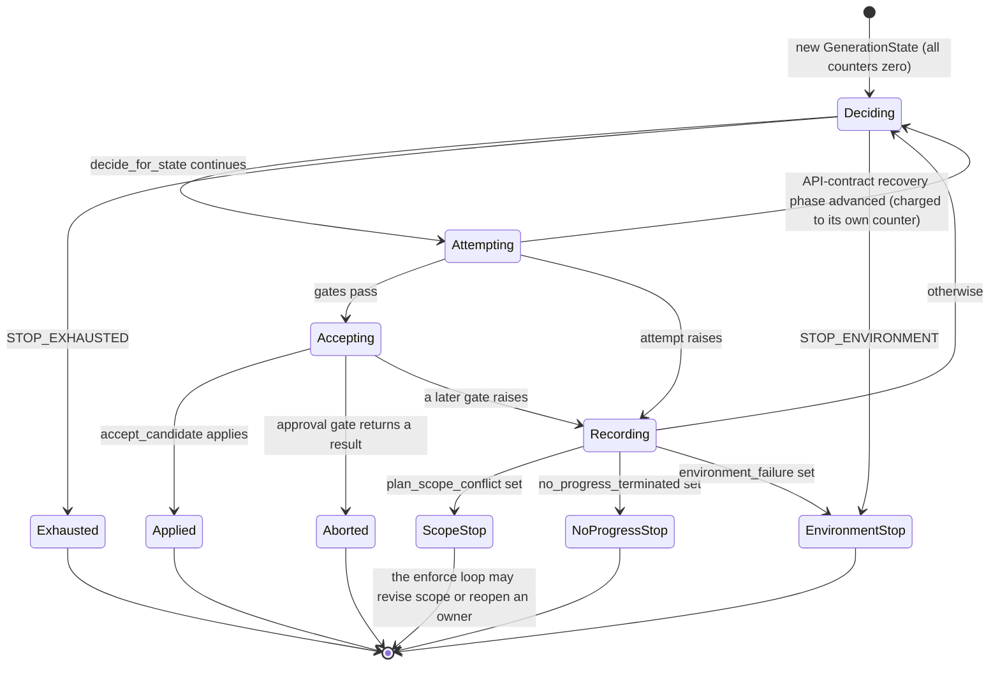
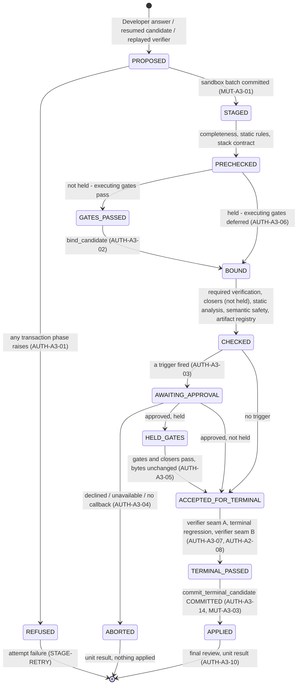
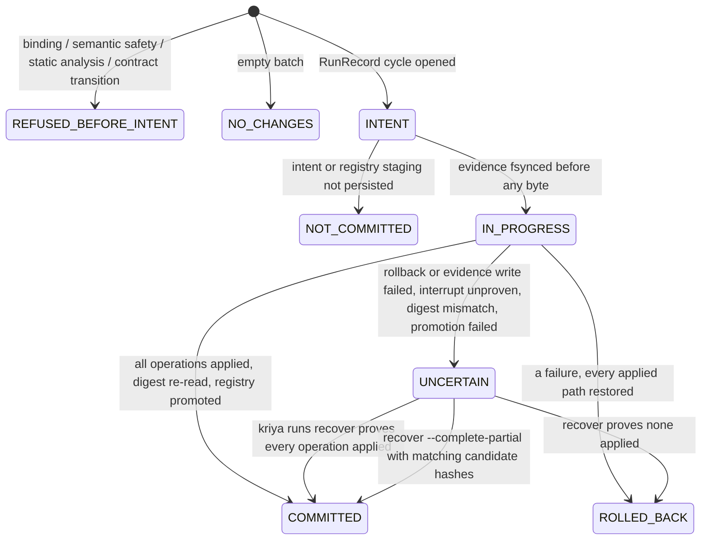
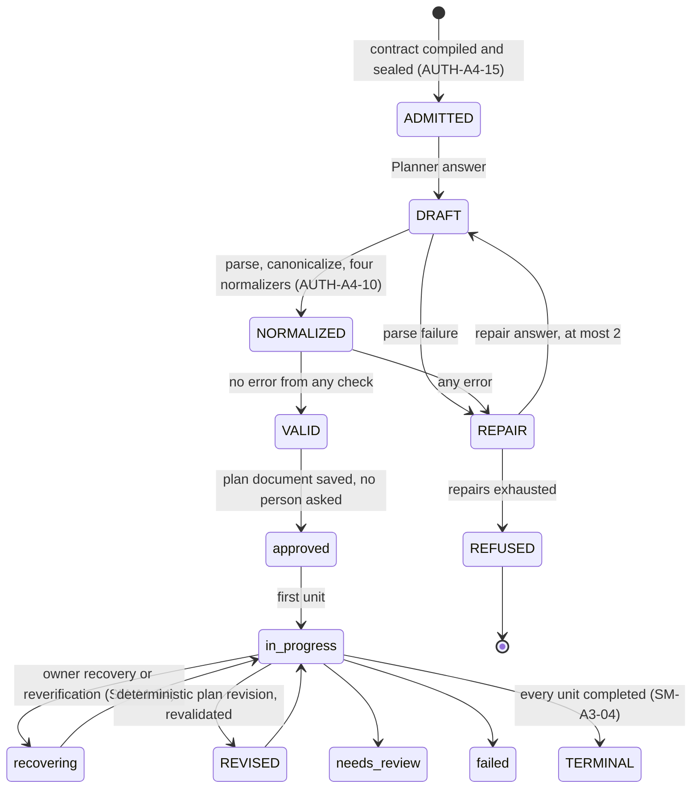

# 02 - State machine

Canonical runtime baseline: commit `3eded93c0cfb50f8855d04510e3f9aa2cd5208f7`, tree
`97a3da6b2ef664e2b7e25c4c6fe3fc3f42f253a0`. AS-IS.

The end-to-end candidate state machine (UNKNOWN -> CANDIDATE -> VALIDATED -> APPROVED -> APPLIED -> VERIFIED ->
SETTLED, with refusal, needs-review, recovery, replay, exhaustion and terminal failure) is assembled in slice A3.
Slice A1 contributes the retry sub-machine and the blocker lifecycle.

## Slice A1

### SM-A1-01 - The unit retry sub-machine (`TRACED`)

State is the tuple held on `GenerationState`: `attempt_number`, `budgets` (`RetryBudgets`), `last_attempt_mode`,
`open_findings`, `last_implicated_files` / `last_missing_files`, `api_contract_recovery`, the progress fields,
and three stop flags (`environment_failure`, `plan_scope_conflict`, `no_progress_terminated`).

Legal attempt modes and what admits them (`retry_policy.decide_retry_action`, in evaluation order):

| Order | Condition | Result |
|---|---|---|
| 1 | `environment_failure` is set | `STOP_ENVIRONMENT` |
| 2 | API-contract recovery active and its count < 3 | `API_CONTRACT_RECOVERY` |
| 3 | API-contract recovery spent and contract not restored | `STOP_EXHAUSTED` |
| 4 | `attempt_number >= max_total_attempts` | `STOP_EXHAUSTED` |
| 5 | Only the fallback's reserved allowance remains | `FALLBACK_TARGETED` or `FULL_SET` on the fallback |
| 6 | Implicated files and targeted count < 3 (unless a fallback-targeted request is preferred) | `TARGETED` |
| 7 | Missing files and targeted count < 3 | `MISSING_FILES` |
| 8 | Implicated files, a fallback is available, one-shot flag unused | `FALLBACK_TARGETED` |
| 9 | Full-set count < `max_retries` | `FULL_SET` |
| 10 | Otherwise | `STOP_EXHAUSTED` |

`environment_failure` is the stop mechanism for many non-environment stops as well (a policy denial, a
candidate-independent deterministic failure, a verifier semantic stop, a fallback incompatibility, and more). The
policy checks only that it is set. What kind of stop it is reaches the result through other fields; that mapping
belongs to slice A3.

### SM-A1-02 - The blocker lifecycle as the code represents it (`TRACED` + `MEASURED`)

The lifecycle the owner asked about is: B open -> attempted repair -> B still open -> B resolved -> B2 open.
The code has two partial representations and no state for most of those steps.

| Step | Open-finding view (`open_findings`) | Family view (`retry_policy` on the signature) | Represented? |
|---|---|---|---|
| B open | The open set becomes `[finding(B)]`, `first_attempt = n` | Signature of B recorded as last and as seen | Yes |
| Attempted repair fails on a delivery, resource or internal failure | Open set unchanged | Previous signature inherited: not a new family, nothing reset | Yes (NON-CANDIDATE-FAILURE-SCOPED-RESET-001) |
| B still open, reported again by the validator | The open set is **replaced** by a new finding of the same failure with a new `first_attempt` | Same signature: not a new family | Only by the family view. The finding does not show continuity (probe P4) |
| B still open, line shifted | New finding, different locations | Same signature | Only by the family view (probe P2, P5) |
| B resolved, no other failure | Nothing records it. The loop simply ends in success | Nothing | **No** |
| B resolved and B2 opened, B2's text differs | Open set replaced by finding(B2) | New family: scoped budgets reset, the exposing attempt is not charged | Yes, as "new family" (probe P1, P8) |
| B resolved and B2 opened, B2's text equals B's after normalisation (for example the same assertion message in another test method of the same file) | Open set replaced by finding(B2) | **Same signature: not a new family, no fresh allowance** | **Misrepresented** as B still open (probe P3) |
| B still open but its text changed materially (for example the exception message embeds a changed value) | Open set replaced | **New family: fresh allowance** | **Misrepresented** as B2 (`MEASURED`, A1b probe P11: the preserved run-10 assertion with only the reported actual value changed by one is a different signature and is read as a new family) |
| B open, then an orchestrator refusal that is in no table (`no_progress_retry`: nothing was sent to a model) | **Open set replaced by a finding of the refusal**; B's evidence is gone from the open set | **New family: scoped budgets replenished** | **Misrepresented** as B2 (`MEASURED`, A1b probe P10). `GAP-A1-07` |
| B open (a semantic-safety staging rejection), then any other candidate finding | Open set replaced; the rejection's prohibition is no longer in it | New family | The set holds one finding, so a second concurrent blocker cannot be represented (`MEASURED`, probe P10; `SEMANTIC-SAFETY-REPAIR-CONTINUITY-001`) |
| A returns after B (A -> B -> A) | Open set replaced by finding(A) | Seen before: not new, charged | Yes (probe P9) |

Consequences that follow directly from the table:

- A fresh scoped allowance is granted on a text difference, not on a proven change of blocker.
- No state means "B resolved". The only resolution signal is that the attempt passes every gate.
- `first_attempt` cannot be used to measure how long a blocker has been open.

### SM-A1-03 - Resume transitions of the retry sub-machine (`TRACED`)

| From | Event | To |
|---|---|---|
| Any state inside the retry loop | Process ends; operator resumes a direct or milestone unit | `Deciding` with a new `GenerationState`; plan and design reused if fingerprints match; no candidate, no finding, no counters |
| `Accepting` after the `candidate_gates_passed` checkpoint | Process ends; operator resumes | Candidate and gate outcomes reused if fingerprints match; a new `GenerationState` |
| Any state of an enforce subtask, plan run in its sandbox (production) | Process ends or the run fails; operator resumes the enforce run | The plan is planned again and runs from its first subtask; no completion is reused (`COMPLETIONS_NOT_IN_WORKSPACE`); every enforce recovery counter starts at zero (`MEASURED` by the committed tests cited in `AUTH-A1-10`). This row replaces the A1 wording, which described only the in-place case |
| Any state of an enforce subtask, plan run in place | Process ends; operator resumes the enforce run | Completed subtasks are skipped after the digest, plan-hash and workspace checks; every other subtask is invoked again; enforce recovery counters start at zero. The `resume` flag is forwarded to each unit (`AUTH-A1-10`, `BYP-A1-12`) |

### SM-A1-04 - The enforce recovery sub-machine of one stage (`TRACED`, read line by line in A1b)

States are the stage states the loop persists (`pending`, `in_progress`, `completed`, `needs_review`) plus the
in-memory episode state of `AUTH-A1-14`. One stage execution proceeds as follows.

| Step | Condition | Action | Unit invocations (role) | Bound |
|---|---|---|---|---|
| 1 | Always | Run the stage | 1 (`planned`, or `dependent_reverification` on a convergence re-entry) | - |
| 2 | Result carries a `PLAN_SCOPE_DEFECT` conflict with grounded files and no resolvable completed owner | Revise the plan's scope, revalidate, run the stage again | 1 per pass (`plan_scope_recovery`) | 3 passes |
| 3 | Result carries a scope conflict whose artifacts resolve to completed owners | Build a recovery execution plan; for each owner group: `VERIFY` (no invocation), `MAY_CHANGE` or `MUST_CHANGE` owner run; then one consumer step | 1 per reopened owner (`owner_recovery` or `may_change_owner_recovery`; an owner without declared verification first gets the in-loop self-correction, `BYP-A1-13`), then 1 consumer step (`verifier_replay` when the refused candidate is still valid, else `consumer_retry`; possibly 1 `verifier_repair` after a person authorizes it) | 3 cycles per stage execution; `len(subtasks) * 3` per run; identical owner bytes stop the cycle; identical convergence state stops the run |
| 4 | A verification-only stage stopped with `VERIFICATION_RETRY_NO_CHANGE_POSSIBLE` | Reopen completed mutating ancestors nearest first, each at most once, until one produces an accepted change; then run the stage again | 1 per owner tried (`verification_owner_recovery`), then 1 (`verification_rerun`) | One episode per verification unit per process |
| 5 | Any accepted owner change | Every transitive dependent becomes `pending`; a completed one loses its result and is queued for re-entry | Later: 1 per re-entered stage | Monotone between recovery events |

A reopened owner whose bytes did not change has its dependents' states and results restored exactly. An owner whose
repair the consumer step refuses ends `needs_review`, and so does the plan.

## Slice A2

### SM-A2-01 - A run-authored test source inside one unit invocation (`TRACED`; transitions marked `M` are `MEASURED` by probe or committed test)

Owner of every transition: `workflow/verifier_semantic.py::UnitSemantics`, called from three seams
(`retry_strategy.py::_generated_verifier_ruling` before attribution; `development_loop.py::settle_generated_verifiers`
before the terminal regression and again before apply). State lives in memory: per unit (`pending`, `regenerating`,
`denied`) and per run (`VerifierSemanticLedger`).

| From | Event | To | Effect |
|---|---|---|---|
| written, not executed | a test gate returns a COMPLETE report and an executed identity maps to the file | SUBJECT (failing or passing) | none yet |
| written, not executed | the report is not COMPLETE, or no test ran (collection or compile failure) | not a subject | the historical retry path handles the failure (`BYP-A2-03`) |
| written, executed | an executed identity maps to no run-authored file (`M`: P5, P7) | **not a subject, no unknown** | the historical retry path handles the failure (`GAP-A2-02`) |
| written, executed | the identity maps to two run-authored files, or a run-authored file cannot be read or parsed | UNKNOWN PROVENANCE | typed stop, nobody is asked |
| SUBJECT | unattended (`M`) | NEEDS REVIEW (terminal for the unit) | typed stop `verifier_semantic_authority_required`; nothing applied |
| SUBJECT | attended, the ledger already holds a valid decision for these bytes under this contract | ACCEPTED | proceed; not asked again |
| SUBJECT | attended, person answers valid | ACCEPTED | path write-denied for the rest of the invocation |
| SUBJECT | attended, person answers invalid, enforce allow-list unit, regeneration not yet spent | REGENERATION PENDING | the next attempt's write scope is exactly this path |
| SUBJECT | attended, person answers invalid, direct run (`M`) or regeneration spent | NEEDS REVIEW | typed stop |
| SUBJECT | cannot decide, no decision, decision bound to another subject | NEEDS REVIEW | typed stop |
| REGENERATION PENDING | the retry policy admits a targeted attempt for exactly this path | REGENERATING | scope restored on every exit (`_AttemptScope`) |
| REGENERATION PENDING | the retry policy does not admit it | NEEDS REVIEW | no budget is reset |
| REGENERATING | a gate executes new bytes at the path | SUBJECT (new bytes: needs fresh authority; path write-denied; no second regeneration) | - |
| REGENERATING | no new executed verifier | NEEDS REVIEW | typed stop |
| ACCEPTED, failing | strict owner predicate selects one plan owner (`AUTH-A2-09`) | production repair | attribution is the ruling; the verifier is not a target |
| ACCEPTED, failing | no owner selected (always in a direct run, `M`) | NEEDS REVIEW | typed stop |
| ACCEPTED or denied | the retry policy's next attempt would be FULL_SET | NEEDS REVIEW | full-set regeneration refused |

Not in this machine: a pre-existing test the run did not change (never a subject); a verifier replayed after an owner
recovery (`AUTH-A2-13`); anything across a process restart (the ledger is not persisted: `AUTH-A1-14`, `GAP-A1-02`).

## Slice A3

The diagrams restate the tables beside them and decide nothing; where they differ, the table is right and the
difference is a defect of this document.

### SM-A3-01 - One candidate, from the Developer's answer to the apply (`TRACED`; `M` = `MEASURED` by probe)

Owner of the sequence: `development_loop.py::accept_candidate`, entered after `attempt.py::run_attempt` returned.
"Held" is the human-in-the-loop branch of `AUTH-A3-06`.

| From | Event | To | Fact row |
|---|---|---|---|
| PROPOSED | every phase of the transaction passes | STAGED | `AUTH-A3-01` |
| PROPOSED | first refusal | REFUSED, attempt failure | `AUTH-A3-01`, `FR-A3-01` |
| STAGED | non-executing checks pass; not held; executing gates pass | GATES_PASSED (`candidate_gates_succeeded`) | `gate_orchestrator.py::_run_executing_candidate_gates` |
| STAGED | non-executing checks pass; held (`M` P7) | BOUND with the executing gates deferred; the deterministic pom corrections are applied first so the review shows them | `AUTH-A3-06`, `gate_orchestrator.py::apply_pre_review_candidate_corrections` |
| GATES_PASSED | `accept_candidate` starts | BOUND | `AUTH-A3-02` |
| BOUND | required verification unresolved | attempt failure `verification_infrastructure_failure` | `FR-A3-02` |
| BOUND | a requirement blocks (not held) | deterministic stop | `AUTH-A3-09`, `FR-A3-03` |
| BOUND | static analysis, semantic safety or artifact registry refuses | deterministic stop | `FR-A3-04` |
| BOUND | all pass; not held | checkpoint `candidate_gates_passed` written | `MUT-A3-06` |
| CHECKED | no trigger | ACCEPTED_FOR_TERMINAL | `AUTH-A3-03` |
| CHECKED | trigger, callback present | AWAITING_APPROVAL, after the pre-approval review | `AUTH-A3-12` |
| CHECKED | trigger, no callback | ABORTED `approval_required` | `FR-A3-07` |
| AWAITING_APPROVAL | declined | ABORTED `human_rejected` | `FR-A3-05` |
| AWAITING_APPROVAL | unavailable | ABORTED `approval_required` | `FR-A3-06` |
| AWAITING_APPROVAL | approved, held | HELD_GATES under the guard, self-correction off | `AUTH-A3-05` |
| HELD_GATES | bytes changed | attempt failure, nothing executed or applied | `FR-A3-08` |
| HELD_GATES | a held gate or a closer fails | attempt failure; the pre-approval review is dropped | `FR-A3-09` |
| HELD_GATES | all pass | checkpoint `candidate_gates_passed` written; ACCEPTED_FOR_TERMINAL | `MUT-A3-06` |
| ACCEPTED_FOR_TERMINAL | a generated verifier is unsettled | typed stop or one regeneration | `AUTH-A2-08` |
| ACCEPTED_FOR_TERMINAL | terminal regression blocks | attempt failure or `REGRESSION_UNATTRIBUTED` stop | `AUTH-A3-07`, `FR-A3-10` |
| TERMINAL_PASSED | - | checkpoint `developer_success` written | `MUT-A3-06` |
| TERMINAL_PASSED | commit committed | APPLIED: `overall_attempt_succeeded`, `quality_gates_succeeded` | `AUTH-A3-14` |
| TERMINAL_PASSED | commit refused, conflicted or uncertain | deterministic stop `workspace_commit` | `FR-A3-12`, `FR-A3-13` |
| APPLIED | final review performed | unit success | `AUTH-A3-10` |
| APPLIED | final review refused or errored | unit non-success `final_review_refused`, bytes stay (`M` P1) | `FR-A3-14` |

Resume transitions (`TRACED`): from a `candidate_gates_passed` or `developer_success` checkpoint the candidate is
rebuilt through the transaction (PROPOSED to STAGED). Its executing gates are skipped only when every verification
fingerprint matched (`resume_fingerprints.py::ResumePlan.skip_candidate_gates`); binding, requirement closers,
approval and terminal regression run again. In human-in-the-loop mode the held half is called with the same skip
flag, so POM validation runs and the executing gates are skipped on the restored outcomes. Nothing is restored from
before the approval of a held candidate: no checkpoint exists there (`FR-A3-20`).

### SM-A3-02 - A desktop review record (`TRACED`)

Owner: `control/launch.py` (the record) and `control/launch_approval.py::_wait` (the transitions). One pending review
at a time.

| From | Event | To | Workflow answer |
|---|---|---|---|
| (none) | change gate asks; the diff sidecar and the record are stored | PENDING | waits |
| (none) | no review channel, an empty change set, or the sidecar or record cannot be stored | not offered | UNAVAILABLE `APPROVAL_LAUNCH_CANNOT_ASK` |
| PENDING | valid `decision` frame (review id, kind, digest, capability, not expired), recorded durably | APPROVED / REJECTED (DECIDED for a verifier semantic review) | APPROVED / DECLINED |
| PENDING | decision accepted but the record cannot be written | PENDING in memory, unchanged on disk | UNAVAILABLE `APPROVAL_DECISION_NOT_RECORDED` |
| PENDING | wall-clock expiry (3600 s), host gone, channel failed, wait interrupted, launch ended | EXPIRED | UNAVAILABLE |
| PENDING | wrong, replayed or cross-review decision | PENDING (the capability is not consumed) | still waiting |

### SM-A3-03 - One commit transaction (`TRACED`; binding refusals `M` P6)

Owner: `AUTH-A3-14`.

| State | Workspace | Run consequence |
|---|---|---|
| REFUSED_BEFORE_INTENT, NOT_COMMITTED, ROLLED_BACK | UNCHANGED | deterministic stop `workspace_commit_failed`; enforce: `needs_review` |
| NO_CHANGES | UNCHANGED | counted as committed |
| COMMITTED | holds the candidate | unit or run continues to its success bookkeeping |
| UNCERTAIN | unknown | `needs_review`; the enforce sandbox is retained as the only copy of the bytes; later mutating runs are refused until recovery |

### SM-A3-04 - The enforce terminal (`TRACED`)

Owner: the tail of `enforce_loop.py` (lines 4470-4921 at the baseline).

| From | Event | To |
|---|---|---|
| stage loop ended | a subtask is not completed | no gates run (`TERMINAL_GATES_NOT_RUN`); sandbox completions discarded; `failed`, or `needs_review` when a subtask is NEEDS_REVIEW |
| stage loop ended | all subtasks completed | VERIFYING: eight terminal gates on the plan sandbox (`AUTH-A3-08`) |
| VERIFYING | any gap | sandbox completions discarded, sandbox removed, `failed` (`needs_review` for an artifact error). **No transition back to a unit** (`GAP-A3-02`) |
| VERIFYING | commit eligible | COMMITTING (`SM-A3-03`) |
| COMMITTING | COMMITTED | completions adopted as the workspace's, derived artifacts saved, learning persisted, `success` |
| COMMITTING | not committed | `needs_review`, `workspace_commit_failed` |
| any | exception | the durable state is settled as the ordinary path would have (pessimistic until the journal proves the commit), then the error propagates |

### SM-A3-05 - A work unit in the direct / milestone executor (`TRACED`; `M` P3)

Owner: `plan_executor.py::_execute` (`_Lifecycle`). States: PENDING, RUNNING, VERIFIED, FAILED, BLOCKED, STALE.

| From | Event | To |
|---|---|---|
| PENDING | durable completion validated by resume | VERIFIED (`COMPLETION_REUSED`), not run |
| PENDING / STALE | driver precondition stops | BLOCKED; later units BLOCKED; plan result is the stop |
| RUNNING | unit result `quality_gates_passed` true and the driver's post-check keeps it | driver `complete_unit`; VERIFIED |
| RUNNING | otherwise, and the driver does not retry | FAILED; dependents BLOCKED `DEPENDENCY_FAILED`, independents BLOCKED `PLAN_HALTED_AFTER_FAILURE`; plan result is the driver's failure result (`M`: a unit whose candidate was applied and whose review was refused takes this edge) |
| RUNNING | the driver answers retry (milestone failure callback) | RUNNING again |
| all units VERIFIED | plan phases pass | plan success |
| any | a result claims success while a unit is not VERIFIED | `needs_review`, `PLAN_TERMINAL_MISMATCH` |

A unit that fails after earlier units committed leaves those commits in the real workspace; a multi-unit result says
so (`committed_work_units`, `committed_changes_retained`) when a RunRecord exists. Probe P3 ran without a RunRecord,
so that key was absent there: an artifact of the probe harness, not a product statement.

## Slice A4

### SM-A4-01 - The structured plan of an enforce run (`TRACED`; `M` = `MEASURED` by probe or committed test)

Owner: the planning loop and the unit loop of `enforce_loop.py`. The first five states exist only as control flow;
the later ones are the `lifecycle_state` values written into the approved-plan document.

| From | Event | To |
|---|---|---|
| start | admission refuses under a blocking policy; baseline authority unavailable; no mutation required | run ends before planning (`FR-A4-04`, `FR-A4-05`) |
| ADMITTED | Planner answer | DRAFT |
| DRAFT | JSON block parses and yields at least one subtask | NORMALIZED: `canonicalize_planned_file_actions`, `coalesce_same_file_owners`, `redirect_immutable_test_edits`, `derive_verification_contracts`, `scope_verification_to_requirements` (`M`: the last one, committed tests) |
| DRAFT | no parse, or zero subtasks (`STRUCTURED_PLAN_EMPTY`) | REPAIR |
| NORMALIZED | `validate_plan`, plan targets, unbounded-subtask, grounded-artifact, edit-feasibility and the two regression checks report nothing (`M` P3 for the failing direction) | VALID |
| NORMALIZED | any error | REPAIR; the retained baseline is the last non-regressed failure |
| REPAIR | fewer than 2 repairs used | DRAFT (the repair prompt carries what must be preserved) |
| REPAIR | 2 repairs used | REFUSED: `STRUCTURED_PLAN_REPAIR_EXHAUSTED`, `needs_review`, `PLANNING_ERROR` |
| VALID | - | `approved`: plan document saved, `current_plan_hash` = hash of the raw Planner plan (`M` P9: the hash covers `plan_id`); the resume comparison runs here (`AUTH-A1-10`) |
| `approved` | sandbox created, skills run shadow activated when the skills root is inside the repository | `in_progress` |
| `in_progress` | planned-prerequisite, runtime-plan-gap or scope-owner revision | REVISED: the plan object changes, `validate_plan` runs again, the document and hash are rewritten (three call sites; bodies not read) |
| any | terminal | `SM-A3-04` |

No state is an approval by a person: `approved` means "validated" (`AUTH-A4-10`).

### SM-A4-02 - The Planner's answer in a direct or milestone unit (`TRACED`)

Owner: `stage_planning.py::plan_work_unit`.

| From | Event | To |
|---|---|---|
| start | a predetermined plan (an enforce unit) or a resumed checkpoint with a plan | CLASSIFY, no Planner call |
| start | otherwise | Planner call; `plan` checkpoint saved; CLASSIFY |
| CLASSIFY | `complete` | Architect (stage 2A) |
| CLASSIFY | `schema_invalid` and fewer than 2 repairs used | repair call; `plan` checkpoint saved; CLASSIFY |
| CLASSIFY | `schema_invalid` after 2 repairs | unit ends `planner_output_schema_invalid` |
| CLASSIFY | `unauthorized_path` | unit ends `planner_output_unauthorized_path`, never repaired |
| CLASSIFY | `incomplete_truncated` | unit ends `planner_output_incomplete`, never repaired |

### SM-A4-03 - The knowledge gate (`TRACED`; `M` P5)

| Shape | From | Event | To |
|---|---|---|---|
| direct | stage 0 | no gap, or `knowledge_risk_confirmed`, or a resumed checkpoint | continue; gaps become prompt constraints |
| direct | stage 0 | a gap, not confirmed | `knowledge_gap`, before any model call |
| direct | stage 2A | the Architect's design names a library the goal did not, and the callback approves | continue |
| direct | stage 2A | the same, declined / no decision | `human_rejected` / `approval_required`, before any Developer work |
| direct | stage 2A | the same, no approval callback | continue with a warning |
| enforce | controller | a gap in the user's goal, not confirmed | `knowledge_gap`, before planning |
| enforce | controller | no gap, or confirmed | every gap coordinate becomes "acknowledged" for the run |
| enforce | unit stage 0 | a gap whose coordinate is not acknowledged (`M`: one named only by the Planner's text) | the unit returns `knowledge_gap`; the loop turns it into the run's result only when no file has been established yet (`enforce_loop.py`, the `knowledge_gap_break` block) |

### SM-A4-04 - A skill and its verification (`TRACED`; `M` P8)

| From | Event | To |
|---|---|---|
| absent | `create_skill_skeleton` (live lookup or a human reference during analysis; `kriya skills create`) | unverified skeleton |
| absent | `KnowledgeGuard.generate_skill_template` (auto-accrual in `stage_apply.py` for a dependency the gates suggested and the applied files contain; the CLI's scaffold prompt after a knowledge gap) | unverified template with no rule (`M` P11); from then on the knowledge gate counts the library as covered |
| unverified | a rule is extracted and written with a provenance record | unverified, with "Unverified Rules" |
| unverified, applicable | the person declines to strengthen it | gap acknowledged: durable for a skill outside the workspace, run-local for a workspace skill (`M`: a workspace `skill.yaml` cannot set it) |
| unverified | a passing runtime verification in a run | held verification (in memory); its rules render as trusted for the rest of that run (`reclassify_held_rules`) |
| held | the run's candidate is verified and committed | verified, persisted (`persist_run_learning`) |
| held | the run ends otherwise | discarded (`discard_run_learning`) |
| any | `kriya skills unverify` | unverified |
| workspace skill | `verified: true` written by the project | ignored (`M` P8); `verified_claim` is display only |

## Slice A5

Evidence labels as in the other slices; `M` = `MEASURED` by `evidence/a5/a5_probe.py`.

### SM-A5-01 - The class of a workspace root and its admission (`TRACED`, `repository/bound_tree.py`)

| From | Event | To |
|---|---|---|
| unclassified | a `.git` entry at or above the root, and Git resolves the same top level as the authority root | `GIT_BACKED`: membership is the bound tree |
| unclassified | no `.git` entry, Git resolves nothing, and the folder is plainly not a repository | `NO_GIT_REPOSITORY` |
| unclassified | a `.git` entry but Git cannot resolve a work tree; Git resolves a repository the search did not find or another one; an identity is unresolvable; an OS or subprocess error; a content-filter refusal | refused: `BOUND_TREE_UNAVAILABLE` (never read as "no repository") |
| `NO_GIT_REPOSITORY` | the folder holds nothing but `.kriya`, a regular `kriya.yaml` and desktop metadata files | admitted as a greenfield; `create_git_worktree` then initializes the repository (`MUT-A5-01`) |
| `NO_GIT_REPOSITORY` | any other entry (a README, a `kriya.yml`, a `kriya.yaml` that is a directory or a link) | refused: `BOUND_TREE_NON_GIT_WORKSPACE_NOT_EMPTY`, before the contract is compiled |
| `GIT_BACKED` | the operating root is excluded by the repository's own ignore rules | refused: `BOUND_TREE_OPERATING_SCOPE_EXCLUDED` (read only when the listing is empty) |
| `GIT_BACKED` | the workspace is the repository's top level | candidate = linked work tree `<workspace>/.kriya/worktree` |
| `GIT_BACKED` | the workspace is a subfolder of the repository | candidate = scoped snapshot sandbox, with its own recorded membership |

No state is persisted: the class is recomputed wherever it is needed.

### SM-A5-02 - One planned TOOL subtask (`TRACED`, `workflow/subtask_executor.py`, `tools/tool.py`; lifecycle persistence cited from the subsystem note)

| From | Event | To | Effect boundary |
|---|---|---|---|
| planned | tool name not in the registry | `needs_review` | proven pre-effect |
| planned | malformed autonomy mode | failed, typed | proven pre-effect |
| planned | the tool asks for confirmation and the run is human-in-the-loop | `needs_review`, `TOOL_CONFIRMATION_UNSUPPORTED` | proven pre-effect |
| planned | governance not plannable (operator-only, undeclared, invalid) | refused, the governance reason code | proven pre-effect |
| planned | arguments fail the tool's schema; the tool's own authorization refuses; the call-time authority refuses (MCP: no current approval) | refused | proven pre-effect |
| authorized | the durable `tool_started` marker cannot be written | `TOOL_STARTED_NOT_DURABLE`; the effect never runs | proven pre-effect |
| started | the effect returns | durable `completed`, then success is authoritative | - |
| started | the effect raises | failed, never retried | may have effected |
| started | the process dies | on the next run: `needs_review`, the workspace gate reports `UNRESOLVED_TOOL_EXECUTION` | unknown, treated as may have effected |
| completed | a resume | not run again; authority revalidated without effect; a revoked approval refuses | - |

The machine has no retry edge and no approval edge of its own: a person is involved only through the MCP approval
that already exists before the run, or not at all for a read-only tool.

### SM-A5-03 - One configuration field, from file to effect (`TRACED`; `M` P1, P6)

| From | Event | To |
|---|---|---|
| in a layer | the packaged default or the platform floor set it | effective, trusted |
| in a layer | another source set it and its class is `REPOSITORY_SAFE` (static, or by value: a path inside the configuration's directory, a restricting value, a bound at most the packaged ceiling) | effective, no approval (`M`: the run budget at any value) |
| in a layer | another source set it and its class is anything else, or it is unclassified | violation (`M`: `autonomy.mode`, `risk_threshold_lines`, the Project Setup six) |
| violation | a current approval covers exactly the current security-relevant set | effective |
| violation | no approval, or the set changed since the approval | `ConfigAuthorityError`: nothing loads |
| any | a malformed mode or egress policy, a containment opt-out, a removed field, a relative log directory, a state path inside the workspace but outside `.kriya`, a shadowed configuration file | typed refusal before classification; not approvable |
| any, under `runtime_profile: production` | an explicit value of a sealed leaf that is not the preset (budget: not a positive integer at most 3600) | `ValueError` (`M`: 7200 and `null` refused, 2400 accepted) |

### SM-A5-04 - The code index of a location, as two projects see it (`M` P2 throughout)

The states are those of the one `dependency_graph.db` / `vector_index.db` pair at the configured memory location.
With the packaged defaults that location is the same for every project (`AUTH-A5-09`).

| From | Event | To | What a run in another project then sees |
|---|---|---|---|
| absent | a reader opens the graph database | empty (file created) | "no index": no retrieval, no auto-index skip |
| absent or empty | `kriya analyze` in project A, or A's run with auto-index on | holds A | - |
| holds A | a run in project B | holds A (unchanged) | "already indexed" is true for B; symbol lookups return A's paths; retrieval matches A's files and records A's chunk text in B's trace row; the structural readers that take `current_view()` see only B |
| holds A | `kriya analyze` in project B | holds B | A's index is gone; A's next run is in the row above with the roles exchanged |
| holds X | the embedding identity or the parser identity changes | rebuilt under the new identity for whichever project indexes next | - |

There is no state "holds A, and the reader knows it is A's": the store records no root, so the reader cannot tell.
