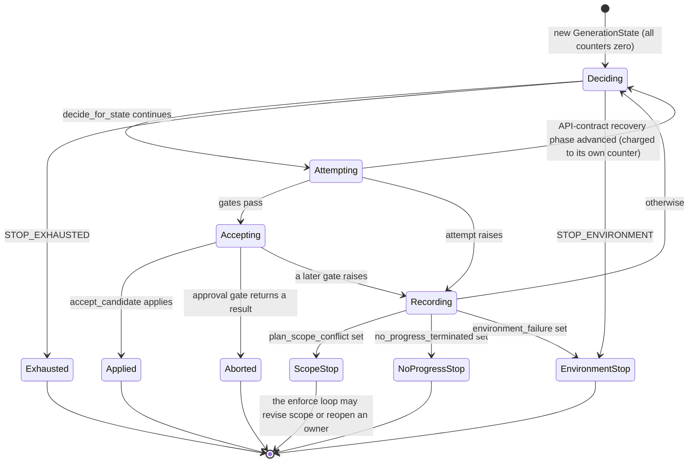

# 02 - State machine

Canonical runtime baseline: commit `3eded93c0cfb50f8855d04510e3f9aa2cd5208f7`, tree
`97a3da6b2ef664e2b7e25c4c6fe3fc3f42f253a0`. AS-IS.

The end-to-end candidate state machine (UNKNOWN -> CANDIDATE -> VALIDATED -> APPROVED -> APPLIED -> VERIFIED ->
SETTLED, with refusal, needs-review, recovery, replay, exhaustion and terminal failure) is assembled in slice A3.
Slice A1 contributes the retry sub-machine and the blocker lifecycle.

## Slice A1

### SM-A1-01 - The unit retry sub-machine (`TRACED`)

State is the tuple held on `GenerationState`: `attempt_number`, `budgets` (`RetryBudgets`), `last_attempt_mode`,
`open_findings`, `last_implicated_files` / `last_missing_files`, `api_contract_recovery`, the progress fields,
and three stop flags (`environment_failure`, `plan_scope_conflict`, `no_progress_terminated`).

Legal attempt modes and what admits them (`retry_policy.decide_retry_action`, in evaluation order):

| Order | Condition | Result |
|---|---|---|
| 1 | `environment_failure` is set | `STOP_ENVIRONMENT` |
| 2 | API-contract recovery active and its count < 3 | `API_CONTRACT_RECOVERY` |
| 3 | API-contract recovery spent and contract not restored | `STOP_EXHAUSTED` |
| 4 | `attempt_number >= max_total_attempts` | `STOP_EXHAUSTED` |
| 5 | Only the fallback's reserved allowance remains | `FALLBACK_TARGETED` or `FULL_SET` on the fallback |
| 6 | Implicated files and targeted count < 3 (unless a fallback-targeted request is preferred) | `TARGETED` |
| 7 | Missing files and targeted count < 3 | `MISSING_FILES` |
| 8 | Implicated files, a fallback is available, one-shot flag unused | `FALLBACK_TARGETED` |
| 9 | Full-set count < `max_retries` | `FULL_SET` |
| 10 | Otherwise | `STOP_EXHAUSTED` |

`environment_failure` is the stop mechanism for many non-environment stops as well (a policy denial, a
candidate-independent deterministic failure, a verifier semantic stop, a fallback incompatibility, and more). The
policy checks only that it is set. What kind of stop it is reaches the result through other fields; that mapping
belongs to slice A3.

### SM-A1-02 - The blocker lifecycle as the code represents it (`TRACED` + `MEASURED`)

The lifecycle the owner asked about is: B open -> attempted repair -> B still open -> B resolved -> B2 open.
The code has two partial representations and no state for most of those steps.

| Step | Open-finding view (`open_findings`) | Family view (`retry_policy` on the signature) | Represented? |
|---|---|---|---|
| B open | The open set becomes `[finding(B)]`, `first_attempt = n` | Signature of B recorded as last and as seen | Yes |
| Attempted repair fails on a delivery, resource or internal failure | Open set unchanged | Previous signature inherited: not a new family, nothing reset | Yes (NON-CANDIDATE-FAILURE-SCOPED-RESET-001) |
| B still open, reported again by the validator | The open set is **replaced** by a new finding of the same failure with a new `first_attempt` | Same signature: not a new family | Only by the family view. The finding does not show continuity (probe P4) |
| B still open, line shifted | New finding, different locations | Same signature | Only by the family view (probe P2, P5) |
| B resolved, no other failure | Nothing records it. The loop simply ends in success | Nothing | **No** |
| B resolved and B2 opened, B2's text differs | Open set replaced by finding(B2) | New family: scoped budgets reset, the exposing attempt is not charged | Yes, as "new family" (probe P1, P8) |
| B resolved and B2 opened, B2's text equals B's after normalisation (for example the same assertion message in another test method of the same file) | Open set replaced by finding(B2) | **Same signature: not a new family, no fresh allowance** | **Misrepresented** as B still open (probe P3) |
| B still open but its text changed materially (for example the exception message embeds a changed value) | Open set replaced | **New family: fresh allowance** | **Misrepresented** as B2 (`MEASURED`, A1b probe P11: the preserved run-10 assertion with only the reported actual value changed by one is a different signature and is read as a new family) |
| B open, then an orchestrator refusal that is in no table (`no_progress_retry`: nothing was sent to a model) | **Open set replaced by a finding of the refusal**; B's evidence is gone from the open set | **New family: scoped budgets replenished** | **Misrepresented** as B2 (`MEASURED`, A1b probe P10). `GAP-A1-07` |
| B open (a semantic-safety staging rejection), then any other candidate finding | Open set replaced; the rejection's prohibition is no longer in it | New family | The set holds one finding, so a second concurrent blocker cannot be represented (`MEASURED`, probe P10; `SEMANTIC-SAFETY-REPAIR-CONTINUITY-001`) |
| A returns after B (A -> B -> A) | Open set replaced by finding(A) | Seen before: not new, charged | Yes (probe P9) |

Consequences that follow directly from the table:

- A fresh scoped allowance is granted on a text difference, not on a proven change of blocker.
- No state means "B resolved". The only resolution signal is that the attempt passes every gate.
- `first_attempt` cannot be used to measure how long a blocker has been open.

### SM-A1-03 - Resume transitions of the retry sub-machine (`TRACED`)

| From | Event | To |
|---|---|---|
| Any state inside the retry loop | Process ends; operator resumes a direct or milestone unit | `Deciding` with a new `GenerationState`; plan and design reused if fingerprints match; no candidate, no finding, no counters |
| `Accepting` after the `candidate_gates_passed` checkpoint | Process ends; operator resumes | Candidate and gate outcomes reused if fingerprints match; a new `GenerationState` |
| Any state of an enforce subtask, plan run in its sandbox (production) | Process ends or the run fails; operator resumes the enforce run | The plan is planned again and runs from its first subtask; no completion is reused (`COMPLETIONS_NOT_IN_WORKSPACE`); every enforce recovery counter starts at zero (`MEASURED` by the committed tests cited in `AUTH-A1-10`). This row replaces the A1 wording, which described only the in-place case |
| Any state of an enforce subtask, plan run in place | Process ends; operator resumes the enforce run | Completed subtasks are skipped after the digest, plan-hash and workspace checks; every other subtask is invoked again; enforce recovery counters start at zero. The `resume` flag is forwarded to each unit (`AUTH-A1-10`, `BYP-A1-12`) |

### SM-A1-04 - The enforce recovery sub-machine of one stage (`TRACED`, read line by line in A1b)

States are the stage states the loop persists (`pending`, `in_progress`, `completed`, `needs_review`) plus the
in-memory episode state of `AUTH-A1-14`. One stage execution proceeds as follows.

| Step | Condition | Action | Unit invocations (role) | Bound |
|---|---|---|---|---|
| 1 | Always | Run the stage | 1 (`planned`, or `dependent_reverification` on a convergence re-entry) | - |
| 2 | Result carries a `PLAN_SCOPE_DEFECT` conflict with grounded files and no resolvable completed owner | Revise the plan's scope, revalidate, run the stage again | 1 per pass (`plan_scope_recovery`) | 3 passes |
| 3 | Result carries a scope conflict whose artifacts resolve to completed owners | Build a recovery execution plan; for each owner group: `VERIFY` (no invocation), `MAY_CHANGE` or `MUST_CHANGE` owner run; then one consumer step | 1 per reopened owner (`owner_recovery` or `may_change_owner_recovery`; an owner without declared verification first gets the in-loop self-correction, `BYP-A1-13`), then 1 consumer step (`verifier_replay` when the refused candidate is still valid, else `consumer_retry`; possibly 1 `verifier_repair` after a person authorizes it) | 3 cycles per stage execution; `len(subtasks) * 3` per run; identical owner bytes stop the cycle; identical convergence state stops the run |
| 4 | A verification-only stage stopped with `VERIFICATION_RETRY_NO_CHANGE_POSSIBLE` | Reopen completed mutating ancestors nearest first, each at most once, until one produces an accepted change; then run the stage again | 1 per owner tried (`verification_owner_recovery`), then 1 (`verification_rerun`) | One episode per verification unit per process |
| 5 | Any accepted owner change | Every transitive dependent becomes `pending`; a completed one loses its result and is queued for re-entry | Later: 1 per re-entered stage | Monotone between recovery events |

A reopened owner whose bytes did not change has its dependents' states and results restored exactly. An owner whose
repair the consumer step refuses ends `needs_review`, and so does the plan.

## Slice A2

### SM-A2-01 - A run-authored test source inside one unit invocation (`TRACED`; transitions marked `M` are `MEASURED` by probe or committed test)

Owner of every transition: `workflow/verifier_semantic.py::UnitSemantics`, called from three seams
(`retry_strategy.py::_generated_verifier_ruling` before attribution; `development_loop.py::settle_generated_verifiers`
before the terminal regression and again before apply). State lives in memory: per unit (`pending`, `regenerating`,
`denied`) and per run (`VerifierSemanticLedger`).

| From | Event | To | Effect |
|---|---|---|---|
| written, not executed | a test gate returns a COMPLETE report and an executed identity maps to the file | SUBJECT (failing or passing) | none yet |
| written, not executed | the report is not COMPLETE, or no test ran (collection or compile failure) | not a subject | the historical retry path handles the failure (`BYP-A2-03`) |
| written, executed | an executed identity maps to no run-authored file (`M`: P5, P7) | **not a subject, no unknown** | the historical retry path handles the failure (`GAP-A2-02`) |
| written, executed | the identity maps to two run-authored files, or a run-authored file cannot be read or parsed | UNKNOWN PROVENANCE | typed stop, nobody is asked |
| SUBJECT | unattended (`M`) | NEEDS REVIEW (terminal for the unit) | typed stop `verifier_semantic_authority_required`; nothing applied |
| SUBJECT | attended, the ledger already holds a valid decision for these bytes under this contract | ACCEPTED | proceed; not asked again |
| SUBJECT | attended, person answers valid | ACCEPTED | path write-denied for the rest of the invocation |
| SUBJECT | attended, person answers invalid, enforce allow-list unit, regeneration not yet spent | REGENERATION PENDING | the next attempt's write scope is exactly this path |
| SUBJECT | attended, person answers invalid, direct run (`M`) or regeneration spent | NEEDS REVIEW | typed stop |
| SUBJECT | cannot decide, no decision, decision bound to another subject | NEEDS REVIEW | typed stop |
| REGENERATION PENDING | the retry policy admits a targeted attempt for exactly this path | REGENERATING | scope restored on every exit (`_AttemptScope`) |
| REGENERATION PENDING | the retry policy does not admit it | NEEDS REVIEW | no budget is reset |
| REGENERATING | a gate executes new bytes at the path | SUBJECT (new bytes: needs fresh authority; path write-denied; no second regeneration) | - |
| REGENERATING | no new executed verifier | NEEDS REVIEW | typed stop |
| ACCEPTED, failing | strict owner predicate selects one plan owner (`AUTH-A2-09`) | production repair | attribution is the ruling; the verifier is not a target |
| ACCEPTED, failing | no owner selected (always in a direct run, `M`) | NEEDS REVIEW | typed stop |
| ACCEPTED or denied | the retry policy's next attempt would be FULL_SET | NEEDS REVIEW | full-set regeneration refused |

Not in this machine: a pre-existing test the run did not change (never a subject); a verifier replayed after an owner
recovery (`AUTH-A2-13`); anything across a process restart (the ledger is not persisted: `AUTH-A1-14`, `GAP-A1-02`).
