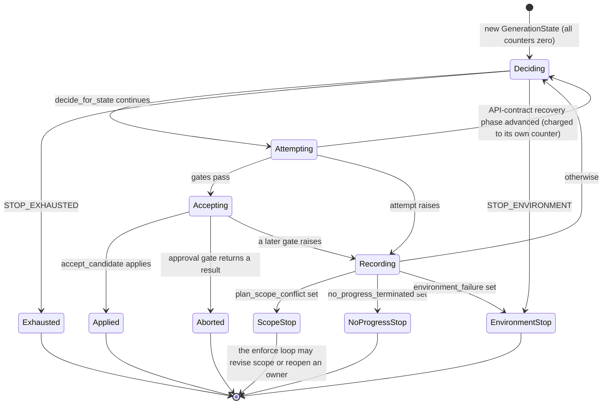

# 02 - State machine

Canonical runtime baseline: commit `3eded93c0cfb50f8855d04510e3f9aa2cd5208f7`, tree
`97a3da6b2ef664e2b7e25c4c6fe3fc3f42f253a0`. AS-IS.

The end-to-end candidate state machine (UNKNOWN -> CANDIDATE -> VALIDATED -> APPROVED -> APPLIED -> VERIFIED ->
SETTLED, with refusal, needs-review, recovery, replay, exhaustion and terminal failure) is assembled in slice A3.
Slice A1 contributes the retry sub-machine and the blocker lifecycle.

## Slice A1

### SM-A1-01 - The unit retry sub-machine (`TRACED`)

State is the tuple held on `GenerationState`: `attempt_number`, `budgets` (`RetryBudgets`), `last_attempt_mode`,
`open_findings`, `last_implicated_files` / `last_missing_files`, `api_contract_recovery`, the progress fields,
and three stop flags (`environment_failure`, `plan_scope_conflict`, `no_progress_terminated`).

Legal attempt modes and what admits them (`retry_policy.decide_retry_action`, in evaluation order):

| Order | Condition | Result |
|---|---|---|
| 1 | `environment_failure` is set | `STOP_ENVIRONMENT` |
| 2 | API-contract recovery active and its count < 3 | `API_CONTRACT_RECOVERY` |
| 3 | API-contract recovery spent and contract not restored | `STOP_EXHAUSTED` |
| 4 | `attempt_number >= max_total_attempts` | `STOP_EXHAUSTED` |
| 5 | Only the fallback's reserved allowance remains | `FALLBACK_TARGETED` or `FULL_SET` on the fallback |
| 6 | Implicated files and targeted count < 3 (unless a fallback-targeted request is preferred) | `TARGETED` |
| 7 | Missing files and targeted count < 3 | `MISSING_FILES` |
| 8 | Implicated files, a fallback is available, one-shot flag unused | `FALLBACK_TARGETED` |
| 9 | Full-set count < `max_retries` | `FULL_SET` |
| 10 | Otherwise | `STOP_EXHAUSTED` |

`environment_failure` is the stop mechanism for many non-environment stops as well (a policy denial, a
candidate-independent deterministic failure, a verifier semantic stop, a fallback incompatibility, and more). The
policy checks only that it is set. What kind of stop it is reaches the result through other fields; that mapping
belongs to slice A3.

### SM-A1-02 - The blocker lifecycle as the code represents it (`TRACED` + `MEASURED`)

The lifecycle the owner asked about is: B open -> attempted repair -> B still open -> B resolved -> B2 open.
The code has two partial representations and no state for most of those steps.

| Step | Open-finding view (`open_findings`) | Family view (`retry_policy` on the signature) | Represented? |
|---|---|---|---|
| B open | The open set becomes `[finding(B)]`, `first_attempt = n` | Signature of B recorded as last and as seen | Yes |
| Attempted repair fails on a delivery, resource or internal failure | Open set unchanged | Previous signature inherited: not a new family, nothing reset | Yes (NON-CANDIDATE-FAILURE-SCOPED-RESET-001) |
| B still open, reported again by the validator | The open set is **replaced** by a new finding of the same failure with a new `first_attempt` | Same signature: not a new family | Only by the family view. The finding does not show continuity (probe P4) |
| B still open, line shifted | New finding, different locations | Same signature | Only by the family view (probe P2, P5) |
| B resolved, no other failure | Nothing records it. The loop simply ends in success | Nothing | **No** |
| B resolved and B2 opened, B2's text differs | Open set replaced by finding(B2) | New family: scoped budgets reset, the exposing attempt is not charged | Yes, as "new family" (probe P1, P8) |
| B resolved and B2 opened, B2's text equals B's after normalisation (for example the same assertion message in another test method of the same file) | Open set replaced by finding(B2) | **Same signature: not a new family, no fresh allowance** | **Misrepresented** as B still open (probe P3) |
| B still open but its text changed materially (for example the exception message embeds a changed value) | Open set replaced | **New family: fresh allowance** | **Misrepresented** as B2 (`INFERRED` from the signature definition; not probed in A1) |
| A returns after B (A -> B -> A) | Open set replaced by finding(A) | Seen before: not new, charged | Yes (probe P9) |

Consequences that follow directly from the table:

- A fresh scoped allowance is granted on a text difference, not on a proven change of blocker.
- No state means "B resolved". The only resolution signal is that the attempt passes every gate.
- `first_attempt` cannot be used to measure how long a blocker has been open.

### SM-A1-03 - Resume transitions of the retry sub-machine (`TRACED`)

| From | Event | To |
|---|---|---|
| Any state inside the retry loop | Process ends; operator resumes a direct or milestone unit | `Deciding` with a new `GenerationState`; plan and design reused if fingerprints match; no candidate, no finding, no counters |
| `Accepting` after the `candidate_gates_passed` checkpoint | Process ends; operator resumes | Candidate and gate outcomes reused if fingerprints match; a new `GenerationState` |
| Any state of an enforce subtask | Process ends; operator resumes the enforce run | The subtask is invoked from the start; completed subtasks are skipped; enforce recovery counters start at zero |
