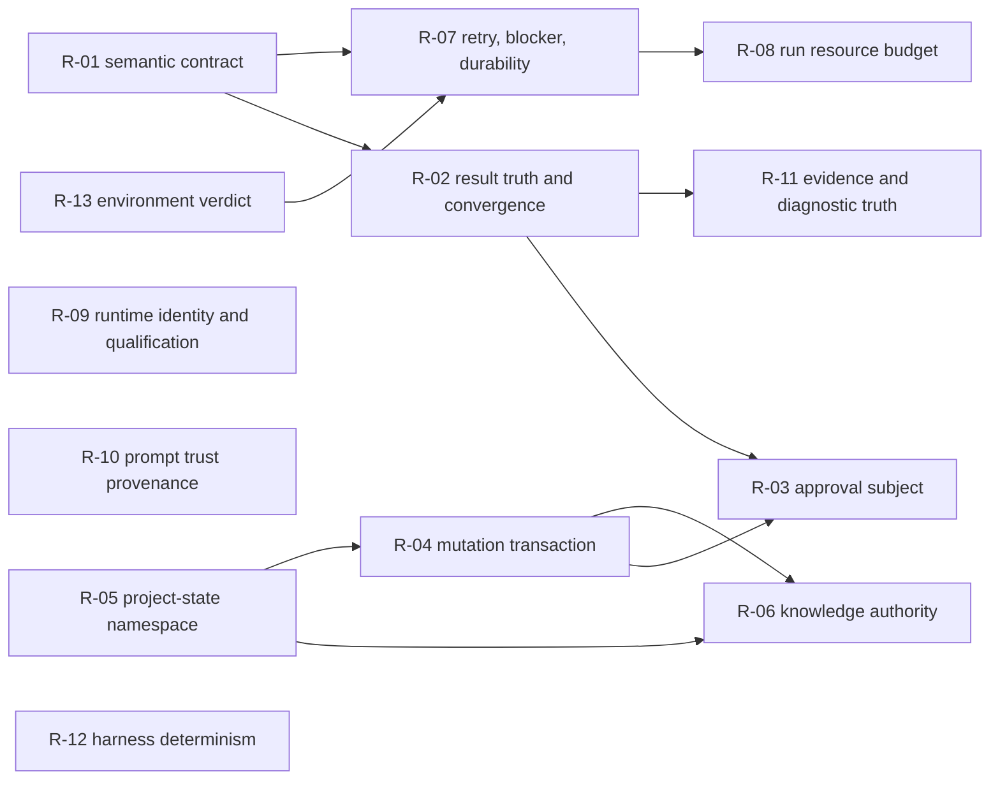

# 06 - Consolidated gap and authority audit (Phase B)

Canonical runtime baseline: commit `3eded93c0cfb50f8855d04510e3f9aa2cd5208f7`, tree
`97a3da6b2ef664e2b7e25c4c6fe3fc3f42f253a0`. AS-IS findings consolidated; every required contract here is `PROPOSED`
and is designed in `07-REQUIRED-CONTRACTS.md` (Phase C). Nothing is implemented. The implementation freeze holds.

This document does not restate the slice gaps. It collapses them under the first wrong authority decision that
explains them. A slice gap (`GAP-A*`) stays the home of its own evidence in `GAP-LEDGER.md`; a root issue (`R-nn`)
is the home of the one truth, its current and required owner, and the list of everything that hangs under it.
`REGISTRY-ROOT-MAP.md` lists every registry row with its class and root (141 of 141, generated and checked).

Evidence labels as in the rest of the set. `B-P1` is `evidence/b/b_probe.py` (output beside it). Facts first
established in this phase are in section 3; everything else is cited by row ID.

Owner rulings applied (2026-11-15, on accepting A3, A4, A5 and A6): root-cause collapse; `GAP-A3-04` split; `GAP-A3-05`
needs an approval subject before any fix; `GAP-A5-01` assessed per state class under one principle; `GAP-A5-02`,
`GAP-A5-03`, `GAP-A5-05` as mutation and authority questions, not source changes; `GAP-A6-01` and `GAP-A6-02` as P1
candidates; `GAP-A6-03` split into runtime result truth and audit integrity; one resource-budget root; the three
Phase-D items stated precisely.

## 1. The root issues

Eleven architecture roots and two supporting ones. "Disposition" is this audit's proposal for Phase D.

| Root | One truth | First wrong authority decision (current owner) | Required owner (`PROPOSED`) | Child gaps | Severity | Disposition |
|---|---|---|---|---|---|---|
| R-01 SEMANTIC-CONTRACT-AUTHORITY | What the user's request requires of the product's behaviour | None exists before generation: the Developer and a generated verifier are the first to state behaviour; regular expressions and model text stand in (`contract_compilation.py`, `requirements.py`) | One compiled semantic contract, before the Planner, that the Developer, the verifier and requirement closure all read | `GAP-A2-01`, `GAP-A2-02`, `GAP-A2-03`, `GAP-A4-05`, `GAP-A4-07`, `GAP-A4-08` | P1 | FIX_REQUIRED_BEFORE_PRODUCTION |
| R-02 RESULT-TRUTH-AND-EXECUTOR-CONVERGENCE | What "valid plan", "verified", "approved", "committed", "accepted" and "success" mean for a run | Each executor is the sole authority of its own run; the status rule turns evidence into a word without consuming requirement truth (`AUTH-A3-10`, `AUTH-A3-11`, `AUTH-A4-14`) | One result contract above both executors; one terminal owner that consumes it | `GAP-A4-01`, `GAP-A3-01`, `GAP-A3-02`, `GAP-A3-03`, `GAP-A3-06`, `GAP-A6-03` part A | P1 | FIX_REQUIRED_BEFORE_PRODUCTION |
| R-03 APPROVAL-SUBJECT-AUTHORITY | What exactly a person (or a threshold) approved | `stage_apply.py::approval_gate` re-reads the sandbox to build a diff per unit and records no identity; no subject above the unit exists | One approval subject with an identity that the commit checks and the record keeps | `GAP-A3-04` (A and B), `GAP-A3-05`, the approval half of `GAP-A5-02` | P1 | FIX_REQUIRED_BEFORE_PRODUCTION |
| R-04 MUTATION-TRANSACTION-AUTHORITY | Which path may change the owner workspace or a repository, and under which transaction | Three writers outside the candidate transaction: a planned MCP call (`MCPManager.start_all` binds the process directory), skill learning (eleven writers, some committing to Git), and the write gate's lack of a class for Kriya's own project inputs | The candidate transaction is the only route of a model-originated change; anything else is operator-only or its own governed store | `GAP-A5-03`, `GAP-A5-05`, the write half of `GAP-A5-02` | P1 | FIX_REQUIRED_BEFORE_PRODUCTION |
| R-05 PROJECT-STATE-NAMESPACE-AUTHORITY | Which project a piece of derived state belongs to | `config/resolution.py` anchors the default memory and skills locations to the installation; no store records an owner | One owner of project-scoped derived state: identity key, write namespace, read namespace and fallback behaviour all bound to the workspace identity | `GAP-A5-01` (classes A to G, section 2) | P1 | FIX_REQUIRED_BEFORE_PRODUCTION |
| R-06 KNOWLEDGE-AUTHORITY | Whether required knowledge is satisfied, and which skills apply | `KnowledgeGuard.check_goal` reads a directory listing; skill relevance is decided twice from different text | Coverage and relevance decided from loaded, applicable, verified skill facts by the Skills owner | `GAP-A4-03`, `GAP-A4-02` | P1 | FIX_REQUIRED_BEFORE_PRODUCTION |
| R-07 RETRY-BLOCKER-DURABILITY-AUTHORITY | Whether a blocker is still the same one, what allowance it has left, and what survives an interruption | `retry_policy.py::observe_failure_family` reads a repeat-detection signature as blocker identity; no module owns durability of retry, recovery or accepted unit work | One blocker identity with a lifecycle, one allowance ledger, persisted with the unit and the plan | `GAP-A1-01`, `GAP-A1-02`, `GAP-A1-03`, `GAP-A1-05`, `GAP-A1-07`, `GAP-A1-08`, `GAP-A1-09`, `GAP-A4-06` | P2 | FIX_REQUIRED_BEFORE_PRODUCTION (never a false success; convergence and cost) |
| R-08 RUN-RESOURCE-BUDGET-AUTHORITY | How much time and work one run may consume in total | The configuration owns a number that bounds a unit invocation; nothing owns the run (`AUTH-A1-08`, `AUTH-A5-12`, `AUTH-A6-10`) | One cumulative run-resource contract with six named levels | `GAP-A1-04`, `GAP-A1-06`, `GAP-A5-04` | P1 candidate (reliability and resource safety) | FIX_REQUIRED_BEFORE_PRODUCTION |
| R-09 RUNTIME-IDENTITY-AND-QUALIFICATION-AUTHORITY | That the binding a role asked for is the binding dispatched and the binding qualified | `LLMClient._binding` resolves a binding by model name, primary first, and defaults to the primary; the run never checks the primary's qualification | One resolved binding object per call, carried from the caller to dispatch; one production admission | `GAP-A6-02`, `GAP-A6-01` | P1 | FIX_REQUIRED_BEFORE_PRODUCTION |
| R-10 PROMPT-TRUST-PROVENANCE-AUTHORITY | Where each piece of text in a model request came from, and what it may influence | `state.error_context` is one untyped string that validator output, Kriya headers and fetched text are concatenated into; ten modules read it as validator evidence | Typed context values with a trust class from creation to dispatch; one renderer applies the fence | `GAP-A4-04` | P1 security | FIX_REQUIRED_BEFORE_PRODUCTION |
| R-11 EVIDENCE-AND-DIAGNOSTIC-TRUTH | That a record or message says what happened, and what a reader may conclude from it | No contract states which record is the outcome of record or what "verified" proves; several records and labels are written before, or apart from, the decision they describe | An explicit evidence contract (integrity class, binding to the RunRecord, retention) and one rule for diagnostic labels | `GAP-A6-03` part B, `GAP-A1-03`, `GAP-A3-07` | P2 (P1 only if the product promises tamper evidence: owner policy) | Split: binding and labels FIX_REQUIRED_BEFORE_PRODUCTION; authenticity GENUINE_FUTURE_FEATURE once the contract says "integrity against damage" |
| R-12 CERTIFICATION-HARNESS-DETERMINISM (supporting) | That a red certification run is a statement about the product | Tests share fixed machine resources, wall-clock margins and the checkout's own state | Hermetic, load-independent tests; one certification cohort definition | none (registry rows only) | P3 | FIX_REQUIRED before the next certification run (test-only, no product change) |
| R-13 VERIFICATION-ENVIRONMENT-VERDICT (supporting) | Whether a failed gate is a statement about the candidate or about the environment | Not established for every launch site: one row cannot be characterized under the freeze | `tools/validate.py` and the launch sites return a typed environment verdict for every refusal | none (registry rows only) | Unknown until characterized | **PHASE-D BLOCKER** for the verification-truth statement (section 7) |

Roots R-08, R-09 and R-10 have no registry row: the closure found them. Every other root lists its rows in
`REGISTRY-ROOT-MAP.md`.

## 2. Each root issue

### R-01 SEMANTIC-CONTRACT-AUTHORITY

| Field | Content |
|---|---|
| Problem | Nothing states the required product behaviour before a model writes code or a test. The goal is prose; requirements are compiled from patterns; a generated verifier can be the first place a behaviour is written down; ambiguity has no representation |
| Evidence | `AUTH-A2-01..05`, `GAP-A2-01` (`MEASURED` A2 probes); `GAP-A4-07` (`TRACED`); `GAP-A4-05` (the runtime-required reading is a pattern match with no UNKNOWN) |
| Affected stages | STAGE-GOAL-INTAKE, STAGE-SEMANTIC-CONTRACT, STAGE-PLANNING, STAGE-GENERATION, STAGE-VERIFIER-AUTH, STAGE-FINAL-VERIFICATION |
| Violated invariant | A generated executable verifier must never be the first creator of required product semantics; model text is evidence, never authority |
| Children and how each follows | `GAP-A2-01` is the root itself. `GAP-A4-07` is the same absence at intake. `GAP-A4-05`: without a contract, "requires execution" is guessed. `GAP-A2-02`: verifier identification fails open because verifier identity is derived, not declared against a contract. `GAP-A2-03`: what an unattended run may do once a test is written is an undocumented consequence. `GAP-A4-08`: Planner integration decisions bind units by owner ruling; under a contract they are checked against it |
| Bypasses | `BYP-A2-*` (routes around semantic authority), `BYP-A4-*` for the goal and plan |
| Registry rows | 6 (`REGISTRY-ROOT-MAP.md`, R-01) |
| Existing seam | `contract_compilation.py` already types missing authority (`acceptable_authorities`, authority requests); `requirements.py::behavior_strength` already separates GENERAL statements; the verifier semantic review (WS3) already holds a person's decision by fingerprint |
| Dependencies | None upstream. R-02 (requirement truth) and R-07 (what a blocker is about) consume it |
| Disposition | FIX_REQUIRED_BEFORE_PRODUCTION |

### R-02 RESULT-TRUTH-AND-EXECUTOR-CONVERGENCE

| Field | Content |
|---|---|
| Problem | Two executors (direct / milestone, and enforce) each establish seven result-bearing facts their own way, and the word shown to the person does not consume requirement truth. Project Setup turns the enforce shape on; a folder with no configuration runs direct |
| The seven truths (`GAP-A4-01`) and where each is decided | (1) plan validity: `AUTH-A4-10` (enforce, structured) versus `AUTH-A4-11` (direct); (2) requirement truth: where and whether requirements are verified, `AUTH-A3-09`; (3) approval semantics: per unit under enforce, per run direct (`AUTH-A3-03`, with R-03); (4) commit truth: unit commits into a plan sandbox then one terminal commit, versus a commit per unit (`AUTH-A3-14`, `AUTH-A3-08`); (5) final-review authority: decides unit status on direct and milestone, advisory under enforce (`GAP-A3-03`); (6) requirement closure: two closers cannot fire under enforce (`GAP-A4-01`); (7) terminal result: `AUTH-A3-10` versus `AUTH-A3-11` |
| Runtime final-result truth (owner ruling, part A of `GAP-A6-03`) | Section 3.5. In short: the RunRecord is terminated from the result payload's own claim, limited by what the record proves (a settled commit or none, every work unit VERIFIED); a result that claims success against a record that did not end SUCCESS is rewritten (`run_coordinator.py::_reconcile_result`, "the ONE result-truth owner for a mutating run"). Requirement truth is not among the record's proofs. The history row is written inside the workflow before that reconciliation and is not rewritten |
| Evidence | `MEASURED` A3 P8 (success with open requirements under the default policies), A3 P1 / P3 (review refusal), A4 probes (plan validity differs); `TRACED` here for the reconciliation order |
| Affected stages | STAGE-PLAN-VALIDATION, STAGE-SUBTASK-SELECTION, STAGE-GATES, STAGE-REVIEW, STAGE-APPLY, STAGE-FINAL-VERIFICATION, STAGE-TERMINAL |
| Violated invariant | Direct and enforce establish compatible truth; the final result consumes verified evidence and never implies more than was established |
| Children | `GAP-A4-01` (root), `GAP-A3-01` (success without requirement truth; no state for "applied, requirements open"), `GAP-A3-02` (no route from a terminal gap to an owning unit), `GAP-A3-03` (final review), `GAP-A3-06` (review text of another state), `GAP-A6-03` A (history status written before reconciliation) |
| Bypasses | `BYP-A3-*`, `BYP-A4-*` for executor choice, `BYP-A6-12` |
| Registry rows | 10 |
| Existing seam | `control/run_coordinator.py` already owns reconciliation of a result against its record; `requirements.py::requirement_truth` already has a closed vocabulary; the production profile already seals the two requirement policies to `block` |
| Dependencies | R-01 (what a requirement is). R-03 for truth (3). R-07 for `GAP-A3-02`'s route back to a unit |
| Disposition | FIX_REQUIRED_BEFORE_PRODUCTION |

### R-03 APPROVAL-SUBJECT-AUTHORITY

| Field | Content |
|---|---|
| Problem | An approval has no subject with an identity. The diff a person sees is rebuilt from the sandbox; under enforce the subject is a unit, never the plan's change; the size trigger of guardrails mode measures a unit, so the Planner's decomposition decides whether a person is asked; nothing tells the person that a file is Kriya's own configuration or a skill |
| `GAP-A3-04` split, as the owner required | **A. Runtime authorization binding.** Can Kriya prove the decision applies to the bytes that may be committed? Partly: the commit recomputes and checks the verified batch against what it commits (`AUTH-A3-02`, sound), and the launch approval record carries a candidate digest per review (`control/launch_approval.py::build_pending`, A5). What is missing is the comparison of the **approved** digest with the **verified / committed** batch on the CLI path, and any plan-level digest. **B. Audit binding.** Can later evidence show which bytes were approved? No: the kernel approval record carries no digest (`MEASURED` A3), and no record links an approval to the commit record. A sound commit guard closes neither |
| `GAP-A3-05` | Exhaustive negative evidence: no aggregate plan-level or run-level approval or size authority in planning (A4), tools, MCP, configuration, application (A5), runtime, control, metrics or evidence (A6, `BYP-A6-17`). The approval subject (unit, candidate transaction, cumulative plan delta, whole run) must be defined before any measure is summed |
| `GAP-A5-02`, approval half | Under human-in-the-loop a person approves a unit diff that may contain `kriya.yaml` or workspace skill files; nothing marks them as inputs of later runs. Ordinary source approval is therefore not an explicit transfer of authority over future configuration or knowledge state. In guardrails mode nobody is in the path below the size threshold. Who authorizes a policy change: nobody, explicitly. When does it take effect: at the next run's configuration load (`REPOSITORY_SAFE` fields without approval, `AUTH-A5-10`). Is it audited as an authority change: no (`TRACED`, A5 limits: not exercised end to end) |
| Affected stages | STAGE-REVIEW, STAGE-APPLY, STAGE-TERMINAL |
| Violated invariant | Evidence binds to exact identity; one authoritative owner per decision |
| Bypasses | `BYP-A3-16` (mode and binary changes not shown), the split bypass of `GAP-A3-05`, `BYP-A5-01`, `BYP-A5-02` |
| Registry rows | 3 |
| Existing seam | The candidate digests of `AUTH-A3-01`; the launch review record; the commit guard |
| Dependencies | R-02 truth (3) and (4); R-04 for the path class |
| Disposition | FIX_REQUIRED_BEFORE_PRODUCTION |

### R-04 MUTATION-TRANSACTION-AUTHORITY

| Field | Content |
|---|---|
| Problem | "Every model-originated change reaches the owner workspace only through a candidate, its gates, its approval and the commit transaction" has three exceptions |
| Exception 1: planned MCP call with a write grant (`GAP-A5-03`) | No independently authoritative transaction (comparison table under `BYP-A6-18`): no exact mutation scope, an approval bound to the tool identity and not to the change, no isolation, no rollback, an audit record without files or digests, no place in the final result. A capability grant is not a mutation approval |
| Exception 2: skill learning (`GAP-A5-05`) | Who decides a skill is learned: a model extraction (SkillGapAgent, lesson extraction) plus, on some routes, a person's review of found references; no deterministic authority. Writer: eleven sites (`MUT-A5-08`) using plain file writes, outside the write gate; most call `git_commit_if_tracked`. Transaction: none; under enforce the writes are deferred by a run shadow for a skills root inside the candidate repository only. Rollback: none. Audit: the skill's own provenance file. Seen by source approval: no. In the final result: only as `unresolved_skill_gaps`. Per shape: direct and milestone write and commit during analysis, before a candidate exists; enforce defers. A second repository writer |
| Exception 3: Kriya's own project inputs (`GAP-A5-02`, write half) | The write gate allows a candidate to carry `kriya.yaml`, `kriya.yml` and workspace skill files (`MEASURED` A5 P5). They pass through the candidate transaction, so the transaction exists, but the path class does not: the gate cannot tell a source file from an authority input of the next run |
| Evidence | `TRACED` (MCP, no server run), `TRACED` (skill writers, controls), `MEASURED` at the gate |
| Affected stages | STAGE-WORKSPACE, STAGE-KNOWLEDGE, STAGE-APPLY |
| Violated invariant | Every mutation has one authority path; a run never edits the owner workspace before its commit transaction; model text never becomes a configuration value |
| Bypasses | `BYP-A5-01..04`, `BYP-A5-07`, `BYP-A6-18` |
| Registry rows | 1 mapped (`KERNEL-STAGING-WORKSPACE-BASE-ESCAPES-001`); the three exceptions are new |
| Existing seam | `AuthorizedFileWriter`; `resolve_planned_tool_governance` (operator-only class exists); `SkillEngine._write_skill_file` and the run shadow |
| Dependencies | R-05 (where a learned skill may be written). R-03 and R-06 consume it (the path class; the one skill writer) |
| Disposition | FIX_REQUIRED_BEFORE_PRODUCTION |

### R-05 PROJECT-STATE-NAMESPACE-AUTHORITY

Principle (owner): *project-derived mutable or semantic state must carry authoritative project identity unless
explicitly promoted into a governed global namespace.* Authority = identity key + write namespace + read namespace +
fallback behaviour, all four.

| Class | Content | Identity key today | Write namespace | Read namespace | Fallback | Verdict |
|---|---|---|---|---|---|---|
| A. Code index (`dependency_graph.db` with the structural tables, `vector_index.db`) | Project-derived, mutable | None (rows keyed by relative path) | `paths.memory`, by default the installation directory | The same location, any project | The packaged default itself is the unkeyed global | **Gap, P1** (`MEASURED` A5 P2: B reads A's index; indexing B deletes A's) |
| B. Learned knowledge (`web_knowledge.db`) | Operator-taught public documentation: one writer, `kriya learn` (`cli.py`), with `provenance_url` and `fetch_date`. Not derived from a project | None | `paths.memory` | Same; always rendered inside the fence and never an authority input (`memory/learned_knowledge.py` contract) | Same default | **Not project-derived.** Global by nature, operator-governed, low-trust by construction. The gap is only that it is not *named* as a global store and lives in the directory a project's explicit `paths.memory` would move. Proposed: INTENTIONAL_CURRENT_CONTRACT once declared global; P1 candidate withdrawn on this evidence (`TRACED`, one writer by search) |
| C. Skills directory | Mixed: the shipped library (global, versioned with the installation) and run-written scaffolds, rules, provenance and staged facts (project-derived) | None | `paths.skills`, by default the installation directory; eleven writers | Every project loads it; location is what makes a skill trusted | Same default | **Gap, P1** (`MEASURED` A5 P8: A's scaffold closes B's knowledge gate). Also R-06 and R-04 |
| D. Release cache (`knowledge_cache.db`) | Public release dates keyed `(ecosystem, package, version)` with source and a refresh time; writers are the registry lookups of `tools/knowledge.py` only | The key is the public coordinate | `paths.memory` | Same | TTL refresh | **Not a gap.** Project-independent public fact, bounded lifetime, no project content. INTENTIONAL_CURRENT_CONTRACT (`TRACED`: schema and the seven writer sites). Limit: an entry is trusted as fetched; it only shifts a knowledge-gate prompt |
| E. Control state, approvals, launches, checkpoints | Project-scoped | Workspace identity (`AUTH-A5-01`) | Under the workspace or keyed files outside it | By identity; a document of another identity is refused | Legacy identity accepted on read only | **Sound** (`MEASURED` A5 P7) |
| F. Run history (`traces.db`) and the retrieval text stored in it (`retrieved_chunks`) | Project-derived (goal, prompt, chunks, events) | None in the row; attribution through evidence manifests | One database per state directory | Desktop history of any project in that state directory; the scoped list filters by manifest identity | A row without a manifest is unattributed | **Gap, P2** (`HISTORY-STATE-DIR-PER-PROJECT-001`, `GUI-RUN-ATTRIBUTION-001`, `MEASURED` A6 P5: no workspace column). Carries another project's chunk text when class A leaked |
| G. Attempt evidence, run logs | Project-derived | The manifest records workspace identity and path | Per run id under the state or log directory | By run id | - | Sound for attribution; integrity is R-11 |

| Field | Content |
|---|---|
| Consistent project identity across surfaces (owner ruling 8) | Desktop, CLI, resume and Project Setup all derive `workspace_identity` from the authority root (`AUTH-A5-01`), so class E is consistent. Direct and enforce: an enforce unit runs inside the plan sandbox, which is its own authority root, so unit checkpoints are keyed by the sandbox (section 3.4). Classes A, C and F have no identity on any surface. A Project Setup folder writes no `paths` section (`MEASURED` A5 P1), so the desktop product runs on the unkeyed defaults |
| Affected stages | STAGE-WORKSPACE, STAGE-KNOWLEDGE, STAGE-CONTEXT, STAGE-EVIDENCE |
| Violated invariant | State or retrieval of project A is never returned, written or reused for project B through any explicit, fallback, default, global, legacy or missing-key path |
| Bypasses | `BYP-A5-05..09` |
| Registry rows | 5 |
| Existing seam | `core/state_paths.py::resolve_state_directory`; the index manifest; `SkillEngine`'s shared-install refusal (exists, not consulted by every writer) |
| Dependencies | None upstream; R-06 and R-04 depend on it |
| Disposition | FIX_REQUIRED_BEFORE_PRODUCTION for A, C, F; INTENTIONAL_CURRENT_CONTRACT for B and D once named global |

### R-06 KNOWLEDGE-AUTHORITY

| Field | Content |
|---|---|
| Problem | "Required knowledge is satisfied" is established by a directory name. No stage validates the facts: not the gate, not the unit analysis (it prompts), not the Developer request (four controls, A6). Which skills apply is decided twice, from the goal and from a unit's composed text |
| Evidence | `MEASURED` A4 P5, P11 (an empty folder, Kriya's own scaffold); `MEASURED` A5 P8 (cross-project); `TRACED` A6 (no later authority) |
| Combined effect | A scaffold Kriya wrote for project A, containing no rule, closes project B's human knowledge gate; on the desktop a gap cannot be confirmed by the person (`KNOWLEDGE_POLICY = "strict"`), so the gate can only stop the run or be closed by a folder |
| Affected stages | STAGE-KNOWLEDGE, STAGE-CONTEXT, STAGE-GENERATION |
| Violated invariant | Evidence binds to identity, nothing is transferred by name; UNKNOWN fails safely |
| Children | `GAP-A4-03`, `GAP-A4-02` |
| Bypasses | `BYP-A4-19`, `BYP-A5-02`, `BYP-A5-11`, `BYP-A6-11` |
| Registry rows | 4 |
| Existing seam | `AUTH-A4-07` (skill fact truth: verification is Kriya's, by a committed run); the engine's loaded skills and tags; `missing_skill_candidates` |
| Dependencies | R-05 (which skills are this project's), R-04 (who writes a skill) |
| Disposition | FIX_REQUIRED_BEFORE_PRODUCTION |

### R-07 RETRY-BLOCKER-DURABILITY-AUTHORITY

| Field | Content |
|---|---|
| Problem | "The same failure" has four definitions (`AUTH-A1-12`); the scoped allowance is granted on a text difference; an unlisted non-candidate failure can replenish it; grants and charges leave no record; and none of it survives an interruption. Accepted unit work under enforce is not durable before the terminal commit |
| Evidence | `MEASURED` A1 probes P1 to P11 and nine committed tests; `TRACED` A1b for enforce recovery; section 3.3 and 3.4 here |
| Affected stages | STAGE-RETRY, STAGE-RECOVERY, STAGE-CHECKPOINT |
| Violated invariant | Fail closed, never approximate (an unknown failure type widens a budget); resume never silently resets authoritative truth unless the contract says so |
| Children | `GAP-A1-01` (root), `GAP-A1-07` (one predicate, two consumers with opposite safe defaults), `GAP-A1-02` and `GAP-A1-09` (durability), `GAP-A1-03` (no record), `GAP-A1-08` (a cap that cannot fire), `GAP-A1-05` (a configured limit below 3 is read as 3), `GAP-A4-06` (enforce resume needs the same run id and a byte-identical new plan) |
| Standing rulings | A blocker registry and a typed key as blocker authority were rejected by the owner (WS4, 2026-11-14); the stale `Finding / FindingState` design is not resurrected. The required contract must therefore define continuity without them |
| Bypasses | `BYP-A1-*` |
| Registry rows | 10 |
| Existing seam | `open_findings.py`, `retry_policy.py`, `control/state.py::ControlState` (already persists `tool_attempts`), the unit checkpoint |
| Dependencies | R-01 (what a blocker is about), R-08 (the allowance is one level of the budget contract) |
| Disposition | FIX_REQUIRED_BEFORE_PRODUCTION. Owner policy inside it: `GAP-A1-09` (durable unit work versus atomic commit) |

### R-08 RUN-RESOURCE-BUDGET-AUTHORITY

The six levels, as the code has them today (`TRACED` unless marked):

| Level | Current owner | Bound today | Who may set it | Gap |
|---|---|---|---|---|
| 1. One model call | `LLMClient._deadline`, `llm.transport` timeouts | The run clock's remainder, narrowed by `inference_deadline()`; transport timeouts | Operator (`llm.transport` is `SECURITY_AUTHORITY`) | None |
| 2. One unit invocation (generation budget) | `autonomy.generation_time_budget_seconds` through `claim_run_generation_clock` | One clock per unit invocation | **Any repository file, at any value including none**, outside the production profile (`MEASURED` A5 P6) | Authority class (`GAP-A5-04` a) |
| 3. Targeted and fallback retry allowance | `retry_policy.py` budgets | Counts per failure family, plus the global attempt ceiling per invocation | Configuration (`AUTH-A1-07`) | Replenishment on an unlisted failure (R-07) |
| 4. Recovery and unit re-invocation | The enforce loop's cycle caps (`AUTH-A1-11`) | Counts; each re-invocation gets a fresh level-2 and level-3 budget | Configuration | The product of levels 2 to 4 is the real bound and nobody states it (`GAP-A1-04`) |
| 5. Total run ceiling (wall clock, model calls, tokens) | **None** | **None**: units times recovery rounds times the unit budget | - | **The root** |
| 6. Operator / profile maximum | The production seal | A positive integer at most 3,600 for level 2 only (`MEASURED` A5 P6: 7200 and none refused, 2400 accepted) | Operator | Caps one level; says nothing about the total |

| Field | Content |
|---|---|
| Problem | No authoritative cumulative run-resource contract. A repository can enlarge total consumption through the number of units and recovery rounds even under the per-unit production cap. 2,400 versus 3,600 is not a conflict (disproved, A5) |
| Affected stages | STAGE-RETRY, STAGE-RECOVERY, STAGE-MODEL-RUNTIME, STAGE-SUBTASK-SELECTION |
| Violated invariant | A configuration source may only set what it cannot use to gain resource authority |
| Children | `GAP-A1-04`, `GAP-A1-06` (answered by A5: the effective per-unit value), `GAP-A5-04` |
| Registry rows | None mapped (`DEMO-TIME-BUDGET-001` is the adjacent intentional row) |
| Existing seam | The run generation clock (one per mutating run exists as a concept: `run_coordinator.py::claim_run_generation_clock`), the value-bounded field class of `config/authority.py` |
| Dependencies | R-07 (levels 3 and 4) |
| Disposition | FIX_REQUIRED_BEFORE_PRODUCTION |

### R-09 RUNTIME-IDENTITY-AND-QUALIFICATION-AUTHORITY

Required chain (owner): `requested model identity -> resolved binding -> qualification / admission identity ->
dispatched model`, exact-bound.

| Field | Content |
|---|---|
| Problem 1: binding resolved by name (`GAP-A6-02`, widened) | `LLMClient._binding(model)` takes the first binding whose model name matches, the primary first, and returns the primary's binding when none matches. A role call passes model, endpoint, temperature, output budget, reasoning flag and `extra_body`; it does **not** pass the context window, the context policy or the runtime adapter, which come from that name lookup. Qualification, the doctor and `kriya model status` use a role-first lookup (`inference_settings.py::role_binding_for_model`). The two can differ |
| Reachability in production | **Reachable with a valid configuration** (`MEASURED` B-P1): `llm` and `agent_llms.reviewer.llm` naming the same model with different settings is accepted (the only same-alias check, `routing_alias_conflicts`, covers routing candidates); the Reviewer's binding says `ollama_native` at 65,536 and the call executes on the default `ollama` adapter at 32,768 with the primary's `extra_body`, while the identity that would be qualified for the Reviewer has another settings digest. The unknown-name branch itself was not shown reachable (every name the configuration supplies resolves) |
| Problem 2: production admission (`GAP-A6-01`) | The run checks QUALIFIED for a Developer fallback and a retry identity only. The primary and every other role are assessed nowhere during a run; `doctor --production` is a separate command with no durable link to a run |
| Decision the owner asked for (A or B) | **A: every production run verifies its exact active bindings.** B (doctor as a mandatory external precondition) would need a durable doctor result bound to the configuration digest, every role's runtime digest and settings digest, a freshness rule, and a check of that binding at run start: that is A's check plus a second store and a staleness window. The qualification records already are the durable, identity-bound evidence; the run can read them directly with the function the doctor uses. Evidence label: `TRACED` (the doctor's check and the run's fallback check call the same `assess`) |
| Evidence | `MEASURED` A6 P7, B-P1; `TRACED` A6 controls |
| Affected stages | STAGE-MODEL-RUNTIME, STAGE-GENERATION, STAGE-REVIEW |
| Violated invariant | Evidence binds to exact identity; nothing is transferred by name; fail closed |
| Bypasses | `BYP-A6-01`, `BYP-A6-02`, `BYP-A6-04` |
| Registry rows | None (new) |
| Existing seam | `role_binding_for_model`, `binding_object`, `_binding_identity` and `routing_alias_conflicts` (the conflict rule exists for routing), `model_qualification.assess` |
| Dependencies | None upstream |
| Disposition | FIX_REQUIRED_BEFORE_PRODUCTION (both problems) |

### R-10 PROMPT-TRUST-PROVENANCE-AUTHORITY

| Field | Content |
|---|---|
| Problem | A model request has no structural trust classes (two messages; headings only). Text fetched during a run loses the one mechanism that marks it as reference, never instruction |
| Trust / provenance owner today | None. `untrusted_context.py` owns the fence; nothing owns the classification of a value before it is rendered. Learned knowledge is fenced because its one reader fences it; fetched text is not because its one writer appends it to a string |
| Does untrusted content stay typed through every transformation | No (`MEASURED` A6 P1): the augmenter appends it to `state.error_context`; the retry package relabels a slice of it "advisory"; six other consumers read the whole string as validator output |
| Does placement grant instruction authority | Yes in two places: Kriya-authored scaffold text derived from it, and the Reviewer's system prompt on a rejected candidate, inside the block headed as a deterministic control-plane fact |
| Downstream actions that can be influenced | The Developer's next candidate (through reasoning: the text sits in the task section with the error), the retry path (which test runs first), the Reviewer's text shown to the person, and durable learned facts. Not influenced: the write gate, gate verdicts, approvals, the commit |
| Reach | Web lookup is off by default and in the Project Setup profile; the production profile seals offline mode; each query needs an approval |
| Affected stages | STAGE-RETRY, STAGE-GENERATION, STAGE-REVIEW, STAGE-KNOWLEDGE |
| Violated invariant | Retrieved text is evidence, never authority; untrusted text is fenced |
| Children | `GAP-A4-04` (both routes: the retry route here; the skill-rule route is also R-04 and R-06) |
| Bypasses | `BYP-A4-04`, `BYP-A6-05..09` |
| Registry rows | None (new); related `DESKTOP-LOOKUP-QUERY-APPROVAL-001` |
| Existing seam | `fence_untrusted_reference`, `outside_untrusted_reference`, `RetryPackage.advisory_context` (a separate field already exists), the bytes-source inventory test |
| Dependencies | None upstream |
| Disposition | FIX_REQUIRED_BEFORE_PRODUCTION. Provenance is lost before dispatch |

### R-11 EVIDENCE-AND-DIAGNOSTIC-TRUTH

| Field | Content |
|---|---|
| Problem | (B of `GAP-A6-03`) Durable audit integrity: the history row is replaceable and unbound (`MEASURED` A6 P5); a consistently rewritten evidence chain and seal reads VERIFIED (`MEASURED` A6 P4); writes of both are best-effort. Around it: records written before the decision they describe (`GAP-A3-07`), allowance changes with no record (`GAP-A1-03`), labels and counts that do not mean what they say, gate results without a purpose, records with no retention owner, several run identifiers with no binding |
| What Kriya promises today | The subsystem note calls the recorder "observational"; the history writer's own comment says "no digest binds these rows; every reader is a display or a metric". No document promises tamper evidence. The desktop shows the word "verified" for a chain check. So the architecture contract is implicit, which the owner ruled insufficient |
| Classification | Not closed by "the RunRecord is authoritative" (that is R-02). Two parts: (1) **binding and completeness**, needed for any honest audit: a history row and an evidence store that name the workspace and the RunRecord revision they describe, labels written by the deciding owner, retention owners. FIX_REQUIRED_BEFORE_PRODUCTION, P2. (2) **authenticity against a writer with access to the state directory**: an owner policy choice. If Kriya is to promise tamper-evident evidence, FIX_REQUIRED (P1); if evidence is diagnostic history of a local single-user tool, the contract must say so in the documentation and on screen, and authenticity is a GENUINE_FUTURE_FEATURE. This audit recommends the second, stated explicitly |
| Affected stages | STAGE-EVIDENCE, STAGE-TERMINAL, STAGE-RETRY |
| Violated invariant | Evidence binds to exact identity; a record never implies more than was established |
| Children | `GAP-A6-03` B, `GAP-A1-03`, `GAP-A3-07` |
| Bypasses | `BYP-A6-12..16` |
| Registry rows | 16 |
| Existing seam | The evidence manifest (already carries workspace identity and base revision), `run.closed` (already mirrors the RunRecord revision), the redaction owner, `control/retention.py` |
| Dependencies | R-02 (what the outcome is) |
| Disposition | As classified above; owner policy item for Phase D |

### R-12 CERTIFICATION-HARNESS-DETERMINISM (supporting)

Fifteen registry rows, all test-only: timing margins under load, a fixed machine-global port, goldens that depend on
the checkout's path, memory directory or an unnormalized field, an architecture finder that misses aliased imports,
tracked bytecode. No product owner is wrong. They matter to one architecture fact: certification is one full-suite
run with no retry for luck, so a harness race can make the certification verdict a statement about the machine.
Disposition: FIX_REQUIRED before the next certification run, as one test-hygiene slice with no product change.
`KERNEL-TESTS-CHECKOUT-MEMORY-MORE-FILES-001` and part of `KERNEL-GOLDEN-HARNESS-VOLATILITY-001` close with R-05.

### R-13 VERIFICATION-ENVIRONMENT-VERDICT (supporting)

Seven registry rows about the boundary between "the candidate failed a gate" and "the environment could not run the
gate". What is established: the validators type the environment-unavailable case and the retry machine does not
charge a typed environment failure to the candidate (`AUTH-A1-01`, `FR-A5-18`, `FR-A5-19`). What is not: whether
every daemon refusal on a loaded host reaches that type. Section 7 states the missing evidence. Until then this root
is the one **PHASE-D BLOCKER**.

## 3. Facts first established in Phase B

### 3.1 Learned knowledge is operator-taught, not project-derived (`TRACED`)

One writer: `cli.py` (`kriya learn`) through `LocalVectorStore.add_learned_knowledge` (search:
`add_learned_knowledge(` has one caller). Rows carry text, embedding, `provenance_url`, `fetch_date`. The module's
contract: read only through `retrieve_learned_references`, shown only inside the fence, never joined to a goal. It is
therefore global reference knowledge under the operator's authority. Used in R-05 class B.

### 3.2 The release cache is a public-fact cache (`TRACED`)

`tools/knowledge.py::KnowledgeCache`: table `release_cache`, primary key `(ecosystem, package, version)`, columns
`release_date`, `retrieved_at`, `source`; seven writer sites, each after a public registry answer (Maven Central,
PyPI, npm, RubyGems, the Go proxy, crates.io, NuGet); a TTL. No project content, no project key needed. Used in R-05
class D.

### 3.3 A resumed enforce run does not keep its run id unless the caller passes it (`TRACED`)

`workflow_controller.py`: `run_id = run_id or trace_id_override or (active run's id) or new_run_id()`. A resume is a
new top-level run: `begin_mutating_run` claims a new id (or the desktop launch's id). So the evidence store, the
history row and the plan-level reuse test of `GAP-A4-06` all see a new run. Whether the CLI passes the earlier id for
`--resume-id` on the enforce path was not read (`INFERRED` that it does not for a plain `--resume`). Consequence
(R-07, R-11): a resumed run's evidence is a second store with no link to the first.

### 3.4 Unit checkpoints of an enforce run survive the sandbox reset only when the repository ignores `.kriya/` (`TRACED`)

A unit's checkpoints are keyed by the plan sandbox (its own authority root, `AUTH-A5-01`), so they live under
`<sandbox>/.kriya/`. The next run resets the sandbox with a forced checkout and `git clean -fd`, which removes
untracked paths that are not ignored. `.kriya/` is added to the repository's local exclude file only by the
greenfield bootstrap (`worktree.py::_bootstrap_greenfield_repository`). So in a repository Kriya bootstrapped (or
whose own ignore rules cover `.kriya/`) the unit checkpoints survive; in any other existing repository they are
deleted by the next run's reset. Not measured. This closes the open question of `BYP-A5-14` / `BYP-A1-12`: resume
state of an enforce unit depends on an ignore rule nobody owns (R-07).

### 3.5 Runtime final-result truth: who writes the RunRecord's terminal state (`TRACED`)

`control/run_coordinator.py::coordinated_mutation` (the wrapper of every mutating entry): (1) the wrapped function
returns its result payload; (2) if the payload claims success (`quality_gates_passed is True` or status `success`),
`_complete_successful_run` moves the record to SUCCESS only when the record itself proves it: no unverified work unit,
and a legal transition (a settled COMMITTED cycle, or no commit cycle); otherwise it fails the record; a payload that
says failed or needs review fails the record; (3) `_reconcile_result` rewrites a result that claims success while the
record did not end SUCCESS (`needs_review` for an uncertain commit, else `failed`), keeping the factual sub-results;
(4) at run exit any non-terminal record is failed (or UNCERTAIN). Answers to the owner's four questions:

| Question | Answer |
|---|---|
| Who writes it | `run_coordinator.py` only (`transition_mutating_run`, `begin_run_commit`, `settle_run_commit`), through `RunRecord`'s own legal-transition table |
| Exact transition to terminal | SUCCESS needs both the payload's claim and the record's proofs; FAILURE / UNCERTAIN from the payload, an exception, or run exit |
| Can another record change runtime behaviour | No: recovery, the workspace commit-state assessment and resume read the RunRecord and checkpoints. The history row, the evidence store and the log are read by displays, metrics and operator tools only (`AUTH-A6-11`) |
| Does the final UI / API consume it or recompute | The CLI result and exit code consume the reconciled payload. `launch.status` reads the RunRecord. The desktop history list and detail read the history row's `status`, which is written inside the workflow **before** step 3 and is not rewritten, and recompute the application outcome from recorded gate outcomes (`AUTH-A6-12`). So one surface can show a pre-reconciliation status |

Limit: the record's proofs do not include requirement truth (`GAP-A3-01`): SUCCESS means "committed or nothing to
commit, every unit VERIFIED", not "requirements verified".

### 3.6 Two bindings of one model name (`MEASURED` B-P1)

See R-09. Output: `evidence/b/b_probe_output.txt`.

## 4. Cross-slice checks

| Check | Verdict | Where it fails |
|---|---|---|
| One truth, one owner | **Fails** for blocker identity (four definitions, R-07), skill relevance (two selections, R-06), plan validity and unit acceptance (two executors, R-02), model binding (two lookups, R-09), project membership at index sites (R-05), run outcome as displayed (R-02 / R-11) | Holds for root identity, candidate identity at commit, configuration authority, tool governance |
| An owner never defines contradictory truths | **Fails** once: `open_findings.replaces_open_finding` serves two consumers whose safe defaults are opposite (`GAP-A1-07`); `RunState.final_workflow_quality_passed` mixes commit truth with an advisory call (`GAP-A3-03`) | - |
| Mutation authority references decision authority | **Fails** for MCP writes, skill learning, and the configuration / skill path class (R-04); holds for the candidate batch (the commit checks the verified batch) |
| UNKNOWN fails safely | **Fails** in the places each slice's UNKNOWN table marks: requirement truth under `record` (R-02), an unlisted failure type (R-07), an unmapped verifier (R-01), a knowledge folder (R-06), the owner of a store (R-05), a model name (R-09), the origin of prompt text (R-10), whether a run-level bound exists (R-08) | Holds for configuration classes, root class, tool governance, runtime adapter, provider settings |
| Resume never silently resets authoritative truth | **Fails**: retry and recovery counters, open findings, fallback state and human recovery decisions restart (R-07); enforce unit checkpoints depend on an ignore rule (3.4); a resumed run has a new id and evidence store (3.3) | Holds for the commit state (`kriya recover`) and tool execution markers |
| Direct and enforce establish compatible truth | **Fails** (R-02, seven truths) | - |
| Desktop, CLI, tool and MCP cannot bypass kernel authority | **Holds** for the desktop and CLI entries (every mutating entry is a coordinated mutation with the same gates; approvals arrive through the review channel). **Fails** for a planned MCP call with a write grant (R-04) |
| The final result consumes verified evidence, never recomputes truth | **Partly**: the reconciled result consumes the RunRecord; the desktop history shows a pre-reconciliation status and recomputes the application outcome as a display (R-02 / R-11); requirement truth is not consumed by the status (R-02) |

## 5. Authority audit over the truths the documentation addendum lists

`Owner` is the AS-IS owner; `OK` means one owner with a sound contract; otherwise the root that must fix it.

| Truth | AS-IS owner (row) | Status |
|---|---|---|
| Goal truth | The user's words, by identity (`AUTH-A4-01`) | OK |
| Requirement truth | `requirements.py` (`AUTH-A4-02`, `AUTH-A3-09`) | R-01 (what it is), R-02 (what it decides) |
| Semantic contract | None | **R-01** |
| Ambiguity resolution | None | **R-01** |
| Skill fact truth | Skills owner, verification by a committed run (`AUTH-A4-07`) | OK as a rule; bypassed by writers outside the engine (R-04) |
| Skill relevance | Two selections (`AUTH-A4-08`) | **R-06** |
| Plan validity | Two validators (`AUTH-A4-10`, `AUTH-A4-11`) | **R-02** |
| Root / workspace identity | `context/workspace_identity.py` (`AUTH-A5-01`) | OK |
| Membership | `repository/bound_tree.py` (`AUTH-A5-02`) | OK; sibling sites under R-05 |
| Candidate identity | `candidate_transaction.py` (`AUTH-A3-01`) | OK; five identities to bind (R-03) |
| Candidate transaction | The guarded commit (`AUTH-A3-02`, `AUTH-A3-14`) | OK for the candidate; three exceptions (**R-04**) |
| Source approval | `stage_apply.py::approval_gate` (`AUTH-A3-03..05`) | **R-03** |
| Semantic approval | Verifier semantic review (`AUTH-A2-08`) | OK where a typed channel exists; scope under R-01 |
| Verifier identity | `verifier_semantic.py` (`AUTH-A2-06`) | **R-01** (fails open when unmapped) |
| Verifier expectation truth | None before generation | **R-01** |
| Test construction truth | Compile phase fact (`AUTH-A2-09`) | OK |
| Attribution | `attribution.py` (`AUTH-A2-10`, `AUTH-A2-11`) | OK as a decision; labels under R-11 |
| Blocker identity | A repeat signature (`AUTH-A1-02`, `AUTH-A1-03`) | **R-07** |
| Blocker resolution | `open_findings.py` | **R-07** |
| Retry allowance | `retry_policy.py` (`AUTH-A1-05..07`, `AUTH-A1-13`) | **R-07**, **R-08** |
| Repair owner | Attribution kind (`AUTH-A2-10`) and the enforce recovery plan (`SM-A1-04`) | OK inside a unit; no route from a terminal gap (R-02) |
| Recovery episode identity | None persisted (`AUTH-A1-14`) | **R-07** |
| Apply authority | The commit service (`AUTH-A3-08`, `AUTH-A3-14`) | OK |
| Replay truth | `AUTH-A3-15`, `AUTH-A2-13` | OK |
| Provider / runtime / model identity | `core/model_runtime.py` fingerprint (`AUTH-A6-03`); binding by name (`AUTH-A6-01`) | **R-09** |
| Tool execution | `tools/tool.py` governance (`AUTH-A5-06`) | OK; MCP write under R-04 |
| Workspace mutation | Write gate and commit; three exceptions | **R-04** |
| Configuration authority | `config/authority.py` (`AUTH-A5-10`) | OK; the budget class under R-08, the self-modification path under R-03 / R-04 |
| Checkpoint state | `control/checkpoint.py` (`AUTH-A1-09`, `AUTH-A1-10`) | **R-07** |
| Evidence truth | Four writers, no contract (`AUTH-A6-11`) | **R-11** |
| Requirement closure | Closers, differing per executor (`AUTH-A3-09`) | **R-02** |
| Final result truth | `run_coordinator.py` reconciliation over the RunRecord (3.5); status rule without requirement truth | **R-02** |

No truth has owner = UNKNOWN: each either has an owner or names the root whose required contract supplies one.
The verification-environment verdict (R-13) is the one item whose AS-IS behaviour is not fully established.

## 6. Slice gaps that are not defects

| Gap | Class | Reason |
|---|---|---|
| `GAP-A1-04` | Owner ruling folded into R-08 | "Fresh full budgets per re-invocation" is not accepted as a contract (standing ruling); R-08 defines it |
| `GAP-A1-06` | Disproved as a gap | The effective budget of a launch is established (A5): the configuration value, per unit invocation |
| `GAP-A2-03` | Owner policy under R-01 | What an unattended or direct run may do once a test is written |
| `GAP-A4-08` | Intentional by owner ruling (SHARED-DECISION-AUTHORITY-001) | Listed so the matrix is complete; checked against the contract once R-01 exists |
| `GAP-A1-05` | Small defect under R-07 | A field whose accepted range differs from its effective range |
| R-05 classes B and D | Intentional once declared | Learned knowledge and the release cache are global by nature |

## 7. The three Phase-D characterization items

| Item | Exact missing evidence | Why it cannot be obtained under the freeze | Could either result change production readiness? | Status and provisional disposition |
|---|---|---|---|---|
| `WAVE8-DOCKER-REFUSAL-BECOMES-FALSE-VERDICT-001` (R-13) | For one real launch refused by the container daemon on a loaded host: the typed result each launch site returns (gate verdict of False, or a typed environment verdict), at the candidate gates, the terminal gate and the baseline run | It needs a real loaded daemon (a refusal cannot be provoked deterministically on the developer machine without loading containers), and the deterministic alternative, a scripted refusal at each launch site, is a new test: tests are frozen | **Yes.** If a refusal is read as "the candidate failed", an environment event consumes retry allowance and is attributed to source (R-07 accounting, wrong repair). If any path could read it as passed, it is a false success. Either changes the verification-truth statement | **PHASE-D BLOCKER.** Acceptance test named for the first implementation slice after the freeze: a scripted daemon refusal at every launch site yields a typed environment verdict |
| `RUNTIME-GATE-VENV-LACKS-PROJECT-TEST-DEPENDENCY-001` (R-13) | The install log and environment listing of the one contained gate whose project environment lacked a test dependency | Needs the same real contained run; the registry's run evidence did not keep that listing | **No.** The owner (`tools/validate.py::_ensure_project_venv_impl`) and the typed outcome (`PYTHON_ENVIRONMENT_UNAVAILABLE`) are the same whichever cause it was; a missing dependency surfaces as a failed gate or a typed environment stop, never as a pass. Its only production effect is the one the blocker above already covers | Non-blocking. Provisional: ROOT_GAP under R-13, closes with the blocker's acceptance test plus one test that a gate environment is built from the project's declared test dependencies |
| `TECHNICAL-VERIFICATION-BARE-ROWS-001` (R-11) | The rendered DOM of one bare row in the rebuilt desktop app | The cause is unknown and the recorded data cannot produce it; only the owner's look at the app (or a capture) can show it; no code path is implicated | **No.** A rendering of recorded gate types; the kernel projection is traced (`AUTH-A6-12`) and a defensive fix already ships | Non-blocking. Provisional: closes as DISPROVED on the owner's next observation, else reopens with the captured DOM as a desktop defect |

Also carried, not a registry row: the eight class-D setup errors of 2026-11-14 (`FR-A5-18`): only a count exists; the
same tests were green serially and in their tier; the run lacked the documented descriptor limit. Either result
(descriptor exhaustion, or a real fixture race) is a test-harness fact under R-12 and cannot change a product
classification. Non-blocking; missing evidence: the error text of one reproduction.

## 8. Extensibility conclusions (wording fixed by the owner)

- **vLLM** (`TRACED`, not empirical): `CURRENT PORT SUFFICIENT; NEW ADAPTER/QUALIFICATION WORK REQUIRED, NO KERNEL
  REDESIGN EXPECTED.` Not "supported". Production conditions: exact provider and model identity (artifact digest and
  server version); exact served context capacity equal to the requested window; over-window refusal with no silent
  truncation (the case the OpenAI-compatible Ollama path fails); a local endpoint under the egress contract;
  qualification of every role's exact identity; role mapping through bindings that R-09 makes exact. The seam table
  is in `05-INTEGRATION-BYPASS-MAP.md`.
- **Skills / Tools UX** (`TRACED`): `Richer read-side UX appears structurally compatible; mutating Skills/Tools
  require closure of canonical mutation/transaction authority first` (R-04, R-05, R-06).

## 9. Dependencies between roots (input to the Phase-C order)

An arrow means "the required contract of the target needs the source's truth to be defined". R-09, R-10 and R-12
have no upstream dependency and can be built at any point; R-05 and R-01 are the two independent starting points.
