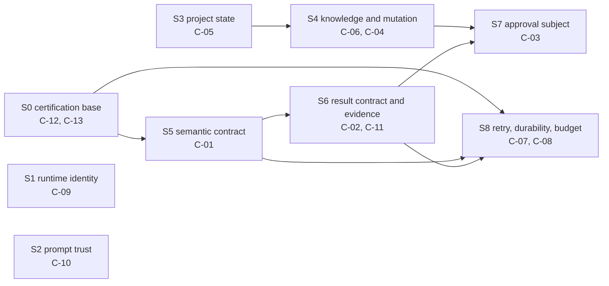

# 07 - Required contracts (Phase C, TO-BE)

Canonical runtime baseline: commit `3eded93c0cfb50f8855d04510e3f9aa2cd5208f7`. **Everything in this document is
`PROPOSED`** in the sense that nothing is implemented. The owner ruled on it on 2026-11-15
(`12-D0-CLOSURE-HARDENING.md` section 1): the policy choices marked "owner policy" below are ruled, and the slices
are authorized one at a time, in order, after the D0 pass. Section 7 lists what D0 changed here. AS-IS lives in the six
maps and in `06-GAP-AUTHORITY-AUDIT.md`; this document never restates it, it cites it.

Reading order per root issue: `AS-IS -> GAP -> REQUIRED CONTRACT -> IMPLEMENTATION DELTA -> ACCEPTANCE PROOF`. The
first two are the audit's; this document supplies the last three.

Design rules applied to every contract:

- Start from the truth's owner and work backward to its inputs. No new abstraction without a measured or traced need.
- Prefer the smallest correction at the first wrong owner over a new subsystem. Where an owner exists, extend it.
- Fail closed: every UNKNOWN the contract introduces has a typed outcome and a reason code in a closed table.
- Owner rulings in force are constraints, not options: no blocker registry or typed blocker key as authority (WS4,
  2026-11-14); the old `Finding / FindingState` design is not resurrected; the native adapter is the production
  runtime; SEC-009, TOOL-002 and TOOL-003 are not changed.
- Module and symbol names of things that exist are cited from the maps. Names of things that do not exist yet are
  proposals and are written in *italics*.

## 1. Contracts per root issue

### C-01 Semantic contract authority (R-01)

| Field | Required contract |
|---|---|
| Truth | What the user's request requires of the product's behaviour, per requirement, before any model writes code or a test |
| Required single owner | `workflow/contract_compilation.py`: the sealed verification contract gains one field per requirement, the *semantic state* |
| Authoritative inputs | The user's goal words; operator artifacts (requirements contract, acceptance file, approved examples); examples stated in the goal itself (`goal_example_forms.py`). Nothing a model produced |
| Persisted identity and state | In the sealed contract (schema version raised), per requirement: *SPECIFIED* (at least one deterministic clause from the inputs above, with clause ids), *GENERAL_UNSPECIFIED* (a behaviour statement with no clause), *AMBIGUOUS* (two readings the compiler can name: today only mutation scope; extended to the closed set of patterns the compiler can prove, not to model judgement). The contract digest is already a resume identity and in `ControlState` |
| Allowed mutation | None after sealing. New clauses arrive only through an authority request answered by a person or an operator artifact, which produces a new sealed contract (the contract-evolution rule of `CORR016_AUTHORIZED_CONTRACT_EVOLUTION_DESIGN.md`) |
| Forbidden bypass | A generated verifier, a Planner criterion or a structural closer (`test_addition`) closing a *GENERAL_UNSPECIFIED* requirement. A pattern miss deciding that the request does not require execution (`GAP-A4-05`): absence of a match is *unknown*, and unknown keeps the Planner's runtime verification |
| UNKNOWN behaviour | *GENERAL_UNSPECIFIED*: the requirement can be closed only by a person's verifier semantic decision bound to that requirement id (the WS3 review, which exists) or stays `UNVERIFIED`. *AMBIGUOUS*: attended run asks (one typed question per ambiguity); unattended run under the production profile refuses before planning; elsewhere recorded and carried to the result. An executed test identity that maps to no file is *unmapped*: the unit is held for review, never read as "not run-authored" (`GAP-A2-02`) |
| Why minimal and generic | Three states on an owner that already seals content before the first model call. No specification language, no model-extracted specification |
| Alternatives rejected | A model-written specification approved by a person (model text becomes the contract's first draft: the person reviews prose, the invariant "a model is never the first creator of semantics" is lost). A formal behaviour language (no measured need; one scenario family so far) |
| Planner integration decisions (`GAP-A4-08`) | Unchanged by owner ruling; the validator additionally refuses a decision that contradicts a *SPECIFIED* clause |
| Acceptance proof | A2 probes P8 and P9 as tests: a general sentence compiles to *GENERAL_UNSPECIFIED* and `test_addition` cannot close it; a goal example compiles to a clause that the example oracle closes; a `src/`-layout run-authored test is held; an ambiguity fixture produces the typed state and, unattended under production, a refusal before the Planner |
| Negative controls | Removing the semantic state makes the closure test fail; restoring "unmapped = not run-authored" makes the held-unit test fail; a model-supplied clause is refused by the sealing function |
| Stop conditions | If more than the closed pattern set is needed to classify ambiguity (that is, a model would have to judge), stop: ambiguity stays representable only for the provable cases and the rest is `GENERAL_UNSPECIFIED` |
| Narrowed in D0 (X-12) | The owner already seals a status per requirement (`CLOSABLE`, `AUTHORITY_REQUIRED`, `AMBIGUOUS`, `NOT_A_CLAIM`, `DISPOSITIONED`), residual claims and an ambiguity reason, and refuses typed under the `block` policies. The semantic state is therefore a derived, sealed value over what exists (five values: the three above plus *STRUCTURAL* and *NOT_APPLICABLE*, so that every entry has one), not a new schema. What is new is its consequence under `record`, the question to an attended person, and its reach to the Planner, the verifier review and closure. Implementation specification: `12` section 6, S5 |
| Ruled (2026-11-15, ruling 8) | Attended: ask and resolve explicitly. Unattended production: refuse. No silent default: unattended elsewhere the ambiguity is recorded, the requirement cannot close without a person, and the result is a non-success (C-02) |

### C-02 Result truth and executor convergence (R-02)

| Field | Required contract |
|---|---|
| Truth | The one meaning of plan validity, requirement truth, approval, commit, final-review authority, requirement closure and terminal result, whichever executor ran |
| Required single owner | `control/run_coordinator.py` remains the one result-truth owner (it already reconciles a result with its RunRecord). It consumes one *result contract* evaluated from the RunRecord and the requirement truth |
| Authoritative inputs | The RunRecord's own proofs (commit settled or none, every work unit VERIFIED) **plus** the run's final requirement truth (`requirements.py::requirement_truth`, closed vocabulary), recorded on the RunRecord as an annotation before the terminal transition |
| Terminal vocabulary | *SUCCESS* only when the record's proofs hold and requirement truth is `ALL_VERIFIED` or `RESOLVED_WITH_OPERATOR_ACCEPTANCE`. *APPLIED_REQUIREMENTS_OPEN* (new): the change is committed and at least one requirement is open or contradicted; reported as needs review, exit code non-zero, in every profile. *FAILED*, *NEEDS_REVIEW* (uncertain commit) as today. The requirement policies (`record` / `block`) decide only whether a run stops early; they never change the word |
| The seven truths, one definition each | (1) Plan validity: one validation function called by both executors; an executor may add operational checks, never a second verdict. (2) Requirement truth: one closer set, available on both executors (the two closers that cannot fire under enforce are made callable from the terminal gate). (3) Approval: C-03. (4) Commit truth: the RunRecord's commit cycle, already shared. (5) Final review: advisory on every executor; a refused or failed review is recorded and shown, and never flips a unit that is committed and verified (the Reviewer has no authority, `AUTH-A3-12`). (6) Requirement closure: evaluated once, at the terminal of the run, over the committed tree. (7) Terminal result: the result contract above |
| Persisted identity and state | RunRecord annotation *requirement_truth* (status and counts, written by the coordinator from the event the workflow already emits); the history row is written, or rewritten, **after** reconciliation with the reconciled status |
| Allowed mutation | The coordinator's terminal transition only |
| Forbidden bypass | A status computed by an executor and shown without reconciliation; a surface that states an outcome from anything but the reconciled result or the RunRecord |
| UNKNOWN behaviour | Missing or malformed requirement truth is not `ALL_VERIFIED`: the result is *APPLIED_REQUIREMENTS_OPEN* (committed) or *FAILED* (not committed) |
| Repair after a terminal gap (`GAP-A3-02`) | A terminal requirement gap names its owning unit through requirement ownership (`AUTH-A4-15`) and opens one bounded recovery episode for that unit under C-07's ledger. Second step of the slice; if ownership cannot be established the run ends *APPLIED_REQUIREMENTS_OPEN* or *FAILED* as above |
| Why minimal and generic | The executors are not merged. The truths converge by calling the same functions and by one terminal owner that already exists |
| Alternatives rejected | Merging the two executors (large rewrite, no evidence it is needed for truth). Keeping `record` as "success with open requirements" (the owner's rule: applied must not imply verified) |
| Acceptance proof | A3 probe P8 inverted: under every profile a run with an open requirement is not SUCCESS. A scripted plan run through both executors yields the same seven verdicts (one table-driven test). A refused final review on a committed, verified unit leaves the unit accepted on all three paths. The history row's status equals the reconciled status in a scripted contradiction |
| Negative controls | Removing the requirement-truth proof makes the P8 test fail; writing the history row before reconciliation makes the row test fail; a second plan validator makes the convergence test fail |
| Stop conditions | If making the two enforce-only-missing closers callable needs a change to how the plan sandbox is built, stop and record the closer set per executor as the contract instead |
| Ruled (2026-11-15, rulings 2 and 3) | Final review is advisory on every executor. Applied with open requirements is a typed non-success with a non-zero exit; `quality_gates_passed` is never true merely because bytes were applied. Record state, payload and exit table: `12` section 6, S6 (X-15) |
| Clause added in D0 (X-17) | A guard that exists on one executor only (the false-premise mutation guard, `ENFORCE-FALSE-PREMISE-MUTATION-GUARD-001`) is called by both |

### C-03 Approval subject authority (R-03)

| Field | Required contract |
|---|---|
| Truth | What a person, or a threshold, approved |
| Two subjects, kept apart | **Execution approval**: may this candidate's code be executed on my machine? Subject: one unit's candidate (today's held execution; unchanged in scope). **Apply approval**: may these bytes enter my workspace? Subject: the **commit transaction**: the exact batch (path, mode, content digest) one commit will apply. Direct and milestone: the unit's batch. Enforce: the plan candidate at the terminal commit, that is the cumulative plan delta |
| Required single owner | `policy/approval.py` for the subject and its identity; `workflow/stage_apply.py::approval_gate` and the enforce terminal commit ask through it; the commit service checks it |
| Authoritative inputs | The bound batch of `AUTH-A3-01` / `AUTH-A3-02` (never a re-read of the sandbox) |
| Persisted identity and state | The approval record stores the subject kind and the batch digest; the commit record stores the approval's id. (Split B of `GAP-A3-04`: audit binding) |
| Runtime binding | The commit refuses unless the approved digest equals the digest of the batch it is about to apply. (Split A: runtime authorization binding.) The desktop launch record's per-review digest becomes the same value |
| Size and risk measure (`GAP-A3-05`) | Evaluated on the apply subject, so on the cumulative plan delta under enforce. Decomposition by the Planner cannot lower it. Per-unit measures remain as early warnings only |
| Path class (from C-04) | A commit transaction that contains a Kriya project-authority path (configuration file names, the workspace skills root) requires an explicit apply approval that names those paths, in every autonomy mode, including guardrails below the size threshold. That approval is recorded as an authority-state change, distinct from a source approval |
| Forbidden bypass | An apply without an approval record where the mode or the path class requires one; an approval reused for another digest; a diff that omits a mode or binary change the batch carries |
| UNKNOWN behaviour | A batch whose digest cannot be computed, or an approval whose record cannot be written: nothing is applied |
| Why minimal and generic | One identity that already exists (the batch digest) is stored and compared; no new review kind except the path-class naming |
| Alternatives rejected | Summing unit line counts (the subject would still be the unit). A plan-level approval before execution (the bytes do not exist yet) |
| Acceptance proof | A3 probes as tests: the approval record carries the digest; a batch changed after approval is refused at commit; an enforce plan of N small units whose cumulative delta exceeds the threshold asks once at the terminal commit in guardrails mode; a transaction carrying `kriya.yaml` asks in every mode and the record names the file |
| Negative controls | Removing the digest comparison makes the changed-batch test fail; measuring per unit makes the split test fail |
| Stop conditions | If the enforce terminal commit cannot present a reviewable cumulative diff in the desktop review channel without a new review kind, stop and return for an owner decision on that kind |
| Ruled (2026-11-15, rulings 4 and 5) | Per-unit approval is not sufficient: the subject is the commit transaction's cumulative bytes and digest; unit approvals are supporting evidence. CI workflow and Git attribute files do not join the path class unless a bypass is measured |
| Clause added in D0 (X-16) | Which approvals hold execution: only human-in-the-loop mode holds the executing gates until the person answers (AS-IS, `AUTH-A3-05`); in every other mode the chosen mode is the operator's standing consent to contained execution, and the apply approval always precedes the apply. Stated and pinned by a test in S7; widening it is an owner item (`HITL-OTHER-APPROVAL-TRIGGERS-DEFERRAL-001`) |

### C-04 Mutation transaction authority (R-04)

| Field | Required contract |
|---|---|
| Truth | Which path may change the owner workspace or a repository |
| Required single owner | The candidate transaction (`candidate_transaction.py`, the write gate `policy/filesystem.py::AuthorizedFileWriter`, the commit service) is the only route of a model-originated change. Everything else is an operator action or a Kriya-state write |
| MCP (exception 1) | A planned MCP call never receives a writable workspace mount: the planned-governance resolution (`tools/tool.py::resolve_planned_tool_governance`) classes an MCP tool whose bound capability profile holds a workspace or additional write grant as operator-only for planned calls. The fact is read from the bound profile, never from the tool's description. Operator execution (`kriya tools execute`) is unchanged. Delivered in S4 at the tool's own declaration (`mcp/mcp.py::MCPTool.planned_governance`, which the one resolution reads): a profile with `workspace_write` or any `additional_write_paths` declares OPERATOR_ONLY (`TOOL_OPERATOR_ONLY`); a profile that cannot be read is `TOOL_GOVERNANCE_INVALID`. The server's workspace binding uses the run's authority root, not the process directory |
| Skill learning (exception 2) | One skill-write entry on the Skills owner; every writer uses it. Run-time learning (scaffolds, extracted rules, staged facts) is written as unverified project state under C-05's project location, never into a repository and never committed to Git during a run. Promotion into a repository's skills directory is either a candidate change (through the write gate and C-03's path class) or an explicit operator command |
| Delivered in S4 step 2a (owner rulings 2026-11-16) | The one entry is `SkillEngine.write_skill_path` (path class -> actor -> one atomic write), the one commit funnel `commit_skill_change`. A RUN writes only the project's own roots (the identity-derived overlay, or a skills root in the repository the workspace belongs to), inside one transaction (the run shadow, on every shape) that is persisted as one commit only when the candidate passed. *Corrected against the clause above:* a project's own repository skills root stays writable by a run through that transaction (the owner's PROJECT_MUTABLE class); the shipped library and an explicit root outside the project are never written by a run. Shipped identity is positive (distribution RECORD, or the product repository's HEAD tree), never the location. `docs/architecture/12-D0-CLOSURE-HARDENING.md` section 15 |
| Kriya project inputs (exception 3) | A closed table of project-authority relative paths beside the trusted control names. The write gate denies a model-directed write to them with a new reason code unless the user's goal itself names the file, in which case C-03's path-class approval applies |
| Persisted identity and state | None new for MCP. Skill writes carry provenance (exists). The path-class table is code |
| Forbidden bypass | Any `open()` for writing under a skills root outside the one entry; `git_commit_if_tracked` during a run; a planned call to a write-granted MCP tool |
| UNKNOWN behaviour | A capability profile that cannot be read: the tool is not plannable (as today for governance). A skills location that cannot be classified project or global: no write |
| Also | The fail-closed but untyped refusal at the guarded commit (`KERNEL-STAGING-WORKSPACE-BASE-ESCAPES-001`) gets a typed reason code |
| Why minimal and generic | Alternative A of `GAP-A5-03` is a classification, not a new transaction. One writer for skills replaces eleven |
| Alternatives rejected | Mounting the candidate into the MCP server (needs a per-run server lifetime and a candidate-aware mount; a real feature, deferred: GENUINE_FUTURE_FEATURE). Keeping mid-run Git commits behind a flag (a second repository writer stays) |
| Acceptance proof | With the stand-in MCP fixture: a planned call to a tool of a write-granted server is refused pre-effect and the workspace is byte-identical; the same tool runs by operator command. A scripted direct-shape run that fails leaves the skills directories and the repository HEAD unchanged. A5 probe P5 inverted for the two configuration names and a workspace skill path |
| Negative controls | Restoring plannable governance for the write-granted tool makes the first test fail; a structural test fails on any new skill writer outside the entry; removing a table entry makes the P5 test fail |
| Stop conditions | If an existing supported workflow depends on a planned write-capable MCP call, stop: that is evidence for the candidate-mounted alternative and an owner decision |

### C-05 Project-state namespace authority (R-05)

| Field | Required contract |
|---|---|
| Truth | Which project a piece of derived state belongs to |
| Principle | Project-derived mutable or semantic state carries authoritative project identity unless explicitly promoted into a governed global namespace |
| Required single owner | Split by what is owned (owner ruling 2026-11-16, replacing "`core/state_paths.py`: one function"): **CONFIG** (`config/resolution.py`) owns the identity and path POLICY: which project a configuration is bound to, where its state lives (`project_state_root`, the `paths.memory` and `paths.skills` defaults, `global_store_directory`), the source and store-owner verdicts and the closed refusal table. **RETRIEVAL** (`memory/project_store.py`) owns the persistence and stamp MECHANISM: the store files, the identity stamp each carries, and the only ways one is handed out. **STATE** (`core/state_paths.py`) may expose a compatibility facade of CONFIG's pure names where the dependency direction allows; it never re-exports RETRIEVAL. The run's project is bound once, at STATE's run boundary (`coordinated_mutation`): canonical run authority -> bind or validate the project identity exactly once -> downstream execution |
| Authoritative inputs | `workspace_identity` of the authority root (`AUTH-A5-01`) |
| Per class | **Code index and vector index (A):** live under the project state root; the manifest records the identity it was built for; a reader refuses a store of another identity with a typed "no index for this project" and never reads it. **Skills (C):** two roots: the shipped library, read-only to a run; and the project's run-written overlay under the project state root. A project's own repository skills directory stays possible and is bound the same way. **Run history (F):** each row records the workspace identity (and, with C-11, the RunRecord revision). **Release cache (D):** a declared global store under the named global location `<state>/global`, read-only to a run except its one writer (the registry lookup): its rows are public release dates keyed by ecosystem, package and version, fetched from fixed registry hosts and refreshed by TTL; nothing of a project is in it. Invariant (owner ruling 2026-11-16): no project-derived or user-private semantic data may enter this cache; if evidence ever shows project-specific content entering it, the class is reopened. **Learned knowledge (B):** project-scoped by default (owner ruling 2026-11-16: newly learned knowledge is project-derived unless explicitly promoted by a separate governed authority); a PROJECT store under the same stamp as the code index, with one writer (`kriya learn`). *Premise corrected in S3 (2026-11-16; code evidence wins over the earlier "global by nature" wording):* `kriya learn` takes a URL, a local file or free text, and a row records no scope and no approval, so nothing proves a taught chunk is meant for every project. What was taught in one project is therefore not shown to a model working in another. Making a chunk available to every project is a governed promotion and belongs to S4; S3 decides namespace and identity only. **Control state, approvals, checkpoints (E):** unchanged |
| Project root semantics (D-001, unchanged by S3) | A configuration bound to a root that is no repository: its ordinary directories (`A/src`, `A/module`) belong to it unless a canonical foreign boundary intervenes. A nested independent repository or workspace is foreign and refused. A Kriya-owned internal tree (`.kriya`) is foreign as source. A run started independently from `A/src` with no authoritative root selected is its own project. So the contract does NOT say that every working directory inside a tree that is no repository yields the same identity; it says: when the same authoritative project root is selected or bound, CLI, Desktop, direct, enforce and resume preserve that identity |
| Fallback behaviour | An explicit `paths.memory` or `paths.skills` remains possible and is identity-bound. The packaged default is no longer a directory shared between projects. A fallback from a project-keyed lookup to an unkeyed store does not exist: absence is "no index", never another project's |
| Migration | An existing shared index has no attribution to migrate by: it is ignored and reported (`kriya doctor` lists every store file left in `<install>/memory`; nothing is read, adopted, migrated or deleted). Skills already in the installation directory that the shipped manifest does not list are reported, not loaded as trusted: this clause needs the shipped-skills manifest and is S4's (`SKILLS-LEGACY-INSTALL-SCAFFOLDS-001`); S3 stops new run-written skills from landing there by default. *Corrected in S4:* no manifest was created. A scaffold cannot impersonate knowledge because coverage needs a trusted rule and a scaffold holds none (C-06), which closes the measured symptom without a new owner; what remains (a run-written skill WITH rule content left in a source checkout's installation directory by an old run) stays on the row |
| Delivered in S3, and what is left | Delivered: classes A, B, D, F and the default of class C (an unconfigured `paths.skills` is the project's overlay; the shipped library is a second read-only root of the engine and of the knowledge gate). Left to S4, each a registry row: identity binding of an EXPLICIT `paths.skills` that lies outside the project (`SKILLS-EXPLICIT-ROOT-IDENTITY-BINDING-001`, needs the one skill-write entry of C-04); promotion of learned knowledge to a governed global namespace (`LEARNED-KNOWLEDGE-GLOBAL-PROMOTION-001`) |
| Forbidden bypass | A reader or writer that opens a project-class store by a path not derived from the identity (structural test over the store modules) |
| UNKNOWN behaviour | A store whose recorded identity is missing or differs: refused |
| Why minimal and generic | One path function and one identity check per store; the stores themselves do not change shape |
| Alternatives rejected | A project column in each shared database (every reader must filter correctly forever; one missed reader is a leak). Leaving the default and documenting it (the desktop product runs on the default) |
| Acceptance proof | A5 probes P1, P2 and P8 inverted: two unconfigured projects resolve different locations; after indexing A every reader called for B answers "no index"; indexing B leaves A's index intact; A's scaffold does not change B's knowledge gate. Kernel goldens no longer read the checkout's memory |
| Negative controls | Altering a store's recorded identity yields the refusal; removing the identity check makes the P2 test fail |
| Stop conditions | If a supported workflow relies on one index serving several workspaces (a monorepo opened at two roots), stop: the identity is the authority root, which already covers subfolders of one repository; anything else is an owner decision |

### C-06 Knowledge authority (R-06)

| Field | Required contract |
|---|---|
| Truth | Whether required knowledge is satisfied; which skills apply to the run |
| Required single owner | The Skills owner (`skills/skill.py::SkillEngine`). `KnowledgeGuard` asks it; it no longer lists a directory |
| Authoritative inputs | The skills loaded for this project (C-05), their tags, and their verified facts (`AUTH-A4-07`) |
| Coverage rule | A library is covered when a loaded skill's name or tags name it (token equality) **and** the skill holds at least one trusted rule, or a person accepted the gap for this run. A folder, a scaffold or an unverified rule is "not covered". Delivered in S4: `SkillEngine.covers_library`, asked by `KnowledgeGuard.check_goal` through its `coverage` argument; a guard given no owner to ask reports every library as a gap |
| Trusted rule (S4) | Decided once, when the skill is loaded (`SkillEngine._trusted_rules`, carried as `Skill.trusted_rules`). A skill inside the workspace: no rule is trusted, whatever its files say. A rule with a provenance record (a run wrote it): trusted only when the record says a committed run verified it (a literal true) and, where the record lists the projects that verified it (`verified_for`), this project is listed. An unreadable provenance file: no rule of that skill is trusted. A rule with no record in a skill Kriya or the operator owns (the shipped library, a skills directory outside the workspace): authored by that owner, trusted. Every rule a run writes carries a record (`create_skill`, `record_rule_provenance`) |
| Relevance rule | Skill applicability is decided once per run from the user's goal and the validated plan's declared libraries, recorded, and carried to every unit. A unit's composed text never selects skills |
| Persisted identity and state | The run's selected skill set with each skill's content digest, in the run events (exists as the active-skill manifest) and in the plan's control state |
| Allowed mutation | None by the gate. Scaffolding after a gap writes to the project overlay (C-04, C-05) and never closes the gate |
| Forbidden bypass | Closing the knowledge gate by any write the run itself made; a second selection |
| UNKNOWN behaviour | A skill that cannot be loaded or whose verification state cannot be read is "not covered". On the desktop the person can confirm a gap through a typed decision (today the desktop policy is strict with no confirmation: the run can only stop) |
| Why minimal and generic | The guard receives the engine's answer instead of a path; the selector is already sound |
| Alternatives rejected | Embedding-based relevance (invented capability; owner: do not invent embedding retrieval). Trusting unverified rules for coverage (the rule that created the false closure) |
| Acceptance proof | A4 probes P5 and P11 as tests: an empty folder and Kriya's own scaffold leave the gap; a skill with a trusted rule and a matching tag clears it. The Planner and every unit hold the same selected set in a scripted plan whose unit text names another library |
| Negative controls | Reverting to the directory listing makes P5 fail; selecting per unit makes the same-set test fail |
| Stop conditions | None. Ruled (2026-11-15, ruling 12): Scenario 04's reliance on the present gate is not authority; the scenario is migrated (its knowledge supplied as a skill with a trusted rule, or the gap accepted by a person for the run) and revalidated in S4, and the defective gate is not preserved for it |
| Clause added in D0 (X-17), corrected in S4 | A rule with no provenance record in a skill INSIDE THE WORKSPACE renders as unverified (`SKILL-RULE-PROVENANCE-PROJECT-SUPPLIED-001`, `BYP-A4-06`: delivered). *Wording corrected in S4 (code evidence wins over "whichever root it was loaded from"; submitted for the owner's review):* three of the four shipped skills carry no provenance file (`MEASURED`), so the literal clause would make the shipped library unverified and uncovering; the loader's existing authority rule is by location (`_skill_verification_is_authoritative`, B3: `TRACED`); and the measured defect (A4 P8) is the project-supplied case. A record-less rule in a root Kriya or the operator owns stays that owner's authored rule. Rendering the unverified block inside the untrusted fence is not delivered in this step |

### C-07 Retry, blocker and durability authority (R-07)

| Field | Required contract |
|---|---|
| Truth | Whether the open finding is still the same one, how much allowance it has, and what survives an interruption |
| Constraints | No blocker registry and no typed blocker key as authority (owner ruling). Continuity is therefore defined by what already exists |
| Required single owner | `workflow/retry_policy.py` for the allowance (already the one grant path inside a unit); the unit checkpoint and `control/state.py::ControlState` for durability |
| Continuity rule | The failure-family signature is **declared** the allowance authority for one unit, with two corrections: (1) the predicate that lets a failure open a family is its own, fail-closed predicate (a closed list of candidate-failure types; an unlisted type inherits the previous family), separate from the predicate that keeps a finding in memory (`GAP-A1-07`); (2) the allowance ledger is carried across invocations of the same unit, so a new `GenerationState` continues the families and charges already recorded for that unit (`AUTH-A1-13`) |
| Persisted identity and state | Per unit, written at every failed attempt: the retry budgets, the family history, the open finding, the fallback state, the attempt count. Per plan, in `ControlState`: the enforce recovery state of `AUTH-A1-14` (cycle counters, reopened owners, the verifier semantic ledger, replay handles, human recovery decisions) |
| Allowance record (`GAP-A1-03`) | Every grant and charge is a typed run event and evidence record with the counters before and after |
| Where unit state lives under enforce | Under the owner workspace's control state, keyed by plan and unit, not under the plan sandbox: it must not depend on a repository's ignore rules (audit 3.4) |
| Accepted unit work (`GAP-A1-09`) | Ruled (2026-11-15, ruling 9): accepted unit work stays in the candidate (atomic commit kept) and is **resumable** only when durably bound to the exact plan identity, verification-contract digest and candidate batch digests, and revalidated (re-hashed) before reuse; never because a checkpoint exists |
| Enforce resume (`GAP-A4-06`, audit 3.3) | A resume carries the earlier run's id as its parent and reuses the approved plan document; it does not ask the Planner for a byte-identical plan |
| Forbidden bypass | A new invocation of a unit that starts from zero allowance without recording why (a declared reset: a new plan revision, a human decision) |
| UNKNOWN behaviour | Unreadable persisted retry state: the unit runs with **no** scoped allowance left for families it cannot account for (it may make full-set attempts under the global ceiling) and says so; never a silent full grant |
| Small corrections | The configured no-progress limit is validated to its effective range (`GAP-A1-05`); the per-requirement cap that cannot fire is removed or made effective with its test (`GAP-A1-08`) |
| Why minimal and generic | The one grant path, the one checkpoint and the one control state are extended; no new authority object |
| Alternatives rejected | A blocker registry or typed key (rejected by the owner). Exact-output identity as the allowance authority (a one-line shift would grant a new allowance) |
| Acceptance proof | A deterministic scripted loop (corrected in D0, X-13: the run-10 mechanism itself is fixed at the baseline and pinned by nine tests; the symptoms still reproducible are `GAP-A1-07`, `BYP-A1-01` and the loss at an interruption): the same assertion across attempts and across a re-invocation shares one allowance; an unlisted orchestrator failure (`no_progress_retry`) does not replenish it; a process killed after N charges resumes with N charges recorded; a person is not asked twice for one recovery decision |
| Negative controls | The existing nine committed tests; reverting the predicate split makes the unlisted-failure test fail; dropping the ledger from the checkpoint makes the resume test fail |
| Stop conditions | Each original symptom of `12` section 6 (S8) is reproduced pre-fix before the part that fixes it; a part whose symptom cannot be reproduced stops (corrected in D0, X-13) |

### C-08 Run resource budget authority (R-08)

| Field | Required contract |
|---|---|
| Truth | The time and the amount of work one run may consume |
| AS-IS that stays | One generation clock per top-level run on the run lease, read by every unit invocation, retry, role, embedding and validator deadline; human waits excluded; the production seal of at most 3,600 seconds |
| Required single owner | `config/authority.py` for who may set the value; `control/run_coordinator.py` (the run lease) for a work ledger beside the clock |
| The levels | (1) Model call: unchanged. (2) Run generation time: the value joins the value-bounded class that exists (`config/authority.py::_VALUE_BOUNDED_FIELDS`, a packaged ceiling per field) with ceiling 3,600: a repository value of 1 to 3,600 needs no approval, a larger value or none needs the operator's approval (corrected in D0, X-14: the class bounds against a constant, not against another layer's value); where no layer sets one, the run is declared unbounded in the preflight and in the result, never silently. (3) Attempts per invocation and (4) re-invocations: C-07's ledger. (5) **Work of the run** (new): a ceiling on unit invocations and on Developer attempts for the whole run, held on the run lease, set by the trusted layers, sealed by the production profile. (6) Profile maximum: unchanged for time; added for work |
| Resume | A resumed run records its parent run and the time and work the parent consumed; whether it continues that ledger or starts a new budget is an explicit operator choice at resume, recorded on the RunRecord |
| Authoritative inputs | The trusted configuration layers; the monotonic clock; the counts on the lease |
| Persisted identity and state | The run ledger (time consumed, unit invocations, attempts) as a RunRecord annotation at each unit boundary |
| Forbidden bypass | A repository value above the trusted one; a unit invocation not counted on the lease |
| UNKNOWN behaviour | No trusted time bound: under production a configuration error (as today); elsewhere "unbounded" stated in the preflight and the run events |
| Why minimal and generic | The clock is already on the lease; the value-bounded field class already exists |
| Alternatives rejected | A token budget as the primary bound (provider-reported, unknown before the call). A second clock per unit (the run clock already bounds every unit) |
| Acceptance proof | A5 probe P6 inverted for the value (a repository raise and a repository removal are violations; a lower value is accepted). B-P2 kept as the pinning test of the clock's scope. A scripted enforce plan whose re-invocations would exceed the work ceiling stops typed at the ceiling |
| Negative controls | Removing the value bound makes the P6 test fail; not counting re-invocations makes the ceiling test fail |
| Stop conditions | None beyond the dependency on C-07's ledger |
| Ruled (2026-11-15, ruling 10) | The work ceiling and the resume ledger are part of S8 and are done before any production-ready declaration. The ceiling is derived from the enforce loop's own caps, not a new tuning number (`12` section 6, S8) |

### C-09 Runtime identity and qualification authority (R-09)

| Field | Required contract |
|---|---|
| Truth | Requested model identity -> resolved binding -> qualification identity -> dispatched model, exact-bound |
| Required single owner | The caller that chooses the model (the role choke point `agents/agent.py::call_with_escalation`; the Developer choke point) resolves **one binding object** and passes it to `LLMClient`. `LLMClient` no longer looks a binding up by model name |
| Authoritative inputs | The effective configuration (and the routing plan). The binding is the configuration object itself: the role's own, a chain entry, or the primary |
| Unknown or ambiguous identity | A model name with no binding is refused, typed, before any provider contact. Two bindings that share a model name with different identity-relevant settings are a configuration error at load (the rule that exists for routing candidates, `routing_alias_conflicts`, applied to every binding) unless the configuration gives them distinct aliases |
| Production admission (alternative A) | Under `runtime_profile: production`, before the engine is built, every role's active binding (primary and chain) is assessed with the function the doctor uses; anything but QUALIFIED for the role's required capabilities refuses the run with a typed reason naming the role, the model and the record's state. The decision and the digests it used are recorded on the run. Outside production: recorded, never refused (unchanged). Ruled (2026-11-15, ruling 7): the run owns admission, the doctor is a preflight only. Added with the ruling: at dispatch under production, a binding that the admission did not record as QUALIFIED (a routing candidate or chain entry resolved later) is assessed before its first use and refused typed when it is not; nothing is dispatched on an unknown binding |
| Persisted identity and state | A `model.admission` run event and RunRecord annotation: per role the runtime digest, settings digest, policy digest and status |
| Forbidden bypass | A call whose binding was not resolved by the caller; `KRIYA_MODEL_RUNTIME_PROBE=0` under production (it makes every runtime non-exact: refused by the admission) |
| UNKNOWN behaviour | A non-exact runtime, a missing or stale record: not admitted under production |
| Why minimal and generic | The role-first resolver exists (`role_binding_for_model`); the assessment exists; both are moved to where the decision is |
| Alternatives rejected | Doctor as a mandatory external precondition (alternative B): needs a durable doctor result bound to configuration and identities, a freshness rule, and a run-start check of that binding, which is this check plus a second store. Keeping the name lookup with more matching rules (the lookup is the defect) |
| Acceptance proof | B-P1 and A6 P7 inverted: the same-name configuration is refused at load, or with distinct aliases the Reviewer's call uses its own adapter and window; an unknown name is refused. A production configuration with an unqualified primary is refused before any model call; the same configuration outside production starts; the doctor and the admission agree on one fixture |
| Negative controls | Restoring the name lookup makes the B-P1 test fail; skipping the primary in the admission makes the unqualified-primary test fail |
| Stop conditions | `tests/test_inf001_runtime_parity.py` pins the wire and the runtime digest: if passing a binding object changes a digest, stop (a digest change invalidates every qualification record) |

### C-10 Prompt trust provenance authority (R-10)

| Field | Required contract |
|---|---|
| Truth | The origin of each piece of text in a model request, and what it may influence |
| Required single owner | `workflow/untrusted_context.py` for rendering (the fence), and the retry state for typing: fetched text is held in its own field and never concatenated into the error context |
| Authoritative inputs | The origin of the value at creation: validator output, Kriya text, the user's words, repository bytes, model output, skill text, learned reference, **fetched during this run** |
| Rule | A value of an untrusted class reaches a request only through `fence_untrusted_reference`, in the user message, never in a system message. Its only consumer is the prompt builder of the request it was fetched for. It is not read by the targeted-test selection, the scaffold builders, the Reviewer's rejected-candidate prompt or the lesson extraction |
| Persisted identity and state | None persisted beyond the run; the evidence record of the request gains the list of untrusted segments with their source URL and digest, and each outbound query is a typed run event |
| Skill-rule route | Rules extracted from a fetched page stay unverified and fenced until promoted (C-04, C-06) |
| Forbidden bypass | Any consumer of `state.error_context` receiving fetched text (the field no longer contains it); any new bytes source not listed in the bytes-source inventory test |
| UNKNOWN behaviour | Text whose origin is not known to the builder is rendered as untrusted |
| Why minimal and generic | A separate field already exists on the retry package (`advisory_context`); the fence exists; the change is to stop the concatenation and route one field |
| Alternatives rejected | Structured multi-message trust roles at the provider (no provider contract for it; headings would remain the mechanism). Removing live lookup (a product feature the owner has not withdrawn) |
| Acceptance proof | A6 probe P1 inverted, items (a) to (e): the page text is inside the fence with its markers neutralized; it is absent from the Reviewer's system prompt, from the scaffold input, from the targeted-test selection input and from the lesson-extraction prompt |
| Negative controls | Re-concatenating makes each item fail; the inventory test fails until the live lookup is listed |
| Stop conditions | None; independent of every other contract |

### C-11 Evidence and diagnostic truth (R-11)

| Field | Required contract |
|---|---|
| Truth | What each record says, and what a reader may conclude from it |
| Required single owner | Each record keeps its writer. The classification that already exists in code (`control/run_record.py::STORE_CLASSIFICATION`: RunRecord and commit evidence authoritative, six derived stores, the trace database independent observability) is extended to list the attempt-evidence store and the run logs, and gains the rule for surfaces below; `docs/design.md` then states it |
| Integrity classes | RunRecord: **authoritative** (revisioned, ownership-bound; the outcome of record). History row: **bound copy**: carries the workspace identity and the RunRecord revision it was written from; written after reconciliation; a reader compares and reports `consistent`, `differs` or `record unavailable`. Attempt evidence: **integrity against damage**: the chain and seal detect corruption and partial edits; the manifest binds it to the workspace and the base revision; `run.closed` binds it to the RunRecord revision; it is not an authenticity proof and the desktop says "intact", not "verified", or defines the word. Run log: **diagnostic**, with a retention owner and private file mode |
| Authenticity | Ruled (2026-11-15, ruling 6), as recommended and stated in the UI and the documentation: Kriya's evidence is diagnostic history of a local, single-user tool whose state directory is private; an authenticated store (a key outside the state directory) is a GENUINE_FUTURE_FEATURE. If the owner requires tamper-evident evidence for production, it becomes a slice of its own and a blocker |
| Diagnostic truth | A label or count is written by the owner of the decision it describes, at the decision: attribution kind (`unknown` is its own value), `attempts`, retries triggered, gate purpose (the vocabulary covers every orchestrating entry), the role of a model call (knowledge channels scoped), held-gate evidence written after the gates run. One run identity chain: a resumed run records its parent run id |
| Retention | Every record class has a retention owner (launch records and review sidecars, run logs) |
| Forbidden bypass | A surface stating an outcome from the history row without the comparison; a record class without a stated integrity class |
| UNKNOWN behaviour | A row with no binding (written before this contract) is shown as `record unavailable`, never as consistent |
| Why minimal and generic | Two columns, one comparison, wording, and existing fields moved to their owners |
| Acceptance proof | A6 probe P5 as a test: a row whose status differs from its RunRecord is reported as differing; a row of another workspace is not attributed to this one. P4 pinned as the documented limit. Each label fix carries its own regression (the registry rows under R-11) |
| Negative controls | Removing the comparison makes the P5 test fail |
| Stop conditions | The kernel goldens pin every event and record byte: every change here regenerates goldens once, in one slice, with the state-machine tier and the architecture tier run |

### C-12 Certification harness determinism (R-12) and C-13 Verification environment verdict (R-13)

| Field | C-12 | C-13 |
|---|---|---|
| Truth | A red certification run is a statement about the product | A failed gate is a statement about the candidate only when the gate ran |
| Required owner | The test suite (`tests/conftest.py` contract) | `tools/validate.py` and each launch site |
| Contract | No fixed machine-global resource (ports, paths); wall-clock margins replaced by injected clocks; goldens independent of checkout path and memory; one xdist group per shared external resource; tracked bytecode removed from the index | Every container or environment refusal returns a typed environment verdict with a reason code; no launch site converts it to a gate verdict of False or True; the retry machine charges nothing to the candidate for it |
| Acceptance proof | The fifteen rows' own reproducers green under load; one full suite on the final tree | A scripted daemon refusal at every launch site (candidate gates, terminal gate, baseline, requirement closers) yields the typed verdict; this test is the missing evidence of the Phase-D blocker |
| Negative controls | Never weaken an assertion, widen a baseline or skip a test | Converting one refusal to False makes the test fail |
| Stop conditions | A row that turns out to be a product defect leaves this slice | If a launch site is found that does convert a refusal, that is a confirmed product defect: fix now, with the reproducer |

## 2. Corrections in the form the documentation addendum requires

| Correction | Root issue | First wrong owner (AS-IS) | Current owner | Required owner | Dependencies | Slice |
|---|---|---|---|---|---|---|
| C-01 | No semantic contract before generation | None exists | `contract_compilation.py` (statements only) | `contract_compilation.py` (statements and semantic state) | - | S5 |
| C-02 | Two executors, seven truths; status without requirement truth | The status rule (`AUTH-A3-10`, `AUTH-A3-11`) | Each executor | `control/run_coordinator.py` | C-01 | S6 |
| C-03 | No approval subject with identity | `stage_apply.py::approval_gate` | The gate, per unit | `policy/approval.py` + commit check | C-02, C-04 | S7 |
| C-04 | Three writers outside the candidate transaction | `MCPManager.start_all`; the skill writers; the write gate's missing class | Several | The candidate transaction; one skill entry | C-05 | S4 |
| C-05 | Derived state has no project owner | `config/resolution.py` default anchor | None | `core/state_paths.py` | - | S3 |
| C-06 | A folder closes the knowledge gate; relevance decided twice | `KnowledgeGuard.check_goal`; `stage_analysis.py` | The guard; two selectors | `SkillEngine` | C-05, C-04 | S4 |
| C-07 | Allowance on a text difference; nothing durable | `retry_policy.py::observe_failure_family`; no durability owner | The policy; memory | The policy (declared) + checkpoint + `ControlState` | C-01 (weak), C-13 | S8 |
| C-08 | The run clock's value has no trusted owner; no bound on work or across resumes | The configuration class of the budget | The run lease (clock); any configuration layer (value) | `config/authority.py` (value) + the run lease (work ledger) | C-07 | S8 |
| C-09 | Binding by name; no production admission | `LLMClient._binding`; `_enter_developer_model` (fallback only) | `LLMClient` | The role and Developer choke points; one admission | - | S1 |
| C-10 | Fetched text untyped | `_augment_error_with_live_lookup` | `state.error_context` | A typed field + the fence | - | S2 |
| C-11 | The store classification omits two record classes and has no rule for surfaces (X-10, X-11); labels apart from decisions | None | Four writers | The same writers under one contract | C-02 | S6 |
| C-12 | Harness races | The tests | - | The suite contract | - | S0 |
| C-13 | Environment refusal versus gate verdict not proven at every site | Unknown until characterized | `tools/validate.py` | The same, proven | - | S0 |

Why each is minimal, the alternatives rejected, the tests, the negative controls and the stop conditions are in the
contract tables of section 1.

## 3. Implementation slices (after Phase D and only on the owner's authorization)

A small number of large, coherent, safe slices. Each slice is one repair batch in the sense of the engineering rules:
reproduce the original symptom, fix at the root owner, regression, mutation, adjacent tiers, lint; one full suite at
the batch boundary where the rules reserve it.

| Slice | Contracts | Content | Why one slice | Size and risk | First post-fix gate (the original symptom) |
|---|---|---|---|---|---|
| S0 Certification base | C-12, C-13 | Test-only hygiene for the fifteen harness rows; scripted daemon-refusal tests at every launch site (the Phase-D blocker's evidence); fix any site that fails them | Everything later is certified by a suite that must be deterministic; the blocker must be resolved before verification truth is relied on | Small; tests only unless C-13 finds a defect | The rows' own reproducers; the scripted refusal |
| S1 Runtime identity and admission | C-09 | Binding passed by the caller; same-alias rule for every binding; unknown name refused; production admission | One truth chain, one module pair (`llm.py`, the choke points), no dependency | Small to medium; touches every model call's entry: parity test is the guard | B-P1, A6 P7 |
| S2 Prompt trust | C-10 | Fetched text typed, fenced, routed to one consumer; query events; inventory entry | Independent; closes a P1 security path on an opt-in feature | Small | A6 P1 (a) to (e) |
| S3 Project state | C-05 | Project state root; index, vector store, skill overlay and history rows bound to identity; global stores named | The base for knowledge and mutation; changes locations once | Medium; migration is "ignore and report" | A5 P1, P2, P8 |
| S4 Knowledge and mutation | C-06, C-04 | Coverage and relevance from the engine; one skill writer; no mid-run Git commit; planned write-granted MCP tools operator-only; project-authority path class | Both rewrite the same writers and the same gate; the path class is needed by S7 | Medium | A4 P5, P11; A5 P5; the MCP stand-in fixture |
| S5 Semantic contract | C-01 | Semantic state in the sealed contract; closure rules; unmapped verifier held; ambiguity outcomes | The root of requirement truth; nothing else may define it | Medium to large (schema version, goldens) | A2 P8, P9; the `src/` layout probe |
| S6 Result contract and evidence | C-02, C-11 | Terminal vocabulary with requirement truth; seven truths through shared functions; history row after reconciliation and bound; evidence contract wording; label and purpose fixes; retention owners | Result words and the records that carry them change together: one golden regeneration | Large (kernel goldens, desktop wording) | A3 P8, P1, P3; A6 P5 |
| S7 Approval subject | C-03 | Digest in the approval record, checked at commit; apply approval on the commit transaction; cumulative measure; path-class approval | Needs S6's commit truth and S4's path class | Medium | The A3 approval probes; the split-plan scenario |
| S8 Retry, durability and budget | C-07, C-08 | Predicate split; allowance ledger and its record; unit and plan state persisted outside the sandbox; resumable candidate completions; value-bounded run time budget, work ceiling and resume ledger | One accounting model for attempts and time; the run-10 symptom is its gate | Large (state machine, checkpoints) | The scripted loop for `GAP-A1-07`, `BYP-A1-01` and the interruption (X-13: run 10 itself is fixed and pinned); A5 P6 |

## 4. Dependency order (derived, not assumed)

From the dependency graph of audit section 9 and the content of the slices:

| Step | Slice | Why here |
|---|---|---|
| 1 | S0 | Makes certification deterministic and resolves the one Phase-D blocker; no product risk |
| 2 | S1, S2 (either order, or together) | Independent of everything; both P1; both small; both testable with existing probes |
| 3 | S3 | The base of S4; independent of the semantic chain |
| 4 | S4 | Needs S3's locations |
| 5 | S5 | The base of S6 and S8; independent of S3 / S4, so it can run in parallel with steps 3 and 4 if two people work |
| 6 | S6 | Needs S5 (requirement truth) |
| 7 | S7 | Needs S6 (commit truth) and S4 (path class) |
| 8 | S8 | Needs S6's terminal vocabulary for the repair-after-terminal step and S0's environment verdict so an environment refusal is never charged; last because it changes the state machine everything else is verified with |

The order differs from the expected list in one place: runtime identity (expected seventh) has no upstream
dependency and is the cheapest P1 to close, so it moves to step 2; and state isolation precedes mutation and
knowledge because both write into its locations. S6 before S8: the retry machine's repair-after-terminal route needs
the terminal vocabulary; the reverse dependency does not exist.

Certification: one full suite after S0 (the base), then focused gates per slice (state-machine tier, architecture
tier, the slice's probes turned tests, mutation checks), and one full suite on the final tree, per the standing
"full suite is certification" rule.

## 5. What stays unchanged

SEC-009 configuration authority and its approval; TOOL-002 invocation approval and TOOL-003 containment; the write
and read gates' existing refusals; the guarded commit and `kriya recover`; the candidate identity and verification
binding; the provider contract, the runtime port and both adapters; the qualification policy and records; the
verifier semantic review; the fence; the redaction owner; the attempt-evidence store's format (two manifest facts are
already there). No executor merge, no blocker registry, no new specification language, no MCP candidate mount, no
authenticated evidence store.

## 6. Clauses added for the integration findings of the audit (section 12 of `06-GAP-AUTHORITY-AUDIT.md`)

Each finding is closed by a clause in an existing contract; none needs a contract of its own.

| Finding | Contract | Clause (`PROPOSED`) | Acceptance proof |
|---|---|---|---|
| INT-01 stop reason as a string protocol | C-11 | A stop carries a typed reason code from one closed table and a separate message; `state.environment_failure` keeps only environment stops; `terminal_failure_category` reads the code, never a prefix. An unknown code is its own category, never "environment" | A table-driven test over every producer: each stop yields its category by code; a stop with an unregistered code fails a tripwire test; `tests/test_outcome.py` goldens regenerated once |
| INT-02 plan identity | C-07, C-03 | The executed plan has one identity, the content hash of the validated plan, recomputed at each deterministic revision and recorded with its predecessor; a resume reads the approved plan document by that identity; a plan-level approval subject (C-03) names it | A scripted revision leaves a chain of two identities on the plan document; a resume of the revised plan reuses its completions without a new Planner call |
| INT-03 two bindings of one model name | C-09 | In the contract already | B-P1 inverted |
| INT-04 desktop requirement truth and pre-reconciliation status | C-02, C-11 | The RunRecord annotation *requirement_truth* is the value every surface reads; the history row is written after reconciliation | A scripted run whose last attempt differs from the applied candidate shows the applied candidate's truth |
| INT-05 `kriya fix` has no requirement set | C-02 | A fix run's contract is explicit: its one requirement is "the reported failure no longer reproduces", closed by the gate that reproduced it (the failing command or test, re-run on the candidate). A fix run with no reproducible failure is refused or runs as an ordinary goal | A scripted fix whose failure persists ends not successful; one whose failure is gone and whose suite passes ends *SUCCESS* with that requirement verified |
| INT-06 direct resume opens the knowledge gate | C-06 | The gate's decision (covered by which skill digests, or accepted by whom) is persisted with the unit checkpoint and re-evaluated on resume against the current skill set; a checkpoint's existence proves nothing | A resume after the covering skill was removed stops at the gate |
| INT-07 skill facts fail open on read errors | C-06 | A skill folder that cannot be loaded is reported in the run result and counts as "not covered"; an unreadable provenance record makes every rule of that skill unverified | A4 probe P8 extended: a corrupt provenance file renders the rules under "Unverified Rules" |
| INT-08 unresolved criterion id | C-01 | Rendering a unit's semantic context refuses a criterion id that does not resolve (typed), instead of omitting it | A plan fixture with a dangling id is refused at validation and, if forced past it, at rendering |
| INT-09 invalid `sensitive_paths` pattern | C-03 | The pattern list is validated when the configuration loads; an invalid pattern is a configuration error, never a skipped trigger | A configuration with a malformed pattern does not load |
| INT-10 a resumed run is a new run to every record | C-11, C-08 | A resumed run records its parent run id on the RunRecord, in the evidence manifest and in the history row | The three records of a resumed scripted run name the parent |
| INT-11 enforce unit checkpoints depend on an ignore rule | C-07 | In the contract already (unit state lives under the owner workspace's control state) | The resume test passes in a repository that does not ignore `.kriya/` |
| INT-12 an internal Kriya error is charged to the candidate | C-07, C-11 | An internal error charges nothing and is labelled as internal | The existing internal-error fixture leaves the budgets unchanged |
| INT-13 lesson extraction reads the mixed error context, unattributed | C-10, C-11 | In C-10 (the field no longer contains fetched text); the call runs under a role scope | A6 probe P1 and the role-metrics test |

## 7. Changes made by the D0 pass (2026-11-15)

Made in place above, each marked "D0" or "Ruled"; listed here so a reader of an earlier checkpoint can find them.
Reasons and evidence: `12-D0-CLOSURE-HARDENING.md`.

| Contract | Change | Source |
|---|---|---|
| C-01 | The semantic state is a derived, sealed value over the statuses the compiler already seals; five values; ambiguity outcome ruled | X-12, ruling 8 |
| C-02 | Final review and the applied-open state ruled; the record state under the word; the one-executor guard clause | Rulings 2, 3; X-15; X-17 |
| C-03 | Subject ruled; path class limited to Kriya's inputs; the execution-hold clause | Rulings 4, 5; X-16 |
| C-04 | Operator-only for planned write-granted MCP tools ruled | Ruling 11 |
| C-05 | Clause: the code-index file discovery and the analyzer's walk take membership from the bound tree (`AUTH-A5-02`); a site that cannot is listed in the registry row's census and feeds retrieval only (`DIRECTORY-NAME-PRUNING-P3-SIBLING-SITES-001`, `BYP-A5-08`) | X-17 |
| C-06 | Scenario 04 migrated, not preserved; the no-provenance rule clause | Ruling 12; X-17 |
| C-07 | Resumable unit work ruled with its binding; the acceptance proof and stop condition no longer name a fixed symptom | Ruling 9; X-13 |
| C-08 | The budget joins the existing packaged-ceiling class; the work ceiling and resume ledger are in S8 | X-14; ruling 10 |
| C-09 | Admission by the run ruled; dispatch-time clause | Ruling 7 |
| C-11 | Diagnostic history ruled; the section 2 row narrowed | Ruling 6; X-11 |
| S5, S6, S8 | Implementation specifications | `12` section 6 |
