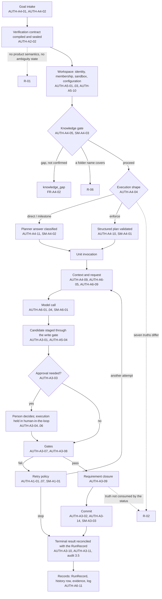
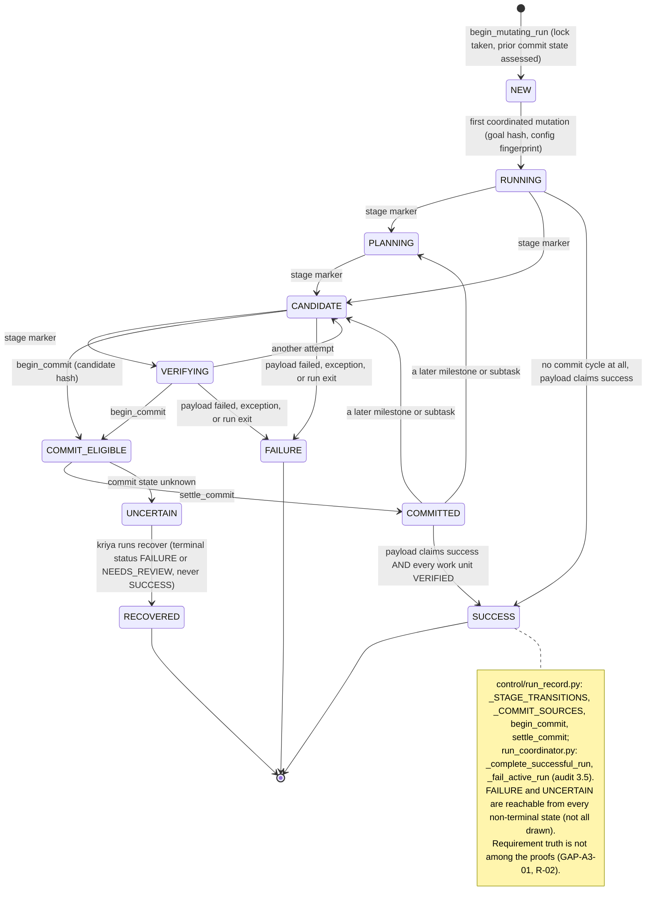
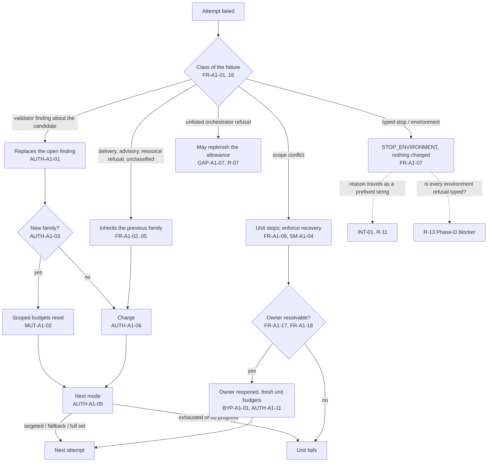
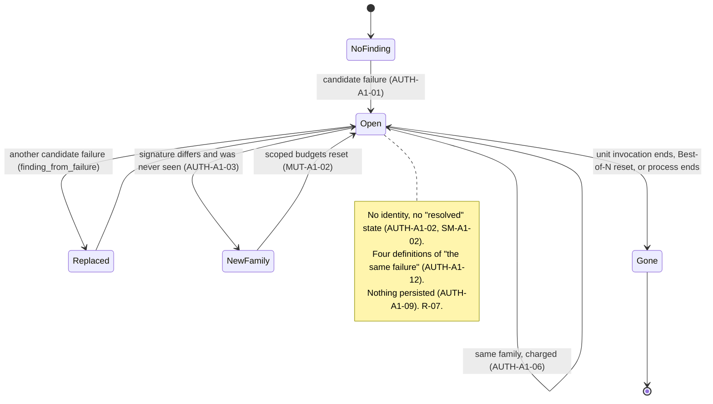
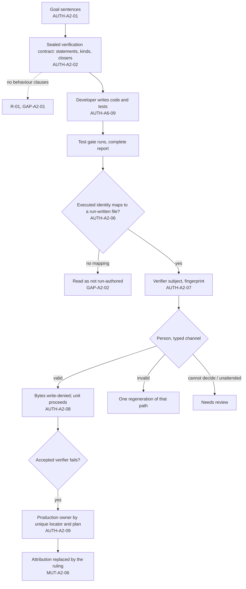
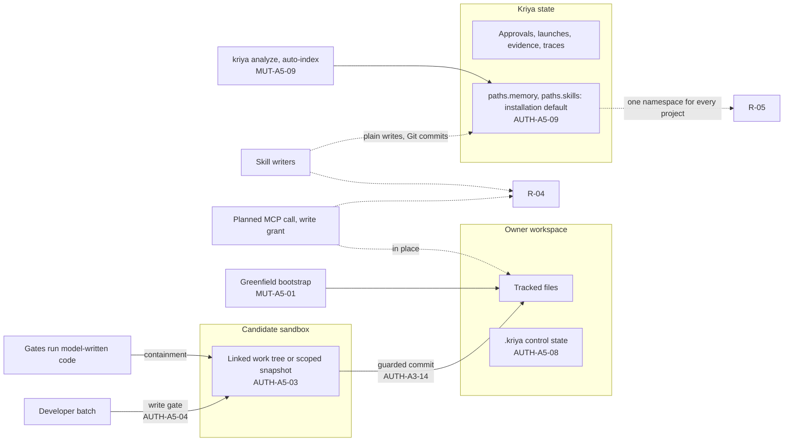
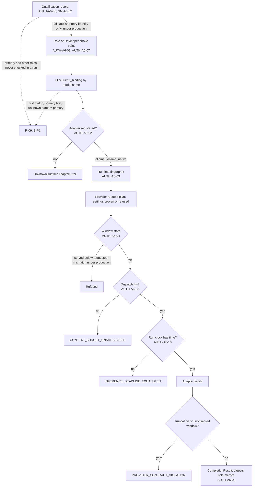

# 10 - Diagrams

Canonical runtime baseline: commit `3eded93c0cfb50f8855d04510e3f9aa2cd5208f7`. AS-IS. Every node carries the row
that holds its fact; a diagram defines nothing and must agree with the tables it cites. Dotted edges lead to the
gap or root issue at that point. Further diagrams of single slices are in `00-END-TO-END-LIFECYCLE.md`.

## D-1 End-to-end lifecycle



## D-2 Authoritative state machine of one run (RunRecord)



## D-3 Failure and recovery



## D-4 Approval and mutation

```mermaid
flowchart TD
    C[Candidate batch: path, mode, digest<br/>AUTH-A3-01] --> TR{Trigger?<br/>AUTH-A3-03}
    TR -- human-in-the-loop, sensitive path, size, profile --> D[Diff rebuilt from the sandbox]
    D --> P[Person: approved / declined / unavailable<br/>AUTH-A3-04]
    P -- approved --> REC[Record: launch record with a digest of the diffs, or an event<br/>AUTH-A3-13]
    P -- declined / unavailable --> X[Nothing applied<br/>FR-A3-06]
    TR -- none --> V
    REC --> V[Verified binding of the batch<br/>AUTH-A3-02]
    V --> CM[Commit refuses unless batch equals the verified binding<br/>AUTH-A3-14]
    REC -. approved digest never compared with the committed batch .-> R03[R-03, GAP-A3-04]
    TR -. per unit under enforce: no plan-level subject .-> R03b[R-03, GAP-A3-05]
    MCP[Planned MCP call, write grant<br/>AUTH-A5-07] -. owner workspace, no candidate .-> R04[R-04, GAP-A5-03]
    SK[Skill learning, eleven writers<br/>MUT-A5-08] -. outside the write gate, Git commits .-> R04
    C -. may carry kriya.yaml and skills .-> R04b[R-04, GAP-A5-02]
```

## D-5 Retry and blocker lifecycle



## D-6 Semantic contract and verifier



## D-7 Workspace mutation and containment



## D-8 Checkpoint and resume

```mermaid
flowchart TD
    U[Unit reaches a stage: plan, design, candidate gates passed, developer success] --> CK[Stage checkpoint with fingerprints<br/>AUTH-A1-09, MUT-A1-12]
    E[Enforce subtask transition] --> CS[ControlState: states, plan hash, digests, completion scope<br/>AUTH-A1-10, MUT-A1-13]
    R[Operator asks to resume] --> NEWRUN[New top-level run: new id, new clock, new evidence store<br/>audit 3.3, B-P2]
    NEWRUN --> VAL{Fingerprints and digests match reality?}
    VAL -- no --> FRESH[Fresh run or resume_refused]
    VAL -- yes --> REUSE[Reuse plan, design, verified candidate]
    REUSE --> LOST[Not restored: retry budgets, open finding, fallback state, recovery state, semantic decisions<br/>AUTH-A1-14, SM-A1-03]
    CS --> SCOPE{Completion scope is workspace?}
    SCOPE -- candidate --> DISC[Completions discarded; plan runs from subtask 1<br/>GAP-A1-09]
    SCOPE -- workspace --> SKIP[Completed subtasks skipped]
    CK -. under the plan sandbox for an enforce unit: survives only if .kriya is ignored .-> I11[INT-11, R-07]
    LOST -.-> R07[R-07]
```

## D-9 Runtime and provider dispatch


