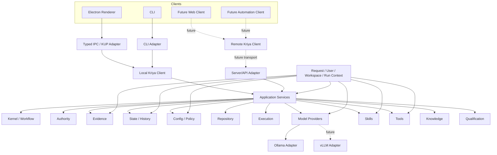

# Kriya Full Modularization — Autonomous Implementation Plan
**Version:** v1.1  
**Date:** 2026-10-16  
**Status:** Supersedes v1.0 where this amendment is more specific.

## EXECUTION AMENDMENT — START FROM THE CURRENT SCENARIO-04 HEAD

The current clean implementation head is:

```text
branch: demo/spring-ignite-protocol
HEAD:   a91157f
```

Before any modularization work:

1. Verify the branch is `demo/spring-ignite-protocol`.
2. Verify local HEAD == origin branch HEAD == `a91157f`.
3. Verify the tracked tree is clean.
4. Create and push the annotated recovery tag:

```text
kriya-pre-full-modularization-20261016
```

The tag MUST point to `a91157f`.

5. Create exactly one new implementation branch from that tag:

```text
arch/full-modularization-v1
```

Do not modularize on `demo/spring-ignite-protocol`.

Do not move or rewrite:
- `kriya-v1.2.0-demo-v2-validated`
- `demo/v2`
- the Scenario-04 evidence/history.

Scenario 04 is NOT live-validated and must not be tagged as validated.

## SCENARIO-04 ARCHITECTURAL INPUT — MANDATORY

Read before implementation:

```text
handover/MODULARIZATION/SCENARIO-04-ARCHITECTURAL-INPUT.md
handover/SPRING-IGNITE-PROTOCOL/LIVE-FAILURE-2-ANALYSIS.md
```

These failures are not side notes. They are concrete evidence of boundaries the modularization must own correctly.

The modularized architecture MUST provide explicit ownership and targeted tests for:

### A. Failure Attribution
Current defect:
- model free-text mentioning a known filename can become diagnosis;
- that can outrank a deterministic compiler locator;
- retry can therefore target the wrong file.

Required target:
- deterministic/authoritative locators outrank model narrative;
- model self-diagnosis is advisory unless no stronger evidence exists;
- attribution is represented as a typed domain result;
- attribution precedence is unit-tested and contract-tested;
- retry-target derivation is deterministic and inspectable.

### B. Retry Target Derivation
Current evidence gap:
- the final retry-target set is not recorded in one authoritative place.

Required target:
- create an explicit typed retry-target decision;
- record:
  - source findings;
  - precedence used;
  - selected files/units;
  - ignored advisory claims;
  - reason;
- emit this as evidence so a future run can be reconstructed without reverse-engineering multiple records.

### C. Repair Candidate Transactions
Current defect:
- one bad sibling file response can discard a valid repair to another file;
- Scenario 04 had a valid ProtocolParser repair that compiled, but a bad Protocol.java sibling caused the whole repair attempt to be refused.

Required target:
- make repair candidate transactions an explicit module/domain concept;
- separate:
  - per-file response validation;
  - per-file edit application;
  - candidate staging;
  - candidate-level deterministic validation;
- do not silently discard a valid independent edit because another sibling response is malformed unless atomicity is actually required by a declared invariant;
- preserve source-review/candidate-identity semantics;
- add deterministic tests proving:
  - valid sibling edit can survive invalid sibling response when independence is proven;
  - dependent edits remain atomic when required;
  - candidate bytes reviewed later are exactly the staged bytes.

Do NOT introduce partial writes to the owner workspace. All repair work remains isolated until final authority/apply.

### D. Generation Budget / Human Wait
Current defect:
- the 900-second run-wide generation clock includes owner approval wait;
- Scenario 04 lost 128.5 seconds of model budget while waiting for source review;
- fallback was then refused because only 226.8s remained against a 300s estimate.

Required target:
- modularize budget ownership;
- distinguish at minimum:
  - wall-clock/run lifetime;
  - active model/generation compute budget;
  - gate reserve;
  - human-wait time;
- human approval wait must not accidentally consume model-generation budget unless a documented policy explicitly says it should;
- preserve an overall wall-clock/liveness mechanism separately;
- provider timing estimates must be provider/model scoped rather than relying on unrelated defaults where evidence exists;
- all budget decisions must emit typed evidence.

This is a behavior correction, so:
1. characterize current semantics;
2. extract budget ownership;
3. implement the corrected policy with deterministic tests;
4. independently review it.

### E. Triage Scope
Current defect:
- fallback triage was asked to attribute Kriya's own budget/orchestrator notice to a source file.

Required target:
- triage only source-grounded/model-grounded failures that are meaningfully attributable;
- orchestrator/policy/budget notices remain orchestrator-owned;
- do not invoke a model merely to guess a source file for a non-source failure;
- add negative tests.

### F. Repair Context Shape
Scenario 04 showed repair prompts that preserved the correct unresolved compiler finding while simultaneously targeting a different file, producing contradictory context.

Required target:
- repair package has one typed source of truth for:
  - unresolved findings;
  - target files;
  - allowed edit scope;
  - authoritative locators;
- rendering to model text must be downstream of that typed package;
- impossible/contradictory combinations must fail before model invocation.

### G. Provider / Fallback Boundary
Do not change the current fallback policy merely because Scenario 04 failed.

But modularization MUST isolate:
- provider/model selection;
- fallback eligibility;
- timing estimates;
- capability metadata;
- routing decision evidence.

Future routing changes must not require workflow/kernel edits.

### H. Evidence
The evidence system made the failure reconstruction possible and must be strengthened, not weakened.

Add direct evidence for:
- attribution decision;
- retry-target decision;
- candidate transaction decision;
- budget decision;
- fallback decision.

A future forensic reconstruction should not need to infer those decisions indirectly.

## ORDER FOR THESE CORRECTIONS

Do not mix structural movement and semantic fixes in the same step.

Use:

```text
1. characterize current behavior
2. extract module / contract
3. prove behavior preserved
4. implement the known generic correction
5. targeted tests + mutants
6. integration tests
7. independent review
```

This order is mandatory for Attribution, Candidate Transactions and Budget semantics.

## POST-MODULARIZATION SCENARIO-04 VALIDATION

Do NOT run another live Scenario-04 model rehearsal during modularization.

After the modularized baseline is:
- independently reviewed;
- canonical-suite green;
- tagged;

then Scenario 04 becomes a first high-value integration test of the new architecture.

Use a fresh scenario candidate, not the failed candidate.

The post-modularization live run should specifically validate:
- planner contract;
- skill delivery;
- attribution;
- retry targeting;
- candidate transaction behavior;
- budget/human-wait handling;
- fallback decision evidence;
- source review;
- build/test/runtime authority.

---


---


# 1. Executive Direction

This workstream has **highest priority**.

Do not treat modularization as a minimal extraction to enable one feature. The goal is to complete the architectural modularization thoroughly enough that a later architecture review should find clear ownership, explicit contracts, enforceable dependency direction, isolated tests, and no hidden monolithic coupling.

The required end state is:

> **Independent modules with explicit contracts, one-way dependency rules, fast targeted module tests, contract tests, integration tests, a stable client/application boundary, and no concrete provider/UI/deployment dependency leaking into the Kriya kernel.**

Kriya must remain behaviorally compatible with the validated Demo V2 baseline while being structurally ready for:

- local desktop deployment;
- future backend/server deployment;
- multiple GUI/CLI/web clients;
- multiple authenticated users;
- per-user configuration;
- per-user/project skills;
- scoped tools and permissions;
- shared local-model infrastructure;
- Ollama today;
- vLLM later;
- future providers without kernel modification;
- future remote execution without another fundamental architecture rewrite.

**Do not implement the future multi-user server in this workstream. Design and implement the architectural seams that make it additive later.**

---

# 2. Efficiency Mandate

Be extremely effective.

Optimize for **high-quality working code and verifiable architecture**, not ceremony.

For every change:

```text
measure/current behavior
→ identify ownership
→ write characterization or architecture test
→ extract/move with behavior preserved
→ run focused tests
→ enforce dependency rule
→ commit
→ move to next module
```

Avoid speculative redesign, huge all-at-once rewrites, style-only refactors, unnecessary helper layers, new DI frameworks, service locators, global mutable registries, reflection-heavy plugin systems, duplicate implementations, parallel execution engines, permanent compatibility wrappers, business-logic changes during relocation, repeated full-suite runs, unnecessary documentation, repeated architecture discussions, and live-model testing when deterministic tests are sufficient.

Prefer typed interfaces/protocols, constructor/factory injection, immutable request/context objects, explicit registries, narrow adapters, temporary compatibility shims with removal criteria, pure domain logic, IO at edges, lazy loading where useful, bounded caches, one canonical implementation per capability, fast tests per module, and existing infrastructure before new frameworks.

---

# 3. PHASE 0 — Freeze Current HEAD Before Any Modularization

**This must happen first.**

Repository:

```text
/Users/sriramnanduri/WorkingDirectory/AI/ClaudeCode/Kriya-main-demo
```

The validated Demo V2 tag must remain immutable:

```text
kriya-v1.2.0-demo-v2-validated
```

## 3.1 Preflight

Run:

```bash
cd /Users/sriramnanduri/WorkingDirectory/AI/ClaudeCode/Kriya-main-demo

git fetch origin --tags
git status --short
git branch --show-current
git rev-parse HEAD
git rev-parse origin/$(git branch --show-current)
git rev-list -n 1 kriya-v1.2.0-demo-v2-validated
```

Do not assume the current branch or SHA.

If the active Spring/Ignite workstream contains uncommitted tracked work:

1. stop feature development;
2. bring only already-started work to a coherent checkpoint;
3. run its focused checks;
4. commit it on its current branch;
5. push normally;
6. make the tracked tree clean.

Do not discard useful Spring/Ignite work. Do not merge anything into the frozen Demo V2 tag/history.

## 3.2 Create pre-modularization recovery tag

Create the annotated tag at the exact clean current HEAD:

```text
kriya-pre-full-modularization-20261016
```

Before creating:

```bash
git show-ref --tags --verify refs/tags/kriya-pre-full-modularization-20261016
```

If it already exists, do not move it. Verify its target and STOP if it is not the intended current HEAD.

Create and push only this tag:

```bash
git tag -a kriya-pre-full-modularization-20261016 \
  -m "Kriya pre-full-modularization recovery point"

git push origin kriya-pre-full-modularization-20261016
```

Verify the tag target equals the current HEAD.

## 3.3 Create exactly one modularization branch

Create:

```text
arch/full-modularization-v1
```

from:

```text
kriya-pre-full-modularization-20261016
```

If it already exists, inspect it first. Never overwrite it.

One active implementation branch only. No force push. No `Co-Authored-By`.

---

# 4. What “100% Modularized” Means

Do not declare completion based on folder structure.

Kriya is fully modularized only when **all** of these are true:

1. Every major runtime capability has one explicit owning module.
2. Public module contracts are small and typed.
3. Internal implementation is not imported directly across module boundaries.
4. Dependency direction is documented and mechanically tested.
5. Kernel has no dependency on Electron, CLI, HTTP, Ollama, vLLM, specific skills, specific tools, or deployment topology.
6. Provider implementations are replaceable behind provider contracts.
7. Skills are discovered/resolved through a SkillRegistry contract.
8. Tools are discovered/resolved/executed through ToolRegistry/Tool execution contracts.
9. Config is resolved through a service rather than arbitrary direct file/environment access throughout the codebase.
10. State/history/evidence access occurs through owning services/stores.
11. Repository/worktree/diff operations have a clear owning module.
12. Build/test/runtime execution has a clear execution boundary.
13. Approval/authority policy has a clear owning module.
14. Evidence/provenance has a clear owning module.
15. Knowledge/KnowledgeGuard has a clear owning module.
16. Qualification/gates have a clear owning module.
17. Desktop GUI and CLI are adapters/clients, not owners of business logic.
18. Current local deployment uses the same application/client contracts intended for future remote clients.
19. User/run/workspace context is explicit enough that future multi-user server deployment does not require a kernel rewrite.
20. Each major module has a fast targeted test suite.
21. Cross-module contracts have contract tests.
22. End-to-end behavior has integration tests.
23. Architecture/dependency tests prevent regressions.
24. Legacy imports/adapters are removed or explicitly registered with a finite removal plan.
25. The canonical suite is green.
26. Independent architecture review has no blocker and no unresolved major architectural gap.
27. The final modularized baseline is tagged.

If any one of these remains materially false, modularization is not complete.

---

# 5. Target Architecture



This is the architectural direction, not permission to create unnecessary layers.

---

# 6. Required Modules and Features to Implement

The exact folder names may change after dependency analysis, but these ownership domains must exist clearly.

## 6.1 Shared Foundations

Own only cross-cutting primitives with **no business behavior**:

- IDs;
- typed errors;
- clock/time abstraction;
- cancellation/deadline primitives;
- immutable common value objects;
- logging interfaces;
- serialization helpers only when genuinely shared.

Forbidden: workflow logic, provider logic, approval logic, filesystem policy, business registries.

## 6.2 Context / Scope

Introduce an explicit context model sufficient for local mode now and future server mode later.

Required concepts:

```text
RequestContext
UserContext / PrincipalContext
WorkspaceContext
RunContext
Security/PolicyContext reference
```

Current local mode may map to a single local principal. Do **not** implement authentication or multi-user persistence now.

The contracts must make it possible later to scope config, skills, tools, evidence, history, workspaces, model usage, cache isolation, and secrets/credentials.

No business module should require `Path.home()` or process-global user identity to understand ownership.

## 6.3 Application Services

Create the use-case boundary above domain modules.

Required service ownership should cover the existing product surface, including:

- project/open workspace;
- run/start/status/history;
- approvals;
- source review;
- runtime review;
- configuration;
- models/providers;
- skills;
- tools;
- evidence/result projections;
- health/preflight.

Do not duplicate domain logic here. Application services orchestrate modules; modules own their rules.

## 6.4 Kriya Client Boundary

Define a stable client-facing contract covering:

```text
projects
runs
approvals
history
models/providers
skills
tools
configuration
evidence/results
health
```

Implement `LocalKriyaClient` against Application Services.

Do **not** implement `RemoteKriyaClient` yet. Design the interface so a future remote client can implement the same semantic operations.

For Desktop:

```text
Renderer
→ typed KUP/IPC
→ Electron host
→ LocalKriyaClient
→ Application Services
```

Renderer must never gain direct backend filesystem/database authority.

## 6.5 Kernel / Workflow

Kernel owns workflow state machine, plan/work-unit orchestration, retry/repair orchestration, domain workflow transitions, workflow lifecycle, and core domain models.

Kernel must depend only on contracts, never concrete infrastructure.

Kernel must NOT know Ollama, vLLM, Electron, HTTP, Maven-specific service implementations, specific skill names, specific tool implementations, or state-directory filesystem details.

Preserve validated Demo V2 semantics.

## 6.6 Authority

Own source approval, runtime-command approval, protected config authority, candidate identity/digest binding, execution authority, stale approval detection, policy decisions, and fail-closed authority results.

Required invariant remains:

```text
reviewed bytes
=
built bytes
=
tested bytes
=
runtime-executed bytes
=
finally applied bytes
```

## 6.7 Evidence / Provenance

Own typed evidence records, provenance, run evidence, attempt evidence, gate evidence, result projections, evidence queries, and bounded safe presentation data.

No renderer direct evidence-store access.

Keep formal requirement-ledger truth distinct from engineering execution evidence.

## 6.8 State / History

Own run state, trace-store access, history snapshots, run lifecycle persistence, and state-directory abstraction.

Preserve validated behavior:

- history is scoped to the active Kriya state directory;
- it is not reconstructed from `<project>/.kriya/control/runs`;
- scenario state may be isolated from owner state.

State-directory selection must be centralized at bootstrap/config ownership, not spread across business modules.

Prepare the contract for future per-user/server state stores without implementing them.

## 6.9 Configuration / Policy

Separate configuration from policy.

Configuration may eventually be layered by scope:

```text
server/default
organization
user
project
run
```

Do not build organization storage/auth now. Implement contracts that accept explicit scope/context. Current local adapters may resolve existing sources.

Centralize environment/file resolution.

## 6.10 Model Provider Module

Define a real `ModelProvider` contract.

Required capabilities:

- provider identity;
- model identity;
- request;
- streaming where supported;
- cancellation;
- deadline;
- context-window information;
- token/budget metadata where currently available;
- structured response capability;
- tool-call capability declaration;
- provider health/preflight;
- typed provider failures.

Define a provider-neutral `InferenceRequest` carrying enough metadata for future shared serving:

```text
request_id
run_id
principal/security-scope reference
model
messages
tool schemas
context budget
output budget
deadline
priority hint
cache-isolation/security-domain hint
```

Move existing Ollama behavior behind `OllamaModelProvider`.

No generic kernel branch such as `if provider == "ollama"`.

Future vLLM must be addable by registering a provider, not changing kernel workflow code.

## 6.11 Provider Registry

Implement explicit provider discovery/registration, provider metadata, capability lookup, health/preflight, configuration validation, and provider selection by config/profile.

Avoid reflection-heavy magic. Prefer explicit registration.

## 6.12 Skills

Create clear Skills ownership.

Required contracts/features:

- Skill metadata;
- Skill source;
- version;
- discover/list;
- load;
- validate;
- enable/disable/selection state;
- compatibility status;
- effective skill resolution for a run;
- error/health status.

Prepare scope semantics for future:

```text
system
organization
user
project
```

Current local mode does not need a real organization/user database.

Workflow code must not read skill directories directly. Renderer must not read skill files directly. Existing `ignite-java17` must still load through the real Skill module.

## 6.13 Tools

Create clear Tools ownership.

Required contracts/features:

- Tool metadata;
- provider/type;
- capabilities;
- permission requirements;
- network/egress declaration;
- approval requirement;
- availability/health;
- registry;
- execution delegation;
- typed execution result.

Existing tool approval semantics remain authoritative. A model-planned tool requiring review must not silently execute.

## 6.14 Execution

Own process execution, build, tests, runtime execution, containment, stdin/stdout/stderr handling, timeouts, process lifecycle, command subjects/results, and environment/cwd resolution.

Keep command execution out of renderer/UI.

Create clear contracts so different future execution backends can be added without workflow rewrite. Do not implement remote workers now.

## 6.15 Repository / Workspace

Own workspace identity, Git operations, worktrees, source reads/writes, diff, patch/application, baseline/candidate management, candidate digest/source identity, and workspace cleanliness/status.

No other module should casually perform Git/worktree manipulation.

## 6.16 Knowledge

Own KnowledgeGuard, knowledge packs, public lookup policy integration, version/temporal knowledge checks, knowledge application, knowledge source metadata, and skill/knowledge interaction where appropriate.

Keep proprietary-data egress rules intact.

## 6.17 Qualification

Own gates, qualification contracts, campaign evaluators, deterministic validators, environment qualification, and provider qualification.

Qualification should consume module contracts, not reach into internals.

## 6.18 Desktop / Electron Adapter

Electron is an adapter. It may own windows, native dialogs, native approval sheets, typed IPC, desktop lifecycle, and local client creation.

It must NOT own workflow rules, source approval truth, runtime authority, evidence truth, skill discovery, tool policy, or model-provider logic.

## 6.19 CLI Adapter

CLI must use the same Application Services / Kriya Client semantic boundary where practical. CLI-specific presentation and interaction are fine.

---

# 7. Future Server / Multi-User Readiness Requirements

This modularization must explicitly make the following future topology possible:

```text
Electron Client A ─┐
Electron Client B ─┤
Web Client C ──────┼── Kriya Server ── shared model services
CLI / CI ──────────┘
```

with users having independent configuration, skills, tool permissions, projects, runs/history, evidence, credentials/secrets references, and model preferences/policies.

The same model weights may serve multiple users. Kriya, not the model, must preserve context and security isolation.

Implement now:

- explicit context/scoping contracts;
- client/application boundary;
- provider request metadata;
- scoped registries/services;
- dependency inversion;
- state/config abstractions.

Do not implement now:

- authentication server;
- organization management;
- remote HTTP/WebSocket transport;
- multi-user database;
- distributed workers;
- GPU scheduler;
- quotas/billing;
- server deployment;
- remote secrets service.

The modularization is successful only if those later capabilities can be added without restructuring the kernel.

---

# 8. Mandatory Dependency Rules

Create an architecture dependency matrix and enforce it in tests.

At minimum:

```text
clients/adapters
    ↓
client/application contracts
    ↓
application services
    ↓
domain module contracts
    ↓
module implementations/infrastructure adapters
```

Forbidden examples:

```text
kernel → electron
kernel → ollama
kernel → vllm
kernel → concrete tool
kernel → concrete skill
skills → renderer
tools → renderer
evidence → renderer
repository → workflow internals
provider → workflow implementation
```

Shared foundations may not become a dumping ground.

If no suitable existing architecture-test tool exists, prefer a small AST/import-based test over adding a heavy dependency.

Architecture tests must run quickly.

---

# 9. Implementation Waves

## Wave 1 — Inventory and Characterization

Before moving code:

- generate package/module dependency graph;
- identify import cycles;
- identify global state;
- identify direct filesystem/environment access;
- identify concrete provider references;
- identify direct Electron/backend coupling;
- identify duplicate implementations;
- identify modules with mixed ownership;
- map tests to current functionality.

Produce concise decision documents:

```text
handover/MODULARIZATION/CURRENT-DEPENDENCY-MAP.md
handover/MODULARIZATION/TARGET-MODULE-MAP.md
```

Create architecture characterization tests before major moves.

## Wave 2 — Foundations + Context + Application Boundary

Extract shared primitives, context, application services, KriyaClient contract, and LocalKriyaClient.

Preserve current renderer/CLI behavior through adapters.

## Wave 3 — Authority + Evidence + State + Config

These are foundational trust domains. Move ownership cleanly before provider/tool/skill work. Characterize all security invariants first.

## Wave 4 — Model Providers

Move current Ollama behavior behind ModelProvider. Add provider registry. Do not add vLLM yet. Prove Ollama behavior unchanged.

## Wave 5 — Skills + Tools + Knowledge

Establish registries/contracts and move existing implementation behind them. Existing skills/tools must continue working.

## Wave 6 — Execution + Repository

Centralize process/build/test/runtime and workspace/Git operations. Remove duplicate direct calls from other modules.

## Wave 7 — Qualification

Move validators/gates/campaign logic to explicit qualification ownership. Keep workflow semantics unchanged.

## Wave 8 — Client/Adapter Migration

Ensure Electron host uses LocalKriyaClient/Application Services, CLI uses the same semantic boundary where practical, and renderer remains typed and unprivileged.

## Wave 9 — Legacy Removal

Search the whole repo for old direct imports, provider-specific branches, direct skill directory reads, direct tool execution bypasses, direct state/evidence reads, direct subprocess use outside execution ownership, direct Git/worktree manipulation outside repository ownership, `Path.home()`/state-dir ownership leaks, duplicated config resolution, and circular compatibility imports.

Remove obsolete compatibility shims once callers are migrated. Do not leave two architectures alive.

## Wave 10 — Architecture Enforcement

Turn the target dependency matrix into automated tests. A future violation must fail immediately.

---

# 10. Testing Architecture

Every major module must have a fast targeted suite.

Target organization conceptually:

```text
tests/kernel/
tests/application/
tests/context/
tests/authority/
tests/evidence/
tests/state/
tests/config/
tests/providers/
tests/skills/
tests/tools/
tests/execution/
tests/repository/
tests/knowledge/
tests/qualification/
tests/client/
tests/integration/
tests/architecture/
```

Do not mechanically relocate every historical test if it adds risk. Create module-level selectors/markers or equivalent so developers can run owning tests quickly.

## 10.1 Module tests

Fast. Use fakes at module boundaries. Test business rules without full workflows.

## 10.2 Contract tests

Required for:

- ModelProvider;
- SkillRegistry/SkillProvider;
- ToolRegistry/ToolProvider;
- Execution;
- Repository;
- Evidence/State stores;
- KriyaClient;
- configuration resolution.

Provider implementations should run against shared contract suites.

## 10.3 Integration tests

Cover:

- workflow + authority + repository;
- workflow + provider;
- skill resolution + workflow;
- tool approval + execution;
- build/test/runtime;
- Electron host/KUP + LocalKriyaClient;
- CLI + LocalKriyaClient;
- state/history + application service.

## 10.4 Architecture tests

Must detect forbidden imports, circular dependencies, concrete-provider dependency from generic modules, renderer/backend authority violations, and direct subprocess/Git/state access outside ownership modules where practical.

## 10.5 Canonical suite

Do not run repeatedly. Run focused tests during each migration, adjacent/module integration tests before each wave commit, optionally one broad midpoint regression only if risk justifies it, and one final canonical suite at final candidate.

---

# 11. Preserve Existing Product Invariants

The following validated behavior must remain unchanged unless a deterministic regression proves a prior defect.

## Source authority

- exact source review before executable candidate behavior in Desktop HITL;
- stale candidate detection;
- byte binding across build/test/runtime/apply.

## Runtime authority

- required runtime reject cannot succeed;
- required runtime reject cannot apply;
- Desktop runtime review;
- native confirmation.

## Tool authority

- tools requiring review do not execute silently;
- egress remains fail-closed.

## Evidence truth

- model narrative cannot override deterministic evidence;
- engineering evidence is distinct from formal requirement ledger;
- run/result projections remain authoritative.

## Provider abstraction

- provider-specific behavior stays inside adapters.

## Renderer security

Renderer may not directly read state, evidence, authority records, protected config, skills, tools, or project-internal control files.

---

# 12. Performance / Optimization Requirements

Do not confuse modularity with runtime overhead.

Required:

- no repeated serialization/deserialization within the same process unless crossing a real boundary;
- no duplicate file scans for skills/tools/config in one request when a bounded cache/index can safely be reused;
- no unbounded global caches;
- no unnecessary threads/processes;
- async only where IO/concurrency benefits exist;
- preserve existing async behavior where appropriate;
- avoid repeated provider capability discovery per inference request;
- resolve effective config/skill/tool set once per run/context where safe;
- preserve streaming behavior;
- preserve cancellation/deadline behavior;
- avoid copying large evidence blobs when IDs/references suffice;
- keep module interfaces coarse enough to avoid chatty internal calls.

Measure before optimizing. Record meaningful startup/run overhead introduced by modularization. Fix architectural causes rather than adding hidden caches everywhere.

---

# 13. Autonomous Mode Rules

The agent is authorized to work autonomously through the entire modularization.

Do not ask the owner about internal file naming, helper naming, routine package placement, test fixture organization, obvious interface extraction, compatibility adapters, straightforward cycle breaking, or small internal API signatures that preserve semantics.

Stop and require owner decision only if:

1. authority/security semantics must change;
2. user-visible workflow semantics must change;
3. retry behavior must change;
4. requirement-ledger truth semantics must change;
5. data/state migration would be destructive;
6. validated behavior must be removed;
7. a boundary conflicts with a documented architecture decision;
8. completing modularization would require implementing server/multi-user infrastructure now;
9. a large subsystem replacement is required instead of extraction;
10. the canonical suite exposes a broad unrelated regression.

If blocked on one area, continue independent safe waves where dependency ordering permits.

---

# 14. Commit Strategy

Use small coherent commits per migration boundary.

Examples:

```text
refactor(modules): introduce application/context contracts
refactor(authority): isolate approval and candidate identity
refactor(evidence): move evidence access behind service boundary
refactor(providers): move Ollama behind ModelProvider
refactor(skills): introduce registry and scoped resolution
refactor(tools): isolate registry and execution contracts
refactor(execution): centralize process/build/test/runtime
refactor(repository): isolate workspace and git operations
refactor(client): route desktop host through LocalKriyaClient
test(architecture): enforce module dependency boundaries
refactor(cleanup): remove legacy cross-module imports
```

Do not mix unrelated behavior fixes with structural moves. Push normally at stable checkpoints. No force.

---

# 15. Independent Review — Mandatory After Implementation

After all implementation and cleanup is complete, use a **fresh independent reviewer** that did not perform the modularization.

The reviewer must inspect code, dependency graph, architecture tests, and representative tests. Do not give the reviewer only the design document.

The reviewer must answer:

### Module completeness

1. Does every major runtime capability have one obvious owner?
2. Are any god modules/classes still coordinating unrelated concerns?
3. Are there hidden duplicate implementations?
4. Are module internals imported across boundaries?

### Dependency direction

5. Is dependency direction one-way and mechanically enforced?
6. Are there circular dependencies?
7. Has shared/common/utils become a business-logic dumping ground?

### Kernel purity

8. Does kernel reference Electron/CLI/HTTP?
9. Does kernel reference Ollama or any concrete provider?
10. Does kernel reference concrete skills/tools?
11. Does kernel depend on state-directory/filesystem implementation details?

### Server readiness

12. Is a client/application boundary real and used?
13. Can a future RemoteKriyaClient be added without changing kernel semantics?
14. Are user/workspace/run scopes explicit?
15. Can future per-user skills/config/state be implemented behind current contracts?
16. Does local mode avoid hard-coded single-user assumptions inside business modules?

### Provider extensibility

17. Can vLLM be added by implementing/registering a provider?
18. Is provider capability/health/config represented generically?
19. Does inference request metadata support future shared serving/security-domain isolation?

### Skills/Tools

20. Are skills and tools accessed through registries/contracts?
21. Are security/approval properties preserved?
22. Can future GUI management use the registry/application boundary without direct filesystem access?

### Authority / evidence

23. Did any extraction weaken source/runtime/tool authority?
24. Is candidate identity still enforced?
25. Is evidence truth still authoritative?
26. Is renderer still unprivileged?

### Testability

27. Does every module have a targeted fast suite?
28. Do shared contract suites exist?
29. Do integration tests cover important module combinations?
30. Do architecture tests prevent regression?

### Performance / maintainability

31. Are there unnecessary abstraction layers?
32. Is there excessive object translation/copying?
33. Are registries/config resolution repeatedly recomputed?
34. Are APIs understandable and narrow?
35. Can a new engineer identify ownership quickly?

### Legacy cleanup

36. Is old architecture still present alongside the new one?
37. Are compatibility shims bounded and scheduled for removal?
38. Are forbidden imports/direct accesses gone?

Classify findings as:

```text
BLOCKING
IMPORTANT
MINOR
```

All BLOCKING findings must be fixed.

All IMPORTANT architectural findings must be fixed unless the reviewer proves they are explicitly outside the modularization definition.

MINOR cosmetic/style issues may be recorded.

After fixes, perform one re-review focused only on changed findings. Do not create endless review cycles.

---

# 16. Final Verification

After independent review fixes:

1. Produce a final dependency graph and compare it with target rules.
2. Run all module suites and contract suites.
3. Run all modular integration tests.
4. Run applicable UI shared/standalone, KUP/contract generation, typecheck, eslint, ruff, pylint, and `git diff --check`.
5. Run one final canonical suite:

```bash
cd /Users/sriramnanduri/WorkingDirectory/AI/ClaudeCode/Kriya-main-demo
ulimit -n 256
.venv/bin/pytest -q -n 8 --dist loadgroup
```

No final tag if canonical is not green.

---

# 17. Final Modularization Tag

If independent review has no blocker, important architectural gaps are closed, module/contract/integration tests pass, architecture tests pass, canonical suite passes, and the tracked tree is clean, create an annotated tag:

```text
kriya-v1.3.0-modularized-baseline
```

The tag is a modular architecture milestone, **not** a claim of full production readiness.

Push only that tag normally. Do not move it later.

---

# 18. Required Deliverables

Create:

```text
handover/MODULARIZATION/CURRENT-DEPENDENCY-MAP.md
handover/MODULARIZATION/TARGET-MODULE-MAP.md
handover/MODULARIZATION/MODULE-CONTRACTS.md
handover/MODULARIZATION/DEPENDENCY-RULES.md
handover/MODULARIZATION/TEST-MATRIX.md
handover/MODULARIZATION/INDEPENDENT-REVIEW.md
handover/MODULARIZATION/FINAL-VALIDATION.md
```

Keep documents concise and decision-oriented.

Update the existing permanent decision log if one already exists for Kriya rather than creating competing ADR systems.

---

# 19. Final Report

Report:

## Baseline
- starting branch;
- starting HEAD;
- pre-modularization tag;
- tag target.

## Module architecture
- final module list;
- final dependency direction;
- dependency cycles before/after;
- forbidden dependencies before/after;
- remaining compatibility shims.

## Client/server readiness
- KriyaClient boundary;
- LocalKriyaClient;
- future RemoteKriyaClient readiness;
- Request/User/Workspace/Run context status;
- future per-user skills/config readiness;
- state/config scoping readiness.

## Kernel
- kernel responsibilities;
- concrete dependencies removed.

## Providers
- ModelProvider contract;
- Ollama adapter status;
- provider registry;
- proof vLLM can be added without kernel edit.

## Skills
- registry/contracts;
- scope readiness;
- existing skill compatibility.

## Tools
- registry/contracts;
- approval/egress preservation.

## Authority
- source/runtime/tool invariants.

## Evidence/state
- evidence ownership;
- history/state ownership;
- renderer isolation.

## Execution/repository
- execution ownership;
- repository/worktree ownership.

## Knowledge/qualification
- ownership and remaining coupling.

## Testing
- per-module test totals;
- contract tests;
- integration tests;
- architecture tests;
- static/UI tests;
- canonical result.

## Performance
- measurable before/after overhead if any;
- important optimizations made;
- no unnecessary abstraction/copying assessment.

## Independent review
- blockers found/fixed;
- important findings found/fixed;
- re-review result.

## Git
- final branch;
- final HEAD/origin;
- final modularization tag;
- clean tree.

## Final verdict

State exactly:

```text
FULL MODULARIZATION COMPLETE: YES/NO
READY TO ADD vLLM WITHOUT KERNEL RESTRUCTURE: YES/NO
READY TO BUILD RICH SKILLS/TOOLS UX ON STABLE CONTRACTS: YES/NO
FUTURE SERVER/MULTI-USER ARCHITECTURE REQUIRES ANOTHER KERNEL REWRITE: YES/NO
```

The expected final answer for the last question is **NO**. If it is YES, modularization is not complete.

---

# 20. Features This Modularization Must Deliver

| Area | Required feature |
|---|---|
| Recovery | Immutable pre-modularization annotated tag |
| Branching | Dedicated single modularization workstream |
| Architecture | Explicit module ownership map |
| Architecture | Enforced one-way dependency rules |
| Architecture | Automated forbidden-import/dependency tests |
| Architecture | Elimination of circular module dependencies |
| Architecture | Removal of duplicate capability implementations |
| Foundation | Shared primitives only, no hidden business logic |
| Context | Explicit RequestContext |
| Context | Explicit principal/user context abstraction |
| Context | Explicit workspace context |
| Context | Explicit run context |
| Application | Application-service/use-case boundary |
| Client | Stable KriyaClient contract |
| Client | LocalKriyaClient implementation |
| Client | Future RemoteKriyaClient-compatible semantic boundary |
| Desktop | Electron host routes through client/application boundary |
| CLI | CLI routes through shared application semantics where practical |
| Kernel | Workflow/state-machine ownership |
| Kernel | Retry/repair orchestration ownership |
| Kernel | Provider/UI/deployment independence |
| Authority | Source approval ownership |
| Authority | Runtime-command approval ownership |
| Authority | Protected-config authority ownership |
| Authority | Candidate digest/identity binding |
| Authority | Stale approval detection |
| Evidence | Evidence/provenance service boundary |
| Evidence | Run/attempt/gate evidence ownership |
| Evidence | Result projection ownership |
| State | Trace/run/history state service |
| State | State-directory abstraction |
| State | Same-state history semantics preserved |
| Config | Central configuration resolution |
| Config | Configuration/policy separation |
| Config | Scope-aware future server/org/user/project/run contract |
| Providers | ModelProvider interface |
| Providers | Provider-neutral InferenceRequest |
| Providers | Streaming/cancellation/deadline contract |
| Providers | Capability declaration |
| Providers | Health/preflight |
| Providers | Context-window/budget contract |
| Providers | Provider registry |
| Providers | Ollama moved behind provider interface |
| Providers | Future shared-serving/cache-isolation metadata seam |
| Skills | Skill metadata contract |
| Skills | Skill registry |
| Skills | Load/validate/discover |
| Skills | Enable/selection state |
| Skills | Compatibility/health status |
| Skills | Future system/org/user/project scope seam |
| Tools | Tool metadata contract |
| Tools | Tool registry |
| Tools | Permission/approval metadata |
| Tools | Network/egress capability metadata |
| Tools | Execution delegation through authority/execution |
| Execution | Central process execution |
| Execution | Build execution |
| Execution | Test execution |
| Execution | Runtime verification |
| Execution | Containment ownership |
| Execution | Timeout/stdin/stdout/stderr/process lifecycle |
| Repository | Workspace ownership |
| Repository | Git operations |
| Repository | Worktree lifecycle |
| Repository | Diff/patch/apply |
| Repository | Source/candidate identity |
| Knowledge | KnowledgeGuard ownership |
| Knowledge | Knowledge packs/source metadata |
| Knowledge | Public lookup/egress policy integration |
| Qualification | Gate/validator ownership |
| Qualification | Provider/environment qualification contracts |
| Security | Renderer remains unprivileged |
| Security | Source/runtime/tool authority preserved |
| Security | Future user/security scope carried through contracts |
| Multi-user readiness | Per-user config/skills/tools/state can later be implemented without kernel rewrite |
| Server readiness | Local and future remote clients share semantic API |
| Model serving readiness | One shared model service can later serve multiple scoped users/runs |
| Testing | Fast targeted module suites |
| Testing | Shared contract suites |
| Testing | Cross-module integration suite |
| Testing | Architecture dependency suite |
| Testing | Final canonical regression suite |
| Quality | Independent architecture review |
| Quality | Mandatory re-review of fixes |
| Quality | Performance/overhead assessment |
| Cleanup | Remove obsolete legacy imports/shims where safe |
| Freeze | Final annotated modularized-baseline tag |

---

# 21. Explicitly Deferred Until After Modularization

Do not implement these during this workstream:

- vLLM adapter itself;
- richer Skills GUI;
- richer Tools GUI;
- remote server transport;
- authentication;
- organization/user database;
- distributed workers;
- GPU scheduler;
- Model Routing V2;
- Backend Readiness V3;
- managed-service approval redesign;
- requirement-ledger redesign;
- broad visual redesign;
- new product features unrelated to modularization.

They become dramatically easier after the modularized baseline is frozen.

---

# Final Instruction

Do not optimize for the fewest changed files.

Optimize for the **last major architectural restructuring Kriya should need**.

The desired outcome is not “the code is in nicer folders.”

The desired outcome is:

```text
clear ownership
+ stable contracts
+ enforceable dependency direction
+ isolated module tests
+ contract tests
+ integration tests
+ preserved authority/evidence semantics
+ provider extensibility
+ client/server-ready boundary
+ future user-scoped config/skills/tools/state
+ no hidden monolithic coupling
```

Work autonomously, make routine engineering decisions without waiting, keep implementation efficient, and do not stop at a partially modular architecture.

When the independent reviewer can inspect the codebase and answer “the module boundaries are clear, testable, extensible, and there is no major architectural gap that requires another restructuring,” the work is complete.
